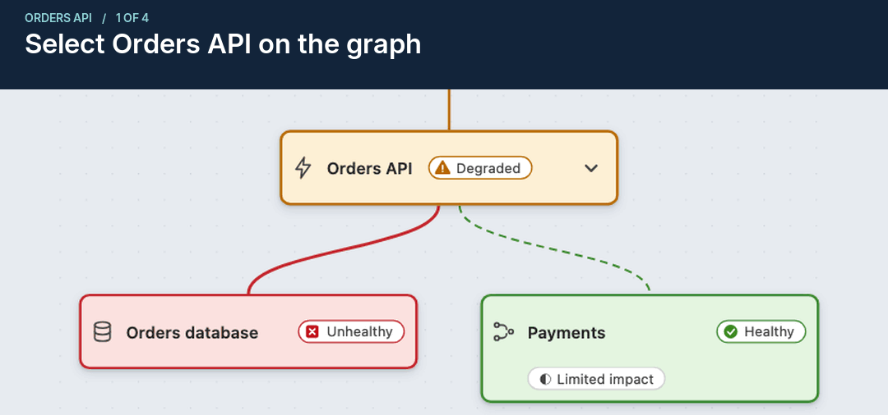
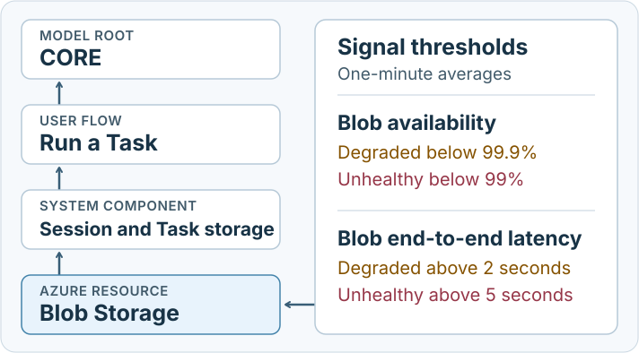
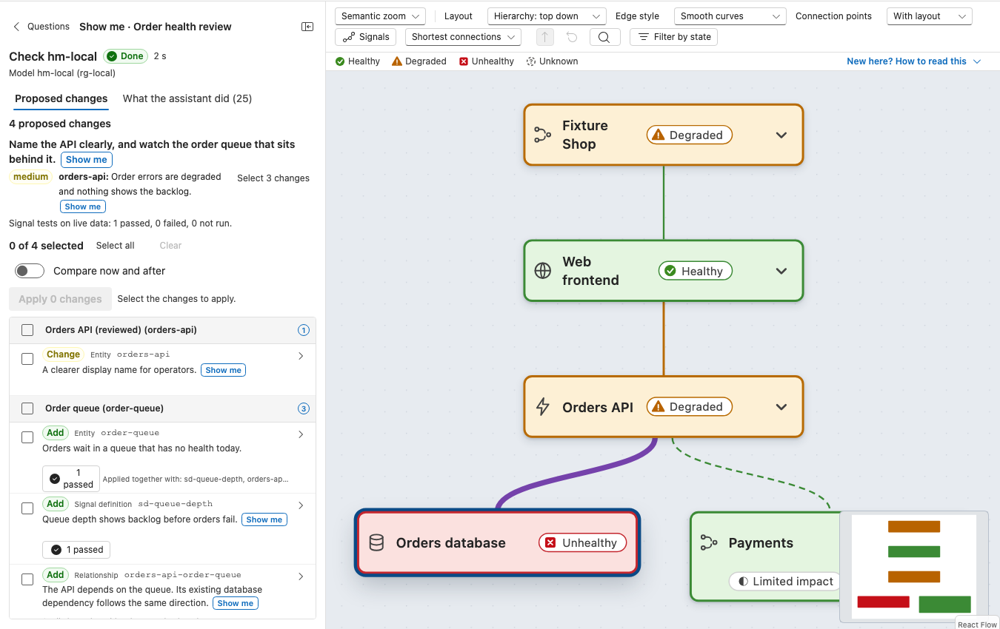
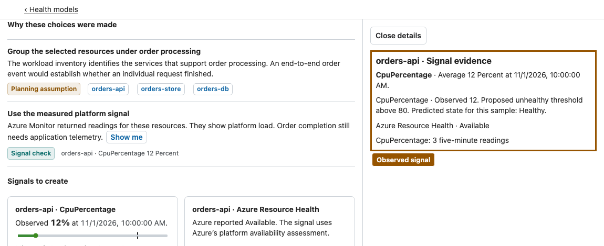

# Azure Health Model demo

Health Pulse shows which parts of a workload depend on an Azure resource. When something goes wrong, pick an entity on the graph and ask the assistant which signal explains its health.



In this local example, the assistant traces the **Degraded** state to three failed orders in the last hour. The threshold is more than one. [Download the 16-second video (MP4)](docs/images/explain-orders-api.mp4?raw=1).

## Get started from scratch

If someone shared a deployment with you, open its web app link, sign in and [explore the model](#trace-a-signal-through-the-deployed-model). To run your own copy, clone the project on macOS, Linux or WSL.

```bash
git clone https://github.com/abossard/ahm-model-demo.git
cd ahm-model-demo
```

### Try the sample without Azure

With Node.js 26, `make` and `uv` installed, run the [local startup commands](docs/development.md#without-azure). Open [the local app](http://127.0.0.1:8080) and select **Orders API**. Click **Why is Orders API Degraded?** to reproduce the walkthrough. The sample uses a scripted assistant and keeps your session in memory until you stop the server.

### Deploy to your Azure subscription

Install the Azure CLI (`az`), Azure Developer CLI (`azd`), Bash, `jq` and `curl`. Check your model quota and permissions to create resources, custom roles, role assignments and app registrations. An Entra administrator must grant consent before users can access Azure through the app. [Prerequisites](docs/development.md#prerequisites) · [Model quota](infra/README.md#foundry)

Sign in to both CLIs with the same account and directory. The last command creates billable Azure resources.

```bash
az login
azd auth login
azd up
```

Choose a **new environment** (1–20 characters), your subscription and **Sweden Central** (`swedencentral`). Open the **Web application** link printed at the end. Sign in with Microsoft, choose your Azure directory and select **Open workspace**. The model picker lists the models your Azure roles let you read. [Sign-in guide](docs/demo.md#sign-in)

When you finish with this deployment, `azd down` removes its resource group. [Teardown details](infra/README.md#deploying)

### Deploy the IoT factory load-test model

The load-test model is opt-in and disabled by default. From an already provisioned, selectable `azd` environment:

```bash
azd env select <environment-name>
azd env set AZURE_IOT_FACTORY_LOAD_TEST true
azd env set AZURE_IOT_FACTORY_BATCH_SIZE 400
azd provision
```

The batch-size setting is optional (22 through 400; default 400). Provisioning creates a separate
`hm-<env>-iot-factory` model with 8,000 entities across 20 levels, 8,799 relationships, and 10 reusable
Azure-backed signal definitions. It binds same-environment demo Container Apps and Foundry resource metrics to all
entities. Expected read-back counts are `entities=8000`, `relationships=8799`, and `signaldefinitions=10`; see the
[read-only verification and first-evaluation checks](infra/README.md#iot-factory-load-test-model).

Setting `AZURE_IOT_FACTORY_LOAD_TEST` to `false` and provisioning again stops new creation and management but does not
delete an existing model. Deletion requires separate exact approval and the
[documented exact-resource deletion procedure](infra/README.md#iot-factory-load-test-model).

## Trace a signal through the deployed model

The default model, `hm-<env>`, monitors the demo itself. Its root, **CORE**, tracks whether people can view a model, send a report, run a Task and apply changes. The **Run a Task** flow depends on Blob Storage to save questions and answers. [Full CORE model](docs/healthmodel/plan.md)



Select the Blob Storage entity under **Session and Task storage** to open its timeline. Click a time on the plot. The graph shows the state at that moment, and the assistant uses it when you ask why. **Back to now** returns to live data. To simulate a storage incident, choose **Send a health report** and set a state and expiry. The report adds a temporary signal to the model.

## Review a proposed change

Choose **Ask → Check this model**. In the local sample the assistant finds that orders are failing and the model has no signal for the queue backlog.



Use **Compare now and after** to preview the proposal. Select the changes you want and check which related changes they require. The Foundry hosted agent has read-only access through Azure MCP. When you confirm **Apply**, the web app writes to the live Azure model using your permissions. The app has no undo.

To design for the deployment’s resource group, choose **Ask → Design a model for my workload**. You can supply a public GitHub repository. The proposal targets `hm-<env>-design`, which starts empty. **History** keeps your questions, results and the assistant’s steps together.

## Build a model from your own resources

Choose **Create model** beside the model picker. Select individual resources or a resource group, then **Analyze resources**. In the local example, **Show me** opens the CPU readings behind a proposed signal.



Revise the workload plan, compare designs and download `plan.md` and `modelspec.md` for the one you choose. When you select **Confirm creation in Azure**, the app creates a new health model in your chosen resource group. [Builder walkthrough](docs/demo.md#create-a-health-model)

Choose **Tour this model** on the receipt to follow its first signal. [Orders onboarding example with screenshots and GIFs](docs/onboarding/tour/README.md)

[Demo guide](docs/demo.md) · [Local development and tests](docs/development.md) · [Infrastructure](infra/README.md) · [Architecture](docs/redesign/plan.md)
