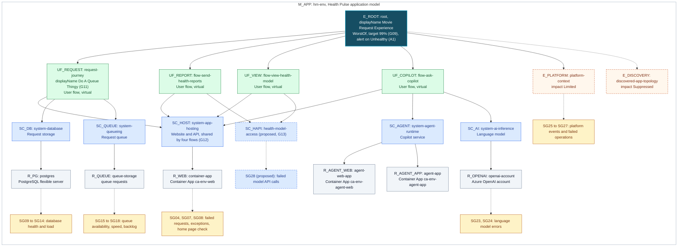

# Health model modelspec: Health Pulse application (`hm-<env>`)

## modelspec CONCEPT

- Scope: the application model `M_APP` (`hm-<env>`) and the workload behind it: web app, copilot, queue, database, language model. The shop model (`M_SHOP`) and survey model (`M_SURVEY`) are out of scope (G20).
- Source-only plan dated 2026-10-22. No Azure reads, deployments, test runs, or commits were made.
- Status values: `new` (not done), `done` (completed, with S-ID or evidence), `problem: <reason>` (blocked or failed check).
- ID prefixes: `M_` model, `E_` root or non-resource entity, `UF_` user flow, `SC_` system component, `R_` Azure resource, `SG` signal, `S` source, `A` alert, `G` gap or decision.
- Entity IDs are the live entity names. Renaming an entity deletes its health history, so only display names are proposed to change.
- Thresholds, targets and alert placement are authored values in source. They are not user commitments unless a row says so.

## What does health mean for my workload?

- The website and its API answer users without failed requests and within a response-time limit. Thresholds are assumed (G09, G21).
- A movie request is accepted, saved to the database, and visible in the queue (assumed; steps from S14).
- The health copilot answers questions and can read the model (assumed; S16, S18).
- The services behind these flows (database, queue, language model) work (assumed; SC rows below).

## Health modelling strategy

| Model Name | Purpose and platform/workload role | Owner and team/organizational/legal boundary | Tenant, subscription and resource scope | Sources or gap | Status |
|----------------|------------------------------------|---------------------------------------------|-----------------------------------------|----------------------|--------|
| `M_APP` `hm-<env>` | Health of the Health Pulse app: movie request journey, health reports, model viewer, copilot. Read by the web app by default. | Unknown. Not stated in the repository (G09). | Subscription from the azd environment; resource group `rg-<env>`; model identity has Reader and Monitoring Reader on the group (S5, S6, S12). Exact IDs unknown (G02). | S3, S5, S6, S7, S8, S12 | new |
| `M_SHOP` `hm-<env>-shop` | Synthetic demo shop. Not the app. | Demo | Same resource group | S3, S5 (G20) | new |
| `M_SURVEY` `hm-<env>-survey` | Separate survey app with its own model and telemetry role `ahm-survey`. Shares the workspace (S19). | Separate app | Same resource group | S19 (G20) | new |

## High-level health model diagram

## User concerns and priorities

Nothing was stated by the user. These are inferred from the repository and need confirmation (G10).

| Concern or priority | User impact and service expectations | Sources or gap | Status |
|---------------------|--------------------------------------|----------------|--------|
| Show a broken request journey live in the demo | Failures appear in the model and alerts fire; the demo script polls `request-journey` by name | S4, S7 L50-L53; inferred (G10) | new |
| Know when the home page is unreachable | The synthetic home page check feeds the website part | S10; inferred (G10) | new |
| Know when the copilot or its language model fails | Copilot CPU, memory and language model errors feed the copilot flow | S6, S16, S7 L635-L813; inferred (G10) | new |

## User flows

| Flow | User outcome and steps | Health objective | Dependencies and resources | Sources or gap | Status |
|------|------------------------|------------------|----------------------------|----------------|--------|
| `UF_REQUEST` `request-journey` (display: "Do A Queue Thingy"; proposed "Request a movie") | Button "Run request journey": enqueue a message, insert a database row and count rows, peek the oldest queue message (S14 L221-L240). | 99% (assumed, G09) | `SC_HOST`, `SC_DB`, `SC_QUEUE` | S4, S7 L54-L72, S8 L86-L110, S14, S17 L259; G11, G16, G18 | new |
| `UF_REPORT` `flow-send-health-reports` (display: "Send Health Reports") | Submit a temporary state for an entity (1 to 120 minutes). Also used by the copilot tool (S16, S18). | 99% (assumed, G09) | `SC_HOST` only today; `SC_HAPI` proposed | S7 L74-L92, S8 L76, S14 L633-L700, S17 L207; G13 | new |
| `UF_VIEW` `flow-view-health-model` (display: "View Health Model") | Browse models, graph, entity detail and 7-day history (S14 L494-L580). | 99% (assumed, G09) | `SC_HOST` only today; `SC_HAPI` proposed | S7 L94-L112, S8 L116, S14 L494-L580; G13 | new |
| `UF_COPILOT` `flow-ask-copilot` (display: "Ask the Health Copilot") | Chat with an agent that reads the model and can send reports (S16, S18). | 99% (assumed, G09) | `SC_HOST`, `SC_AGENT`, `SC_AI` | S7 L114-L132, S8 L126-L146, S16; G03 | new |

## System flows

| Flow | System interactions | Health objective | Dependencies and resources | Sources or gap | Status |
|------|---------------------|------------------|----------------------------|----------------|--------|
| `SC_HOST` `system-app-hosting` (display: "App Hosting"; proposed "Website and API") | Serves the UI, the health-model API and the `/agent` proxy (S14 L474-L755). | 99% (assumed) | `R_WEB`; parents: all four user flows | S7 L137-L155, S8 L76, L86, L116, L126, L156; G12 | new |
| `SC_DB` `system-database` (display: "Database"; proposed "Request storage") | Inserts and counts rows in PostgreSQL (S14 L168-L199). | 99% (assumed) | `R_PG`; parent: `UF_REQUEST` | S7 L157-L175, S8 L96, L166 | new |
| `SC_QUEUE` `system-queueing` (display: "Queueing"; proposed "Request queue") | Enqueues and peeks request messages (S14 L154-L218). | 99% (assumed) | `R_QUEUE`; parent: `UF_REQUEST` | S7 L177-L195, S8 L106, L176; G16 | new |
| `SC_AGENT` `system-agent-runtime` (display: "Agent Runtime"; proposed "Copilot service") | Runs the copilot web and agent apps (S6 L281-L330, S16). | 99% (assumed) | `R_AGENT_WEB`, `R_AGENT_APP`; parent: `UF_COPILOT` | S7 L197-L215, S8 L136, L186, L196 | new |
| `SC_AI` `system-ai-inference` (display: "AI Inference"; proposed "Language model") | Model calls for the copilot. | 99% (assumed) | `R_OPENAI`; parent: `UF_COPILOT` | S7 L217-L235, S8 L146, L206 | new |
| `SC_HAPI` `health-model-access` (proposed, not in source) | Calls from the website to the Health Models API for view and report (S14 spans `healthmodel.*`). | Not set (proposed 99%, G09) | No Azure resource underneath (documented exception, G13); parents: `UF_REPORT`, `UF_VIEW` | S14 L496, L525, L548, L653; G04, G13 | new |

## Alerts

| Alert | Confirmed placement and health objective | Existing rule and suitability | Sources, lookup coverage or gap | Status |
|-------|-----------------------------------------|-------------------------------|---------------------------------|--------|
| A1: `E_ROOT` unhealthy, severity Sev2, action group `ag-<env>-root` | On `E_ROOT`, Unhealthy only. Message: "The movie request journey is unhealthy." Target not set for alert (G09, G10). | No Azure rule read. Existing alert rules on `rg-<env>` unverified (G08). | S7 L22-L52, S11 `rootActionGroup`; G08, G10 | new |
| A2: `UF_REQUEST` unhealthy (proposed) | Not placed. Confirmation needed. | Not read | G10 | new |

## Shared source material

### S1: User request and skill templates

- Evidence class: user-stated fact
- Original location/reference: this conversation; skill file `/Users/abossard/.agents/skills/healthmodel-plan/SKILL.md`, templates `templates/modelspec.md` and `templates/plan.md`
- Precise locator and version: prompt attachment "Follow instructions in #prompt:SKILL.md", 2026-10-22; time not available
- Status: done

### S2: AGENTS.md

- Evidence class: source fact
- Original location/reference: `AGENTS.md` (workspace root, attached)
- Precise locator and version: sections "Follow the request path" and "Change the relevant surface"; keep Application and shop models distinct; synthetic healthy signals are not real health
- Status: done

### S3: README.md

- Evidence class: source fact
- Original location/reference: `README.md`
- Precise locator and version: section "Models" (three models), section "Code"
- Status: done

### S4: docs/demo.md

- Evidence class: source fact
- Original location/reference: [docs/demo.md](../demo.md)
- Precise locator and version: sections "Explore a model", "Understand the health signals", "Run the request journey"; request journey writes PostgreSQL and Storage Queue; the journey always targets the application workload
- Status: done

### S5: infra/README.md

- Evidence class: source fact
- Original location/reference: [infra/README.md](../../infra/README.md)
- Precise locator and version: "The health models" table; "Synthetic demo health" (ignoreUnknown false on shop nodes); "Survey ownership"; saved images and Designer positions may differ from live state
- Status: done

### S6: infra/main.bicep

- Evidence class: source fact
- Original location/reference: [infra/main.bicep](../../infra/main.bicep)
- Precise locator and version: module `web` L169 with `OTEL_SERVICE_NAME` = environment name (L216); module `agentApp` L281 with `OTEL_SERVICE_NAME` = `ahm-health-copilot` (L328-L329); module `healthModel` L382; module `surveyHealthModel` L355; `aiAccountName` `oai-<env>-<token>` in module `copilot`
- Status: done

### S7: infra/modules/health-model-entities.bicep

- Evidence class: source fact
- Original location/reference: [health-model-entities.bicep](../../infra/modules/health-model-entities.bicep)
- Precise locator and version: root L22; `request-journey` L54; `flow-send-health-reports` L74; `flow-view-health-model` L94; `flow-ask-copilot` L114; `system-*` L137-L217; `container-app` L239 (signals L264-L400); `postgres` L413 (signals L434-L530); `queue-storage` L541 (signals L562-L625); `agent-web-app` L635; `agent-app` L695; `openai-account` L755; `platform-context` L815; `discovered-app-topology` L885; entity count 18 at the end of the file
- Status: done

### S8: infra/modules/health-model-relationships.bicep

- Evidence class: source fact
- Original location/reference: [health-model-relationships.bicep](../../infra/modules/health-model-relationships.bicep)
- Precise locator and version: 20 authored relationships, L16-L206 (root to flows and platform L16-L66, flows to components L76-L146, components to resources L156-L206); discovery edge `r-root-discovery` L66
- Status: done

### S9: infra/modules/health-model-discovery.bicep

- Evidence class: source fact
- Original location/reference: [health-model-discovery.bicep](../../infra/modules/health-model-discovery.bicep)
- Precise locator and version: rule `discover-app-insights`; `addRecommendedSignals` Enabled, `addResourceHealthSignal` Disabled, `discoverRelationships` Enabled
- Status: done

### S10: infra/modules/availability-tests.bicep

- Evidence class: source fact
- Original location/reference: [availability-tests.bicep](../../infra/modules/availability-tests.bicep)
- Precise locator and version: home test "Health Pulse home page", GET every 300 s from three locations, always on; journey test POST `/api/demo-request`, `journeyAvailabilityTestEnabled` default false
- Status: done

### S11: infra/modules/health-model.bicep

- Evidence class: source fact
- Original location/reference: [health-model.bicep](../../infra/modules/health-model.bicep)
- Precise locator and version: action group `ag-<prefix>-root` (`rootActionGroup`); model `SystemAssigned` identity; authentication setting `auth-system`; report operator role assigned to the app identity
- Status: done

### S12: infra/modules/health-model-access.bicep

- Evidence class: source fact
- Original location/reference: [health-model-access.bicep](../../infra/modules/health-model-access.bicep)
- Precise locator and version: Reader and Monitoring Reader for the model principal on the resource group
- Status: done

### S13: infra/modules/subscription-monitoring.bicep

- Evidence class: source fact
- Original location/reference: [subscription-monitoring.bicep](../../infra/modules/subscription-monitoring.bicep)
- Precise locator and version: subscription-scope diagnostic setting for categories Administrative, ServiceHealth, ResourceHealth, Alert, sent to the workspace
- Status: done

### S14: src/web/app/main.py

- Evidence class: source fact
- Original location/reference: [src/web/app/main.py](../../src/web/app/main.py)
- Precise locator and version: `configure_azure_monitor` L74; journey functions `enqueue_event` L154, `insert_event_and_count` L168, `peek_queue_head` L203, `run_request_journey` L221; routes `/api/demo-request` L486, `/api/health-models` L494, `/api/health-model` L517, `/api/entities/...` L536, `/api/entities/.../health-reports` L633; CLIENT spans `healthmodel.catalog` L496, `healthmodel.read` L525, `healthmodel.history` L548, `healthmodel.report` L653; `/agent` proxy routes `agent_root` and `agent_sub`
- Status: done

### S15: src/web/app/journey.py and reports.py

- Evidence class: source fact
- Original location/reference: [journey.py](../../src/web/app/journey.py), [reports.py](../../src/web/app/reports.py)
- Precise locator and version: journey page title "Movie request journey"; report signal name `web-ui-health-report`; report validation limits (expiry 1 to 120 minutes, custom reason up to 280 characters)
- Status: done

### S16: src/agent-app (health_api.py, agent.py, main.py); src/agent-web/src

- Evidence class: source fact
- Original location/reference: [health_api.py](../../src/agent-app/src/health_api.py), [agent.py](../../src/agent-app/src/agent.py), [main.py](../../src/agent-app/src/main.py)
- Precise locator and version: copilot tools `read_health_model`, `read_entity`, `send_health_report` (agent.py L24-L171); calls `/api/health-model`, `/api/entities/...`, health-reports endpoint (health_api.py L164-L207); Azure Monitor configured when the connection string is set (main.py L35). Search of `src/agent-web/src` found no Application Insights or OpenTelemetry setup.
- Status: done

### S17: src/web/ui/tests/spa.spec.ts

- Evidence class: source fact
- Original location/reference: [spa.spec.ts](../../src/web/ui/tests/spa.spec.ts)
- Precise locator and version: button labels "Submit report" (L207) and "Run request journey" (L259)
- Status: done

### S18: docs/research/application-insights-availability-health-model.md

- Evidence class: proposal/inference (prior research, dated 9 September 2026)
- Original location/reference: [research note](../research/application-insights-availability-health-model.md)
- Precise locator and version: section "Problems to resolve": Name-only filter, 15-minute query versus PT5M grain, empty result and Unknown not established, observation-based threshold (2 of 3 successes is 66.67%, Unhealthy); section "Adding the journey test"
- Status: done

### S19: src/survey (config.py, telemetry.py) and infra/modules/survey-health-model.bicep

- Evidence class: source fact
- Original location/reference: [survey config](../../src/survey/app/config.py), [survey telemetry](../../src/survey/app/telemetry.py), [survey-health-model.bicep](../../infra/modules/survey-health-model.bicep)
- Precise locator and version: survey role `ahm-survey` (config.py L23); workspace queries in `M_APP` exclude that role; survey model uses `ignoreUnknown: false`
- Status: done

### S20: infra/modules/foundation.bicep, storage.bicep

- Evidence class: source fact
- Original location/reference: [foundation.bicep](../../infra/modules/foundation.bicep), [storage.bicep](../../infra/modules/storage.bicep)
- Precise locator and version: workspace `law-<env>` (L128); Application Insights `appi-<env>` (L148); PostgreSQL `pg-ahm-<token>` with database `demo` (L164, L224); storage account `stahm<token>` with queue `requests` (storage.bicep L15-L18); Container Apps environment `cae-<env>`
- Status: done

### S21: Microsoft Learn, Azure Monitor health model concepts

- Evidence class: primary external source
- Original location/reference: https://learn.microsoft.com/en-us/azure/azure-monitor/health-models/concepts
- Precise locator and version: impact Standard, Limited (never propagates Unhealthy, propagates it as Degraded) and Suppressed; dependencies default WorstOf; Degraded does not count as downtime for health objective; alerts fire only on entities that have one configured; root entity cannot be deleted
- Status: done

### S22: Microsoft Learn, Health modeling for workloads (Well-Architected)

- Evidence class: primary external source
- Original location/reference: https://learn.microsoft.com/en-us/azure/well-architected/design-guides/health-modeling
- Precise locator and version: sections "Build a health model" (flows, platform metrics, application logs, health probes) and "Set actionable alerts" (alert on entity health states rather than one alert per metric)
- Status: done

## User input and decisions

| Input or decision and affected items | Attribution and source | Input/decision date/time | Recorded at | Status |
|-------------------------------------|------------------------|--------------------------|-------------|--------|
| Request to plan the health model from the workspace using the healthmodel-plan skill. Affects all items. | User, S1 | 2026-10-22, time unavailable | 2026-10-22, time unavailable | done |
| Scope: plan `M_APP` only; `M_SHOP` and `M_SURVEY` out of scope. Affects `M_APP`, shared queries. | Agent default, pending user confirmation (G20) | Not applicable | 2026-10-22, time unavailable | new |
| Write only `docs/healthmodel/modelspec.md` and `docs/healthmodel/plan.md`. No Azure writes, branches or commits. | Skill rule, S1 | 2026-10-22, time unavailable | 2026-10-22, time unavailable | done |

## Derived entity plan

| Model and entity identity/role | Flows, resources and dependencies | Proposed health meaning and user impact | Supporting sources and short derivation | Evidence gaps or conflicts | Intent acceptance | Status |
|-------------------------------|-----------------------------------|-----------------------------------------|-----------------------------------------|----------------------------|-------------------|--------|
| `M_APP` / `E_ROOT` `hm-<env>`, root, display "Movie Request Experience" (plan name "Overall app health") | Parent of four user flows, `E_PLATFORM` (Limited), `E_DISCOVERY` (Suppressed). WorstOf. | Unhealthy when any standard flow is unhealthy. Alert on Unhealthy only. | S7 L22-L52, S8 L16-L75, S11. Root is required by S21. | G09, G10, G14 | pending | new |
| `UF_REQUEST` `request-journey` (display "Do A Queue Thingy", plan name "Request a movie") | Under `E_ROOT`. Over `SC_HOST`, `SC_DB`, `SC_QUEUE`. No own signal. | Unhealthy when the website, storage or queue is unhealthy. | S7 L54-L72, S8 L86-L110, S14 L221-L240, S4. Entity name kept because the demo script polls it (S7 L50-L53). | G11, G16, G18 | pending | new |
| `UF_REPORT` `flow-send-health-reports` (plan name "Send health reports") | Under `E_ROOT`. Over `SC_HOST` only, plus `SC_HAPI` proposed. | Today it follows the website only, so failed report calls are invisible. | S7 L74-L92, S8 L76, S14 L633-L700. | G13 | pending | new |
| `UF_VIEW` `flow-view-health-model` (plan name "View the health model") | Under `E_ROOT`. Over `SC_HOST` only, plus `SC_HAPI` proposed. | Today it follows the website only, so failed model reads are invisible. | S7 L94-L112, S8 L116, S14 L494-L580. | G13 | pending | new |
| `UF_COPILOT` `flow-ask-copilot` (plan name "Ask the health copilot") | Under `E_ROOT`. Over `SC_HOST`, `SC_AGENT`, `SC_AI`. | Unhealthy when the website, copilot or language model is unhealthy. | S7 L114-L132, S8 L126-L146, S16. | G03 (copilot errors also count against the website) | pending | new |
| `SC_HOST` `system-app-hosting` (plan name "Website and API") | Parents: four user flows (DAG). Child `R_WEB`. | Follows `R_WEB`. A website problem marks all four flows. | S7 L137-L155, S8 L76, L86, L116, L126, L156. Shared node deliberately kept as DAG in S7 comment above L137. | G12 | pending | new |
| `SC_DB` `system-database` (plan name "Request storage") | Parent `UF_REQUEST`. Child `R_PG`. | Follows `R_PG`. | S7 L157-L175, S8 L96, L166. | none | pending | new |
| `SC_QUEUE` `system-queueing` (plan name "Request queue") | Parent `UF_REQUEST`. Child `R_QUEUE`. | Follows `R_QUEUE`. Backlog grows (no consumer). | S7 L177-L195, S8 L106, L176, S14 L203-L218. | G16 | pending | new |
| `SC_AGENT` `system-agent-runtime` (plan name "Copilot service") | Parent `UF_COPILOT`. Children `R_AGENT_WEB`, `R_AGENT_APP`. | Follows the two copilot apps. | S7 L197-L215, S8 L136, L186, L196. | G03 | pending | new |
| `SC_AI` `system-ai-inference` (plan name "Language model") | Parent `UF_COPILOT`. Child `R_OPENAI`. | Follows the language model account. | S7 L217-L235, S8 L146, L206. | none | pending | new |
| `SC_HAPI` `health-model-access` (proposed, plan name "Health model access") | Parents `UF_REPORT`, `UF_VIEW`. No Azure resource underneath. Signal SG28. | Unhealthy when website calls to the Health Models API fail. | S14 spans L496, L525, L548, L653; S22 (no virtual entity with a single virtual child). | G04, G13 | pending | new |
| `R_WEB` `container-app` (display "Python Container App", plan name "Container App ca-env-web") | Parent `SC_HOST`. Three metrics and five log queries, one of them the home page check. | Follows SG01 to SG08. | S7 L239-L411, S14 L74, S6 L216. | G03, G06, G17, G21 | pending | new |
| `R_PG` `postgres` (display "PostgreSQL Flexible Server") | Parent `SC_DB`. Platform metrics. | Follows SG09 to SG14. | S7 L413-L539, S20 names the server. | G15 | pending | new |
| `R_QUEUE` `queue-storage` (display "Queue Storage") | Parent `SC_QUEUE`. Storage account and queue service metrics. | Follows SG15 to SG18. | S7 L541-L633, S20. | G16 | pending | new |
| `R_AGENT_WEB` `agent-web-app` (display "Agent Web Container App") | Parent `SC_AGENT`. | Follows SG19, SG20. | S7 L635-L693. | G01 | pending | new |
| `R_AGENT_APP` `agent-app` (display "Agent Backend Container App") | Parent `SC_AGENT`. | Follows SG21, SG22. | S7 L695-L753. | G01, G03 | pending | new |
| `R_OPENAI` `openai-account` (display "Azure OpenAI Account") | Parent `SC_AI`. | Follows SG23, SG24. | S7 L755-L813, S6 `aiAccountName`. | none | pending | new |
| `E_PLATFORM` `platform-context` (display "Azure Platform Context", impact Limited) | Parent `E_ROOT`. Log queries on the activity log. | Unhealthy reaches the root as Degraded only (S21). | S7 L815-L883, S13. | G05, G19 | pending | new |
| `E_DISCOVERY` `discovered-app-topology` (display "Discovered Application Topology", impact Suppressed) | Parent `E_ROOT` via `r-root-discovery`. No authored signals. | Does not affect the root. | S7 L885-L898, S8 L66, S9. | G07 | pending | new |

## Signals

Each signal is run by healthmodel-build before deployment. Sources point at line ranges in S7 unless noted.

| Signal | Entity | Kind and data source | Measurement | Degraded and unhealthy rule | Sources or gap | Verification | Status |
|--------|--------|----------------------|-------------|-----------------------------|----------------|--------------|--------|
| SG01 `cpu-percentage` | `R_WEB` | Azure resource metric `Microsoft.App/containerApps` `CpuPercentage`, resource `ca-<env>-web` | Average, PT1M | Unhealthy > 95 | S7 L264 | not run | new |
| SG02 `memory-percentage` | `R_WEB` | Metric `MemoryPercentage`, same resource | Average, PT1M | Unhealthy > 95 | S7 L281 | not run | new |
| SG03 `response-time` | `R_WEB` | Metric `ResponseTime` | Average, PT1M, milliseconds | Unhealthy > 5000 | S7 L298 | not run | new |
| SG04 `failed-requests` | `R_WEB` | Log query on `law-<env>`: `AppRequests`, last 5 min, role not `ahm-survey` | Count of Success == false, PT5M | Unhealthy > 2 | S7 L321; G03 (scope) | not run | new |
| SG05 `failed-postgres-dependencies` | `R_WEB` | Log query: `AppDependencies`, last 5 min, Target has "postgres" or Name has "PostgreSQL" | Count of failed calls, PT5M | Unhealthy > 0 | S7 L337; G04 | not run | new |
| SG06 `failed-queue-dependencies` | `R_WEB` | Log query: `AppDependencies`, Target has queue host or Name has "Queue" | Count of failed calls, PT5M | Unhealthy > 0 | S7 L353; G04 | not run | new |
| SG07 `exceptions` | `R_WEB` | Log query: `AppExceptions`, last 5 min, role not `ahm-survey` | Count, PT5M | Unhealthy > 2 | S7 L369; G03 (scope) | not run | new |
| SG08 `availability-test` | `R_WEB` | Log query: `AppAvailabilityResults`, last 15 min, Name == "Health Pulse home page", NaN row dropped | Percent successful, PT5M | Degraded < 100; Unhealthy < 67 | S7 L385-L411, S18; G06, G17 | not run | new |
| SG09 `database-alive` | `R_PG` | Metric `is_db_alive` on `pg-ahm-<token>` | Average, PT1M | Unhealthy < 1 | S7 L434 | not run | new |
| SG10 `failed-connections` | `R_PG` | Metric `connections_failed` | Total, PT1M | Unhealthy > 0 (assumed, G15) | S7 L451 | not run | new |
| SG11 `cpu-percent` | `R_PG` | Metric `cpu_percent` | Average, PT1M | Unhealthy > 95 | S7 L468 | not run | new |
| SG12 `memory-percent` | `R_PG` | Metric `memory_percent` | Average, PT1M | Unhealthy > 95 | S7 L485 | not run | new |
| SG13 `storage-percent` | `R_PG` | Metric `storage_percent` | Average, PT1M | Unhealthy > 90 | S7 L502 | not run | new |
| SG14 `cpu-credits` | `R_PG` | Metric `cpu_credits_remaining` (Burstable tier) | Average, PT1M | Unhealthy < 5 | S7 L519 | not run | new |
| SG15 `availability` | `R_QUEUE` | Metric `Availability` on storage account | Average, PT1M | Unhealthy < 99 | S7 L562 | not run | new |
| SG16 `end-to-end-latency` | `R_QUEUE` | Metric `SuccessE2ELatency` | Average, PT1M, milliseconds | Unhealthy > 5000 | S7 L579 | not run | new |
| SG17 `transactions` | `R_QUEUE` | Metric `Transactions` | Total, PT1M | Unhealthy > 1000000 | S7 L596 | not run | new |
| SG18 `queue-message-count` | `R_QUEUE` | Metric `QueueMessageCount` on `queueServices` | Average, PT1H | Unhealthy > 100000 | S7 L613; G16 | not run | new |
| SG19 `cpu-percentage` | `R_AGENT_WEB` | Metric `CpuPercentage` | Average, PT1M | Unhealthy > 95 | S7 L656 | not run | new |
| SG20 `memory-percentage` | `R_AGENT_WEB` | Metric `MemoryPercentage` | Average, PT1M | Unhealthy > 95 | S7 L673 | not run | new |
| SG21 `cpu-percentage` | `R_AGENT_APP` | Metric `CpuPercentage` | Average, PT1M | Unhealthy > 95 | S7 L695-L753 | not run | new |
| SG22 `memory-percentage` | `R_AGENT_APP` | Metric `MemoryPercentage` | Average, PT1M | Unhealthy > 95 | S7 L695-L753 | not run | new |
| SG23 `client-errors` | `R_OPENAI` | Metric `ClientErrors` on Cognitive Services account | Total, PT5M | Unhealthy > 10 | S7 L776 | not run | new |
| SG24 `server-errors` | `R_OPENAI` | Metric `ServerErrors` | Total, PT5M | Unhealthy > 0 | S7 L793 | not run | new |
| SG25 `service-health` | `E_PLATFORM` | Log query: `AzureActivity`, last 15 min, ServiceHealth, Level Error or Critical | Count, PT5M | Unhealthy > 0 | S7 L832; G05 | not run | new |
| SG26 `failed-arm-operations` | `E_PLATFORM` | Log query: `AzureActivity`, last 15 min, Administrative, ActivityStatusValue Failed | Count, PT5M | Unhealthy > 0 | S7 L848; G05 (subscription-wide scope) | not run | new |
| SG27 `platform-alerts` | `E_PLATFORM` | Log query: `AzureActivity`, last 15 min, CategoryValue Alert | Count, PT5M | Unhealthy > 20 | S7 L864 | not run | new |
| SG28 `failed-model-api-calls` (proposed) | `SC_HAPI` | Log query: `AppDependencies`, last 5 min, Name starts with "healthmodel.", Success == false | Count, PT5M | Degraded > 0; Unhealthy > 5 (assumed) | S14 spans; G04, G13 | not run | new |

## Gaps and open decisions

| Gap or conflict | Category | Affected items | Known evidence and alternatives | Required resolution and owner | Status |
|-----------------|----------|----------------|--------------------------------|-------------------------------|--------|
| G01 Live state may differ from source | research/lookup | All | S2: saved images and Designer positions may differ from the live deployment. No Azure read in this run. | Read-only `az rest` of entities, relationships and signals for `hm-<env>`; diff against S7 and S8. Owner: healthmodel-build, before any change. | new |
| G02 Environment, subscription and resource tokens unknown | research/lookup | `M_APP`, all `R_*` | Source uses `<env>` and `<token>`. Exact IDs come from deployment outputs (S2). | Read `azd env get-values` and deployment outputs, read-only. Owner: agent, or user if the environment is not local. | new |
| G03 Website failure count includes copilot requests and exceptions | research/lookup, then user input | SG04, SG07, `R_WEB`, `UF_COPILOT` | Filters exclude only `ahm-survey` (S7 L321, L369). Web role is the environment name (S6 L216). Copilot role is `ahm-health-copilot` (S6 L329). Copilot app sends telemetry (S16 main.py L35). Proposal: filter web role to the environment name. | Run `AppRequests \| summarize count() by AppRoleName` over 24 h to confirm. User decides the scope change. Owner: healthmodel-build, then user. | new |
| G04 Dependency names and targets assumed from source | research/lookup | SG05, SG06, SG28, `SC_HAPI` | Span names in S14 (`PostgreSQL insert and count`, `Azure Queue enqueue`, `Azure Queue peek`, `healthmodel.*`). Observed Name and Target values not checked. | `AppDependencies \| summarize count() by Name, Target` over 24 h. Owner: healthmodel-build. | new |
| G05 Activity log is subscription-wide | research/lookup, then user input | SG25, SG26, `E_PLATFORM` | S13 sends categories from every resource group. SG26 has no resource group filter. Proposal: add `ResourceGroup =~ "rg-<env>"` to SG26. | `AzureActivity \| summarize count() by ResourceGroup` over 24 h. User confirms the filter. | new |
| G06 Missing-data behavior unverified | research/lookup | SG08, all parent entities | S18: a valid NaN filter drops the row, so no data may mean Unknown. Unknown propagation also depends on ignoreUnknown (G14). Not established. | Observe the evaluator history during build. Owner: healthmodel-build. | new |
| G07 Discovery children unknown | research/lookup | `E_DISCOVERY` | S9 adds children through discovery. Authored signals are none, so the entity can show Unknown while Suppressed. | Read live children and states of `discovered-app-topology`. | new |
| G08 Existing alert rules not read | research/lookup | A1, `M_APP` | No alert inventory read. | Read-only inventory of rules in `rg-<env>` with full IDs, target, condition and enabled state. Owner: healthmodel-build. | new |
| G09 Health targets are authored defaults | user input | `M_APP`, `UF_*`, `E_ROOT` | 99 on every entity (S7). No commitment in repository or conversation. | User sets per-flow targets, names the owning team, or confirms 99 as a starting value (assumed). | new |
| G10 Alert placement and recipients | user input | A1, A2, `E_ROOT`, `UF_*` | Only root alerts, on Unhealthy (S7 L22-L52). Degraded never alerts (S21). Recipients of `ag-<env>-root` unknown (S11). | User picks flows that alert, the state, and the recipients. Proposal: root and "Request a movie" alert on Unhealthy. | new |
| G11 Display names look like placeholders | user input | `UF_REQUEST`, `E_ROOT` | "Do A Queue Thingy" (S7 L58), "Movie Request Experience" (S7 L26). Journey page title is "Movie request journey" (S15). Renaming an entity deletes its history (S21). | Proposal: change displayName only, to "Request a movie". User confirms. | new |
| G12 Shared website node has four parents | user input | `SC_HOST`, `UF_*` | Skill rule asks for a tree with one copy per flow. Source keeps a DAG on purpose (S7 comment above L137). Per-flow copies would duplicate `R_WEB` and its eight signals, or move signals into copies. | User accepts the DAG for this app (proposal), or asks for per-flow copies. | new |
| G13 Report and view flows have a single child | user input | `UF_REPORT`, `UF_VIEW`, `SC_HAPI` | Both flows depend only on `SC_HOST`. Failed model calls are not visible. Proposal: add `SC_HAPI` with SG28 (S14 spans). It has no Azure resource underneath, because the Health Models service exposes no signal here. That is a documented exception to the rule that components sit on a resource. | User accepts, or drops the proposal (then both flows show website health only). | new |
| G14 ignoreUnknown is true on all logical entities | user input | `M_APP` logical entities | Source uses true (S7). Shop and survey use false (S5, S19), so an Unknown leaf reaches the root there. S21 does not define the behavior. | User picks per model. Proposal: false for `M_APP`, so missing evidence shows. Verify the effect in build. | new |
| G15 Any failed database connection is Unhealthy | assumption | SG10, `R_PG`, `SC_DB`, `UF_REQUEST` | connections_failed > 0 is Unhealthy (S7 L451). One failed login marks the database and the request flow Unhealthy. | Keep as assumed default. Proposal: Degraded at > 0, Unhealthy at a count set after a week of data. | new |
| G16 Queue has no consumer | research/lookup, then user input | SG18, `SC_QUEUE`, `UF_REQUEST` | Code only peeks (S14 L203-L218). No receive or delete call found in `src/web/app`, `src/agent-app/src`, `scripts`. Messages accumulate until expiry (default TTL, to verify). Unhealthy above 100000 (S7 L613). | Lookup: queue TTL and steady-state count. User: add a consumer, or accept growth and retune the threshold. | new |
| G17 Availability signal open issues | research/lookup, then user input | SG08 | S18: Name-only filter, 15-minute query versus PT5M grain, observation-based threshold. Proposal: filter by `_ResourceId` and Name, align the window, choose success percent or location quorum. | Fix query after user decides the policy. Owner: user, then healthmodel-build. | new |
| G18 Request journey has no synthetic signal | user input | `UF_REQUEST` | Journey test is off by default and writes data (S10). S18 suggests a conditional signal. | User chooses: enable the test for demos only, add a conditional signal, or leave it. | new |
| G19 Platform events do not alert | assumption | `E_PLATFORM`, A1 | Impact Limited (S7 L815-L835). S21: unhealthy reaches the root as Degraded, so no root alert. | Keep as default. User can set impact to Standard. | new |
| G20 Shop and survey models out of scope | assumption | `M_SHOP`, `M_SURVEY`, SG04 to SG07 | Shop is a fictional demo (S3, S5). Survey is a separate app and model (S19). Both share the workspace. | User confirms scope. | new |
| G21 Thresholds copied from source | assumption | SG01 to SG08, SG19 to SG24 | No user data behind 95%, 5000 ms, 2 failed requests, 99%. | Tune after a week of real data. Owner: user. | new |
| G22 Manual reports change state | assumption | `UF_REPORT`, all entities receiving reports | S14 and S16: reports add a temporary signal `web-ui-health-report` (1 to 120 minutes), outside the 28 signals above. They change displayed state without evidence. | Not modelled. Show in the plan as a known manual input. | new |

## Intent acceptance

| Concrete intent and affected models/entities | State | Attributable user acceptance/reference | Status |
|---------------------------------------------|-------|----------------------------------------|--------|
| `M_APP` purpose: health of the Health Pulse app across four user flows, five components, six Azure resources, the platform context and the root alert A1. Affected: all `M_APP` entities and signals SG01 to SG27. | pending | None. No acceptance inferred. | new |
| Proposed changes: `SC_HAPI` with SG28; DAG for `SC_HOST`; web-role filter for SG04 and SG07; display name "Request a movie". Affected: G03, G11, G12, G13. | pending | None | new |
