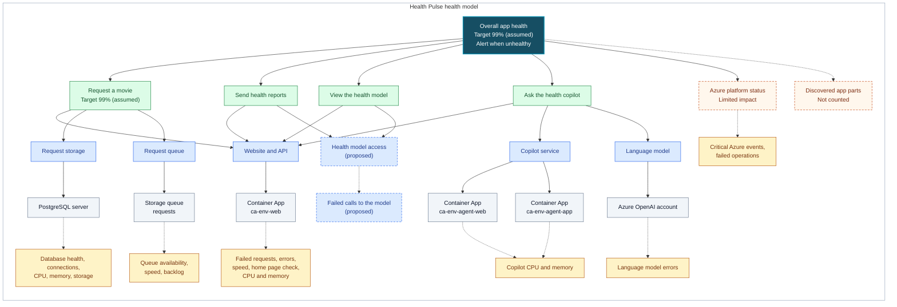

# Health model for Health Pulse

Health Pulse is the movie request app with a health copilot. Its health model shows whether requests, the website and the copilot work, and what breaks them.

## What does health mean for my workload?

- The website and its API answer people quickly and without errors.
- A movie request is saved and shows up in the queue.
- The health copilot answers questions and can read the model.
- The services behind these (database, queue, language model) work.

These are assumed, not agreed yet.

## How to read the states

- **Healthy**: working as expected.
- **Degraded**: working, but slower or partly broken. Does not count against the target.
- **Unhealthy**: broken or too slow. Counts against the target and can raise an alert.
- **Unknown**: no data yet.

The **target** is the share of time a part should be healthy, for example 99%.

## User flows

| User flow | What users do | Depends on | Signals | Health target | Alert |
|-----------|---------------|------------|---------|---------------|-------|
| Request a movie (today named "Do A Queue Thingy") | Press "Run request journey": the request is queued, saved to the database, and the oldest queued item is looked at (not removed) | Website and API, Request storage, Request queue | Website errors and speed, database health, queue health | 99% (assumed) | Overall app only (proposed: this flow too) |
| Send health reports | Mark a part as Healthy, Degraded or Unhealthy for a short time | Website and API, Health model access (proposed) | Website errors and speed, failed model calls (proposed) | 99% (assumed) | Overall app only |
| View the health model | Browse the models, the map and each part's history | Website and API, Health model access (proposed) | Website errors and speed, failed model calls (proposed) | 99% (assumed) | Overall app only |
| Ask the health copilot | Chat with an assistant that reads the model and can send reports | Website and API, Copilot service, Language model | Website errors and speed, copilot CPU and memory, language model errors | 99% (assumed) | Overall app only |

**Not modelled:** the request journey test (off by default because it writes data), a worker that empties the queue (none exists yet), alerts for single flows, and the shop and survey demos, which have their own models.

## Diagram

**Colors:** green = what users do; blue = parts of the system that make it work (dashed = proposed); orange = not counted in the overall health; gray = Azure resources, where "env" stands for your environment name; amber = the checks the model reads.

Read top to bottom: what users do, the parts that make it work, then the Azure resources behind them. The website and API is one part shared by all four flows, so a problem there shows in each of them. Azure platform status can lower the overall health to Degraded at most.

## What happens when something breaks

| If this happens | The model shows | Alert |
|-----------------|-----------------|-------|
| The database is overloaded (CPU above 95%) | PostgreSQL and Request storage turn **Unhealthy**; Request a movie and Overall app health too. Other flows stay Healthy. | Overall alert fires |
| The website fails (more than 2 failed web requests in 5 minutes) | Website and API turns **Unhealthy**, so all four flows and Overall app health turn Unhealthy. | Overall alert fires |
| The language model returns server errors | Azure OpenAI account and Language model turn **Unhealthy**; Ask the health copilot and Overall app health too. Other flows stay Healthy. | Overall alert fires |
| Azure reports a critical platform event | Azure platform status turns **Unhealthy**, but Overall app health only goes to Degraded. | None (alerts fire only on Unhealthy) |

## Assumptions

- Every part has a 99% target. You haven't agreed a target yet.
- Thresholds are starting values from the current model. Tune them after a week of real data.
- One failed database connection counts as Unhealthy. This is probably too strict.
- Manual health reports change a part's state for up to two hours. People type them in; the model doesn't measure them.
- Known issue, to confirm in build: errors from the copilot may also count against the website until the filter is fixed.

## What to do next?

- Confirm the flow names. Proposed: "Request a movie" instead of "Do A Queue Thingy".
- Choose who gets alerted. Proposed: the overall app alert, plus Request a movie when unhealthy.
- Accept the shared website part and the new "Health model access" check for report and view calls. Proposed: yes to both.

Open checks (live state, names of the telemetry data, existing alert rules) are listed in the modelspec. When you accept this plan, run `healthmodel-build` to verify the checks against live data and deploy.
