# Health model modelspec: CORE (`hm-anboahmdemo`)

## modelspec CONCEPT

- Scope: one health model for the core Health Pulse workload. The live target is `hm-anboahmdemo`.
- Proposed display name: `CORE`.
- Planning date: 2026-11-21.
- Evidence boundary: repository source plus read-only reads of `rg-anboahmdemo` in subscription `6fc552c5-06b6-43d7-ac70-2f1eda1be033`. No Azure writes were made.
- Status values: `new`, `done`, or `problem: <concrete reason>`. `new` means identified but not deployed or accepted.
- Stable IDs: `M_` model, `E_` model or platform entity, `UF_` user flow, `SC_` system component, `R_` Azure resource entity, `SG_` signal, `Q_` query, `A_` alert, `G_` gap.
- A repeated resource has one entity copy under each flow that uses it. This keeps the model a tree and prevents one flow's dependency semantics from changing another flow.
- The live model and resource names are evidence. The proposed entity tree, thresholds, health objectives and alert routing remain pending intent acceptance.

## What does health mean for my workload?

- A user can open the site, browse health models and inspect model history.
- A user can submit a temporary health report and have the model accept it.
- A user can run a Task in a Session and receive a completed answer or proposed health model changes.
- A user can apply selected, approved model changes and persist the apply result.
- Web hosting, the hosted agent, Azure MCP, session storage and the model deployment required by those flows work without unacceptable errors or delays.
- A critical Azure platform event is visible without treating every platform problem as a complete workload outage.

## Health modelling strategy

| Model Name | Purpose and platform/workload role | Owner and team/organizational/legal boundary | Tenant, subscription and resource scope | Sources or gap | Status |
|------------|------------------------------------|---------------------------------------------|-----------------------------------------|----------------|--------|
| `M_CORE` (`hm-anboahmdemo`) | One workload model for View model, Send report, Run Task and Apply changes. Proposed root display name `CORE`. | Application owner is not identified in the repository. The web app owns writes; the assistant and MCP remain read-only. | Tenant `46693104-8c42-47b7-98e3-985ed39402f6`; subscription `6fc552c5-06b6-43d7-ac70-2f1eda1be033`; resource group `rg-anboahmdemo`; Sweden Central. | S01, S02, S03, S05, S06, S07 | new |
| `hm-anboahmdemo-design` | Empty design target used by Design Tasks. It is not a second user-facing runtime model. | Same workload, controlled by the builder flow. | Same subscription and resource group. | S06, S17 | new |

## Scope constants

| Constant | Full value | Status |
|----------|------------|--------|
| `SUB_CORE` | `/subscriptions/6fc552c5-06b6-43d7-ac70-2f1eda1be033` | done |
| `RG_CORE` | `/subscriptions/6fc552c5-06b6-43d7-ac70-2f1eda1be033/resourceGroups/rg-anboahmdemo` | done |
| `WS_CORE` | `/subscriptions/6fc552c5-06b6-43d7-ac70-2f1eda1be033/resourceGroups/rg-anboahmdemo/providers/Microsoft.OperationalInsights/workspaces/law-anboahmdemo` | done |
| `APPI_CORE` | `/subscriptions/6fc552c5-06b6-43d7-ac70-2f1eda1be033/resourceGroups/rg-anboahmdemo/providers/Microsoft.Insights/components/appi-anboahmdemo` | done |
| `WEB_CORE` | `/subscriptions/6fc552c5-06b6-43d7-ac70-2f1eda1be033/resourceGroups/rg-anboahmdemo/providers/Microsoft.App/containerApps/ca-anboahmdemo-web` | done |
| `MCP_CORE` | `/subscriptions/6fc552c5-06b6-43d7-ac70-2f1eda1be033/resourceGroups/rg-anboahmdemo/providers/Microsoft.App/containerApps/ca-anboahmdemo-mcp` | done |
| `BLOB_CORE` | `/subscriptions/6fc552c5-06b6-43d7-ac70-2f1eda1be033/resourceGroups/rg-anboahmdemo/providers/Microsoft.Storage/storageAccounts/stahmiqub3z72xhlxs/blobServices/default` | done |
| `FOUNDRY_CORE` | `/subscriptions/6fc552c5-06b6-43d7-ac70-2f1eda1be033/resourceGroups/rg-anboahmdemo/providers/Microsoft.CognitiveServices/accounts/aif-anboahmdemo-iqub3z72xhlxs` | done |
| `PROJECT_CORE` | `/subscriptions/6fc552c5-06b6-43d7-ac70-2f1eda1be033/resourceGroups/rg-anboahmdemo/providers/Microsoft.CognitiveServices/accounts/aif-anboahmdemo-iqub3z72xhlxs/projects/proj-anboahmdemo` | done |
| `MODEL_CORE` | `/subscriptions/6fc552c5-06b6-43d7-ac70-2f1eda1be033/resourceGroups/rg-anboahmdemo/providers/Microsoft.CognitiveServices/accounts/aif-anboahmdemo-iqub3z72xhlxs/deployments/gpt-54-mini` | done |
| `HM_CORE` | `/subscriptions/6fc552c5-06b6-43d7-ac70-2f1eda1be033/resourceGroups/rg-anboahmdemo/providers/Microsoft.CloudHealth/healthmodels/hm-anboahmdemo` | done |
| `ACTION_CORE` | `/subscriptions/6fc552c5-06b6-43d7-ac70-2f1eda1be033/resourceGroups/rg-anboahmdemo/providers/Microsoft.Insights/actionGroups/ag-anboahmdemo-root` | done |

## High-level health model diagram

```mermaid
flowchart TB
    subgraph M_CORE["M_CORE: CORE health model, hm-anboahmdemo"]
        direction TB
        E_CORE_ROOT["E_CORE_ROOT: CORE root<br/>WorstOf, 99% target (assumed)<br/>Alert on Unhealthy"]:::model

        UF_VIEW["UF_VIEW: View a health model<br/>User flow, 99% target (assumed)"]:::journey
        UF_REPORT["UF_REPORT: Send a health report<br/>User flow, 99% target (assumed)"]:::journey
        UF_TASK["UF_TASK: Run a Task<br/>User flow, 99% target (assumed)"]:::journey
        UF_APPLY["UF_APPLY: Apply approved changes<br/>User flow, 99% target (assumed)"]:::journey
        E_PLATFORM["E_PLATFORM: Azure platform context<br/>Limited impact"]:::optional

        SC_WEB_VIEW["SC_WEB_VIEW: Web and API for viewing"]:::system
        SC_MODEL_READ["SC_MODEL_READ: Model catalog and history"]:::system
        SC_WEB_REPORT["SC_WEB_REPORT: Web and API for reports"]:::system
        SC_REPORT_INGEST["SC_REPORT_INGEST: Health report ingestion"]:::system
        SC_WEB_TASK["SC_WEB_TASK: Web and API for Tasks"]:::system
        SC_TASK_STORE["SC_TASK_STORE: Session and Task coordination"]:::system
        SC_AGENT_RUNTIME["SC_AGENT_RUNTIME: Assistant execution"]:::system
        SC_AI_INFERENCE["SC_AI_INFERENCE: Model inference"]:::system
        SC_WEB_APPLY["SC_WEB_APPLY: Web and API for Apply"]:::system
        SC_MODEL_WRITE["SC_MODEL_WRITE: Model change writer"]:::system
        SC_APPLY_STATE["SC_APPLY_STATE: Apply result persistence"]:::system

        R_WEB_VIEW["R_WEB_VIEW: ca-anboahmdemo-web / View"]:::resource
        R_WEB_REPORT["R_WEB_REPORT: ca-anboahmdemo-web / Report"]:::resource
        R_WEB_TASK["R_WEB_TASK: ca-anboahmdemo-web / Tasks"]:::resource
        R_WEB_APPLY["R_WEB_APPLY: ca-anboahmdemo-web / Apply"]:::resource
        R_STORAGE_TASK["R_STORAGE_TASK: stahmiqub3z72xhlxs / sessions, Tasks"]:::resource
        R_STORAGE_APPLY["R_STORAGE_APPLY: stahmiqub3z72xhlxs / sessions, Apply"]:::resource
        R_HOSTED_AGENT["R_HOSTED_AGENT: proj-anboahmdemo / health-model-agent"]:::resource
        R_MCP_SERVER["R_MCP_SERVER: ca-anboahmdemo-mcp"]:::resource
        R_FOUNDRY_ACCOUNT["R_FOUNDRY_ACCOUNT: aif-anboahmdemo-iqub3z72xhlxs / gpt-54-mini"]:::resource

        SIG_VIEW["SG07, SG08: failed and slow model reads"]:::signal
        SIG_REPORT["SG15: failed report ingestion"]:::signal
        SIG_TASK["SG26, SG27: Task failures and duration"]:::signal
        SIG_APPLY["SG37: Apply request failures"]:::signal
        SIG_STORE["SG22, SG44: session-store failures"]:::signal
        SIG_MCP["SG28: MCP availability"]:::signal
        SIG_AI["SG33-SG36: model and platform health"]:::signal
        SIG_PLATFORM["SG48-SG50: platform events"]:::signal
        SIG_WEB["SG01-SG06, SG09-SG14,<br/>SG16-SG21, SG39-SG43:<br/>web errors and platform load"]:::signal

        E_CORE_ROOT --> UF_VIEW & UF_REPORT & UF_TASK & UF_APPLY & E_PLATFORM
        UF_VIEW --> SC_WEB_VIEW & SC_MODEL_READ
        UF_REPORT --> SC_WEB_REPORT & SC_REPORT_INGEST
        UF_TASK --> SC_WEB_TASK & SC_TASK_STORE & SC_AGENT_RUNTIME & SC_AI_INFERENCE
        UF_APPLY --> SC_WEB_APPLY & SC_MODEL_WRITE & SC_APPLY_STATE

        SC_WEB_VIEW --> R_WEB_VIEW
        SC_WEB_REPORT --> R_WEB_REPORT
        SC_WEB_TASK --> R_WEB_TASK
        SC_WEB_APPLY --> R_WEB_APPLY
        SC_TASK_STORE --> R_STORAGE_TASK
        SC_AGENT_RUNTIME --> R_HOSTED_AGENT & R_MCP_SERVER
        SC_AI_INFERENCE --> R_FOUNDRY_ACCOUNT
        SC_APPLY_STATE --> R_STORAGE_APPLY

        SC_WEB_VIEW & SC_WEB_REPORT & SC_WEB_TASK & SC_WEB_APPLY -.-> SIG_WEB
        SC_MODEL_READ -.-> SIG_VIEW
        SC_REPORT_INGEST -.-> SIG_REPORT
        R_HOSTED_AGENT -.-> SIG_TASK
        SC_TASK_STORE & SC_APPLY_STATE -.-> SIG_STORE
        R_MCP_SERVER -.-> SIG_MCP
        R_FOUNDRY_ACCOUNT -.-> SIG_AI
        SC_MODEL_WRITE -.-> SIG_APPLY
        E_PLATFORM -.-> SIG_PLATFORM
    end

    classDef model fill:#164e63,stroke:#0891b2,color:#ffffff,stroke-width:2px
    classDef journey fill:#dcfce7,stroke:#15803d,color:#14532d
    classDef system fill:#dbeafe,stroke:#2563eb,color:#1e3a8a
    classDef resource fill:#f1f5f9,stroke:#64748b,color:#0f172a
    classDef optional fill:#fff7ed,stroke:#c2410c,color:#7c2d12,stroke-dasharray:5 3
    classDef signal fill:#fef3c7,stroke:#b45309,color:#78350f
    style M_CORE fill:transparent,stroke:#94a3b8
```



## Deployed Azure scope and inventory

| Resource or scope | Live state and role | CORE treatment | Sources or gap | Status |
|------------------|---------------------|----------------|----------------|--------|
| `WS_CORE` and `APPI_CORE` | Both succeeded. Application Insights is workspace-based, and both retain data for 30 days. Public ingestion and query are enabled. | Shared data sources for KQL and availability signals. Not a user-flow entity. | S05, S06, S09 | done |
| `WEB_CORE` | Succeeded and Running. External ingress, one replica, 0.5 CPU, 1 GiB, target port 8080. The current image is `acrahmiqub3z72xhlxs.azurecr.io/ahm-model-demo/web-anboahmdemo:azd-deploy-1795124780`. | One resource entity copy under each of the four flows. | S06, S09 | done |
| `MCP_CORE` | Succeeded and Running. External ingress, one replica, 0.5 CPU, 1 GiB, target port 8080. The current image is `acrahmiqub3z72xhlxs.azurecr.io/ahm-model-demo/mcp-anboahmdemo:azd-deploy-1794435593`. | Resource below assistant execution. | S06, S09 | done |
| `/providers/Microsoft.App/managedEnvironments/cae-anboahmdemo` | Succeeded, consumption profile, zone redundancy disabled, static IP and generated FQDN active. | Shared hosting environment. Platform support, not a separate user flow entity. | S06, S09 | done |
| `/providers/Microsoft.ContainerRegistry/registries/acrahmiqub3z72xhlxs` | Deployed. Supplies web and MCP images. | Build-time runtime support. Not a live request dependency. | S06 | done |
| `BLOB_CORE` and storage account `stahmiqub3z72xhlxs` | Succeeded, `Standard_LRS`, primary available, public access disabled, shared keys disabled, private endpoint succeeded. | Resource copies below Task coordination and Apply result persistence. | S06, S09, S17 | done |
| Private Blob path: `vnet-anboahmdemo`, `pe-anboahmdemo-blob`, generated private-endpoint NIC, and two generated NSGs | All present in the live resource inventory. | Network support. Failures are expected to appear in Blob, app, or MCP behavior rather than as separate leaf entities. | S06 | done |
| `id-anboahmdemo-app` and `id-anboahmdemo-mcp` | Both user-assigned identities are present and attached to their respective Container Apps. | Identity support. Their authorization is a deployment dependency, while request errors remain the user-facing evidence. | S03, S06, S09 | done |
| `FOUNDRY_CORE`, `PROJECT_CORE`, and `MODEL_CORE` | Account `S0`, project `proj-anboahmdemo`, hosted-agent name `health-model-agent`, deployment `gpt-54-mini` using `gpt-5.4-mini` version `2026-03-17`, `GlobalStandard` capacity 500. | Account and project/agent are separate resource entities below model inference and assistant execution. | S05, S06, S09 | done |
| `/providers/Microsoft.Insights/webtests/wt-anboahmdemo-home` and `wt-anboahmdemo-mcp` | Both enabled. Each runs every 300 seconds from three locations with a 30-second timeout. All 1,728 combined checks in the observed 24 hours passed. | Data sources for web and MCP availability, not separate entities. | S07, S09 | done |
| `ACTION_CORE` | Enabled in the live subscription. Receiver counts are all zero. | Intended root alert destination, currently unable to notify anyone. | S10, G02 | problem: no alert receivers |
| `HM_CORE` | Provisioning succeeded and state is Healthy. Live inspect showed 15 authored entities plus 3 discovery-generated entities. | This modelspec proposes replacing the authored topology while retaining the ARM identity and history. | S07 | done |
| `hm-anboahmdemo-design`, `hm-builder-e2e-b004b47e8a01118a`, `hm-obo-check-e2a6ecb68d6a44d8`, and `hm-verified-plan-5803c46a4bba51d6` | All succeeded in the resource group. The first is the builder target; the other three are test artifacts. | Out of CORE user-flow scope. | S06 | done |
| `/providers/Microsoft.EventGrid/systemTopics/stahmiqub3z72xhlxs-68c8f4af-2bcf-4c60-bfb9-7ac29dd449f8` | Auto-created system topic in the live resource inventory. | Storage-service support, no independent user outcome. Not modelled as an entity. | S06 | done |

## User concerns and priorities

| Concern or priority | User impact and service expectations | Sources or gap | Status |
|---------------------|--------------------------------------|----------------|--------|
| A user can inspect model state and history | A selected model, its graph, timeline and entity detail load without server errors and without unacceptable delay. | S02, S04, G01 | new |
| A report reaches the model | A valid health report is accepted and the live model refreshes. User mistakes such as 400 or missing access are not application outages. | S02, S04 | new |
| A Task produces a result | A Review, Explain or Design Task reaches the hosted agent, survives dependency calls and finishes before the 600-second timeout. | S02, S03, S04, S16 | new |
| An approved change is applied safely | Only explicitly selected changes are written; the app distinguishes complete, partial and rejected Apply outcomes and persists the result. | S13, G06 | new |
| Azure control-plane problems are visible | Critical platform or failed ARM activity is visible without turning the whole app Unhealthy unless the app dependency fails. | S03, S07, S11, S12 | new |

## User flows

| Flow | User outcome and steps | Health objective | Dependencies and resources | Sources or gap | Status |
|------|------------------------|------------------|----------------------------|----------------|--------|
| `UF_VIEW` | Load the app, list models, read a graph, stream updates, open a timeline and inspect an entity. | 99% Healthy time, assumed. | `SC_WEB_VIEW`, `SC_MODEL_READ`, `R_WEB_VIEW`. | S02, S04, G01 | new |
| `UF_REPORT` | Submit a temporary state for an entity and refresh the live graph. | 99% Healthy time, assumed. | `SC_WEB_REPORT`, `SC_REPORT_INGEST`, `R_WEB_REPORT`. | S02, S04, G01 | new |
| `UF_TASK` | Create a Session, start a Review, Explain or Design Task, follow progress and receive its result. | 99% Healthy time, assumed. | `SC_WEB_TASK`, `SC_TASK_STORE`, `SC_AGENT_RUNTIME`, `SC_AI_INFERENCE`, all Task resource copies. | S02, S03, S04, G01 | new |
| `UF_APPLY` | Review a completed diff, confirm selected changes, write them to the live model and record complete, partial or rejected status. | 99% Healthy time, assumed. | `SC_WEB_APPLY`, `SC_MODEL_WRITE`, `SC_APPLY_STATE`, web and storage Apply copies. | S02, S13, G01, G06 | new |

## System flows

| Flow | System interactions | Health objective | Dependencies and resources | Sources or gap | Status |
|------|---------------------|------------------|----------------------------|----------------|--------|
| `SC_WEB_VIEW` | Serves the UI and View-specific API routes. | No separate objective. | Parent `UF_VIEW`; child `R_WEB_VIEW`. | S04 | new |
| `SC_MODEL_READ` | Catalog query, model/entity/relationship reads, timeline/history reads and live stream. | No separate objective. | Parent `UF_VIEW`; no stable single ARM target because catalog and selected models vary. | S04, G07 | new |
| `SC_WEB_REPORT` | Serves the report form and report API route. | No separate objective. | Parent `UF_REPORT`; child `R_WEB_REPORT`. | S04 | new |
| `SC_REPORT_INGEST` | Reads the target entity and ingests the temporary report through CloudHealth. | No separate objective. | Parent `UF_REPORT`; query signals on `healthmodel.report`. | S04 | new |
| `SC_WEB_TASK` | Serves Session and Task APIs and streams Task events. | No separate objective. | Parent `UF_TASK`; child `R_WEB_TASK`. | S04 | new |
| `SC_TASK_STORE` | Persists Session, Task and Activity records to the sessions Blob container. | No separate objective. | Parent `UF_TASK`; child `R_STORAGE_TASK`. | S04, S17 | new |
| `SC_AGENT_RUNTIME` | Calls the hosted agent and its read-only Azure MCP tools. | No separate objective. | Parent `UF_TASK`; children `R_HOSTED_AGENT`, `R_MCP_SERVER`. | S02, S03, S04, S16 | new |
| `SC_AI_INFERENCE` | Runs the model calls required by the hosted agent. | No separate objective. | Parent `UF_TASK`; child `R_FOUNDRY_ACCOUNT`. | S03, S05, S09 | new |
| `SC_WEB_APPLY` | Serves the diff and confirmation UI and the Apply route. | No separate objective. | Parent `UF_APPLY`; child `R_WEB_APPLY`. | S13 | new |
| `SC_MODEL_WRITE` | Reads the complete target, compares the saved base, and writes or deletes selected CloudHealth resources. | No separate objective. | Parent `UF_APPLY`; route-level signal plus G06 for partial-write visibility. | S13, G06 | new |
| `SC_APPLY_STATE` | Stores the apply result and refreshes the live hub. | No separate objective. | Parent `UF_APPLY`; child `R_STORAGE_APPLY`. | S04, S13, S17 | new |

## Alerts

| Alert | Confirmed placement and health objective | Existing rule and suitability | Sources, lookup coverage or gap | Status |
|-------|-----------------------------------------|-------------------------------|---------------------------------|--------|
| `A1` CORE Unhealthy | On `E_CORE_ROOT`, Unhealthy only, severity 2. Root target 99% is assumed. | `ACTION_CORE` exists and is enabled. The live receiver count is zero, and no metric or scheduled-query alert rules exist in `rg-anboahmdemo`. The CloudHealth entity-to-action-group binding could not be inspected through generic ARM output. | S10, S14, G02, G03 | problem: enabled action group has no receivers |
| `A2` flow alerts | Proposed: no direct flow alerts for the initial model. Use the CORE alert to avoid alert storms while dependency entities retain diagnosis. | No flow alert rules were observed. | S11, S12, G03 | new |

## Executable query catalogue

All queries run against `WS_CORE`, use `Value` as the single numeric output, and rely on the existing Application Insights workspace binding. A query with no matching rows but an existing table returns zero.

### Q_WEB_VIEW_5XX

```kusto
AppRequests
| where TimeGenerated > ago(5m)
| where AppRoleName == "anboahmdemo"
| where Name in (
    "GET /api/health-models",
    "GET /api/health-model",
    "GET /api/health-model/stream",
    "GET /api/timeline",
    "GET /api/entities/{entity_name:path}"
  )
| summarize Value = countif(toint(ResultCode) >= 500)
```

- Status: new

### Q_WEB_REPORT_5XX

```kusto
AppRequests
| where TimeGenerated > ago(5m)
| where AppRoleName == "anboahmdemo"
| where Name == "POST /api/entities/{entity_name:path}/health-reports"
| summarize Value = countif(toint(ResultCode) >= 500)
```

- Status: new

### Q_WEB_TASK_5XX

```kusto
AppRequests
| where TimeGenerated > ago(5m)
| where AppRoleName == "anboahmdemo"
| where Name in (
    "GET /api/sessions",
    "POST /api/sessions",
    "GET /api/sessions/{sid}",
    "POST /api/sessions/{sid}/tasks",
    "GET /api/sessions/{sid}/tasks/{tid}",
    "GET /api/sessions/{sid}/tasks/{tid}/events",
    "GET /api/sessions/{sid}/tasks/{tid}/diff"
  )
| summarize Value = countif(toint(ResultCode) >= 500)
```

- Status: new

### Q_APPLY_5XX

```kusto
AppRequests
| where TimeGenerated > ago(5m)
| where AppRoleName == "anboahmdemo"
| where Name == "POST /api/sessions/{sid}/tasks/{tid}/apply"
| summarize Value = countif(toint(ResultCode) >= 500)
```

- Status: new

### Q_WEB_HOME_AVAILABILITY

```kusto
AppAvailabilityResults
| where TimeGenerated > ago(15m)
| where Name == "Health Pulse home page"
| summarize Value = round(100.0 * countif(Success) / count(), 2)
| where not(isnan(Value))
```

- Status: done
- Verification: 100% from 864 runs across three locations in the observed 24 hours (S08).

### Q_MCP_AVAILABILITY

```kusto
AppAvailabilityResults
| where TimeGenerated > ago(15m)
| where Name == "Azure MCP health"
| summarize Value = round(100.0 * countif(Success) / count(), 2)
| where not(isnan(Value))
```

- Status: done
- Verification: 100% from 864 runs across three locations in the observed 24 hours (S08).

### Q_MODEL_READ_FAILURES

```kusto
AppDependencies
| where TimeGenerated > ago(15m)
| where AppRoleName == "anboahmdemo"
| where Name in (
    "healthmodel.catalog",
    "healthmodel.read",
    "healthmodel.timeline",
    "healthmodel.history"
  )
| summarize Value = countif(Success == false)
```

- Status: new

### Q_MODEL_READ_LATENCY

```kusto
AppDependencies
| where TimeGenerated > ago(15m)
| where AppRoleName == "anboahmdemo"
| where Name in (
    "healthmodel.catalog",
    "healthmodel.read",
    "healthmodel.timeline",
    "healthmodel.history"
  )
| summarize Value = percentile(DurationMs, 95)
| where not(isnan(Value))
```

- Status: new

### Q_REPORT_FAILURES

```kusto
AppDependencies
| where TimeGenerated > ago(15m)
| where AppRoleName == "anboahmdemo"
| where Name == "healthmodel.report"
| summarize Value = countif(Success == false)
```

- Status: new

### Q_SESSION_STORE_FAILURES

```kusto
AppDependencies
| where TimeGenerated > ago(15m)
| where AppRoleName == "anboahmdemo"
| where Name startswith "sessions.store."
| summarize Value = countif(Success == false)
```

- Status: new
- Verification: returns zero in quiet periods because `AppDependencies` exists and the span name is defined in source. Build must verify the live operation names with Session traffic.

### Q_SESSION_STORE_LATENCY

```kusto
AppDependencies
| where TimeGenerated > ago(15m)
| where AppRoleName == "anboahmdemo"
| where Name startswith "sessions.store."
| summarize Value = percentile(DurationMs, 95)
| where not(isnan(Value))
```

- Status: new

### Q_AGENT_TASK_FAILURES

```kusto
AppDependencies
| where TimeGenerated > ago(15m)
| where AppRoleName == "anboahmdemo"
| where Name startswith "foundry.agent."
| summarize Value = countif(Success == false)
```

- Status: done
- Verification: live health model returned 0 at 2026-11-21T18:48:24Z (S07).

### Q_AGENT_TASK_LATENCY

```kusto
AppDependencies
| where TimeGenerated > ago(15m)
| where AppRoleName == "anboahmdemo"
| where Name startswith "foundry.agent."
| summarize Value = percentile(DurationMs, 95)
| where not(isnan(Value))
```

- Status: done
- Verification: live model state is Unknown because no Task ran in the window; the query itself executed successfully and returned no row (S07).

### Q_PLATFORM_SERVICE_HEALTH

```kusto
AzureActivity
| where TimeGenerated > ago(15m)
| where CategoryValue == "ServiceHealth"
| summarize Value = countif(Level in ("Error", "Critical"))
```

- Status: done
- Verification: live model returned 0 at 2026-11-21T18:48:42Z (S07).

### Q_PLATFORM_ARM_FAILURES

```kusto
AzureActivity
| where TimeGenerated > ago(15m)
| where CategoryValue == "Administrative"
| where ResourceGroup =~ "rg-anboahmdemo"
| summarize Value = countif(ActivityStatusValue in ("Failed", "Failure"))
```

- Status: done
- Verification: live model returned 0 at 2026-11-21T18:48:40Z (S07).

### Q_PLATFORM_ALERT_ACTIVITY

```kusto
AzureActivity
| where TimeGenerated > ago(15m)
| where CategoryValue == "Alert"
| summarize Value = count()
```

- Status: done
- Verification: live model returned 0 at 2026-11-21T18:49:52Z (S07).

### Q_APPLY_OUTCOME (new instrumentation)

```kusto
AppDependencies
| where TimeGenerated > ago(15m)
| where AppRoleName == "anboahmdemo"
| where Name == "healthmodel.apply"
| summarize Value = countif(Success == false)
```

- Status: problem: `healthmodel.apply` is not emitted today
- This is a secondary signal for per-change `partial` and `change_rejected` outcomes. `Q_APPLY_5XX` remains the existing day-one signal.

## Shared source material

### S01: User request

- Evidence class: user-stated fact
- Original location/reference: current conversation
- Precise locator and version: 2026-11-21T19:48:00.343+01:00 request: plan the core workload, name it `CORE`, include detailed signals and actual Azure state
- Status: done

### S02: Workload behavior and terminology

- Evidence class: source fact
- Original location/reference: `README.md`, `GLOSSARY.md`, project guide
- Precise locator and version: README "What you can do" and "Models"; glossary sections for Task, Session, Apply and Workload; project guide sections "Follow the request path" and "Change the relevant surface"
- Status: done

### S03: Current health model and deployment topology

- Evidence class: source fact
- Original location/reference: `infra/modules/health-model-entities.bicep`, `infra/modules/health-model-relationships.bicep`, `infra/main.bicep`, `infra/README.md`
- Precise locator and version: current model root, three authored flows, four system components, resource entities, metrics, KQL and 16 authored relationships; agent evidence map captured exact entity and query locations on 2026-11-21
- Status: done

### S04: Web API and telemetry identities

- Evidence class: source fact
- Original location/reference: `src/web/app/main.py`, `src/web/app/task_runner.py`, `src/web/app/sessions_store.py`, `src/web/app/timeline.py`, `src/web/app/config.py`
- Precise locator and version: route map captured on 2026-11-21 for View, Report and Task APIs; explicit spans `healthmodel.catalog`, `healthmodel.read`, `healthmodel.timeline`, `healthmodel.history`, `healthmodel.report`, `sessions.store.*`, and `foundry.agent.respond`
- Status: done

### S05: Deployed azd outputs

- Evidence class: observed result
- Original location/reference: `azd env get-values -e anboahmdemo --output json` with a safe allow-list
- Precise locator and version: read 2026-11-21; environment `anboahmdemo`, region `swedencentral`, resource group `rg-anboahmdemo`, health model `hm-anboahmdemo`, 15 authored entities, 16 relationships, model deployment and public endpoints
- Status: done

### S06: Live Azure resource inventory

- Evidence class: observed result
- Original location/reference: `az resource list --subscription 6fc552c5-06b6-43d7-ac70-2f1eda1be033 --resource-group rg-anboahmdemo`
- Precise locator and version: read 2026-11-21T18:56Z; 24 top-level and nested resources returned, excluding RBAC assignments and global action groups
- Status: done

### S07: Live health model entities, state and signals

- Evidence class: observed result
- Original location/reference: Azure Monitor health model `hm-anboahmdemo` read-only inspect
- Precise locator and version: `readAt` 2026-11-21T18:51:46.636Z, dependency walk `readAt` 2026-11-21T18:52:28.429Z, and discovery walk `readAt` 2026-11-21T18:53:47.945Z
- Status: done

### S08: Live application telemetry

- Evidence class: observed result
- Original location/reference: read-only KQL against `law-anboahmdemo`
- Precise locator and version: 24-hour window ending 2026-11-21T18:57Z; `AppRequests` showed 871 successful `GET /` and no observed 5xx, `AppDependencies` showed no `foundry.agent.*` calls, `AppExceptions` was empty, and all 1,728 home/MCP probe runs passed
- Status: done

### S09: Live Azure resource configuration

- Evidence class: observed result
- Original location/reference: read-only `az containerapp show`, `az containerapp env show`, `az cognitiveservices account show`, `az cognitiveservices account deployment list`, `az storage account show`, `az monitor app-insights component show`, `az monitor log-analytics workspace show`, and web-test resource reads
- Precise locator and version: read 2026-11-21T18:58Z through 2026-11-21T19:02Z
- Status: done

### S10: Live alerts and action groups

- Evidence class: observed result
- Original location/reference: `az monitor action-group list`, `az monitor action-group show`, `az monitor metrics alert list`, `az monitor scheduled-query list`
- Precise locator and version: read 2026-11-21T18:58Z; one enabled action group `ag-anboahmdemo-root`, zero receivers of every supported receiver kind, no metric alert or scheduled-query rule in the resource group
- Status: done

### S11: Health modeling theory

- Evidence class: primary external source
- Original location/reference: https://learn.microsoft.com/en-us/azure/well-architected/design-guides/health-modeling
- Precise locator and version: content version dated 2026-11-09; start with user/system flows, platform metrics, application logs and probes; distinguish required, limited and suppressed dependencies; alert on state changes; maintain models as code
- Status: done

### S12: Azure Monitor health model concepts

- Evidence class: primary external source
- Original location/reference: https://learn.microsoft.com/en-us/azure/azure-monitor/health-models/concepts
- Precise locator and version: content version dated 2026-11-09; Standard, Limited and Suppressed impact; WorstOf; Unknown; Unhealthy as downtime; entity alerts and health objectives
- Status: done

### S13: Apply behavior

- Evidence class: source fact
- Original location/reference: `src/web/app/main.py`, `src/web/app/apply.py`, `src/web/app/healthmodels.py`, `src/web/ui/src/components/ApplyPanel.tsx`
- Precise locator and version: apply route, confirmation, base fingerprint, per-change partial behavior, and persistence captured on 2026-11-21; no explicit Apply dependency span exists
- Status: done

### S14: Alert notification semantics

- Evidence class: proposal/inference supported by S10 and S11
- Original location/reference: live action group plus Well-Architected alert guidance
- Precise locator and version: no separate flow alert is proposed initially because the root alert can reduce alert noise while child entities explain impact
- Status: done

## User input and decisions

| Input or decision and affected items | Attribution and source | Input/decision date/time | Recorded at | Status |
|-------------------------------------|------------------------|--------------------------|-------------|--------|
| Name the plan and model `CORE`; include very detailed signals and the actual live Azure topology | `@abossard`, S01 | 2026-11-21T19:48:00.343+01:00 | 2026-11-21T19:03:06Z | new |
| Include View, Report, Task and Apply as separate user flows | Derived from S02-S04, S13; confirmation pending | unavailable before this plan | 2026-11-21T19:03:06Z | new |
| Use 99% on the root and four flows | Proposed from the existing model and missing user commitment, G01 | unavailable before this plan | 2026-11-21T19:03:06Z | new |
| Alert only the CORE root when Unhealthy | Proposed from existing source and WAF guidance, G03 | unavailable before this plan | 2026-11-21T19:03:06Z | new |

## Derived entity plan

| Model and entity identity/role | Flows, resources and dependencies | Proposed health meaning and user impact | Supporting sources and short derivation | Evidence gaps or conflicts | Intent acceptance | Status |
|-------------------------------|-----------------------------------|-----------------------------------------|-----------------------------------------|----------------------------|-------------------|--------|
| `M_CORE`, `E_CORE_ROOT`, root | Parent of `UF_VIEW`, `UF_REPORT`, `UF_TASK`, `UF_APPLY`, `E_PLATFORM`; `WorstOf`; `ignoreUnknown=false` so missing evidence is visible. | Healthy when all required flows are Healthy. Degraded when one is Degraded or the Limited platform context is Unhealthy. Unhealthy when any required flow is Unhealthy. Unknown if required evidence cannot be established. | S07 root topology; S11, S12 propagation; S01 scope | 99% target and alert recipient G01, G02 | pending | new |
| `UF_VIEW`, user flow | Depends on `SC_WEB_VIEW` and `SC_MODEL_READ`. | Healthy when model browsing and history work. Unhealthy when reads fail or become unacceptable; Unknown if both request and dependency evidence are missing. | S02, S04 | 99% G01 | pending | new |
| `UF_REPORT`, user flow | Depends on `SC_WEB_REPORT` and `SC_REPORT_INGEST`. | Healthy when a valid report is accepted. Degraded after limited failures; Unhealthy after repeated failures. | S02, S04 | 99% G01 | pending | new |
| `UF_TASK`, user flow | Depends on `SC_WEB_TASK`, `SC_TASK_STORE`, `SC_AGENT_RUNTIME`, `SC_AI_INFERENCE`. | Healthy when Tasks are accepted, stored, executed and return a result before the timeout. | S02-S04, S16 | 99% G01; live direct agent read G07 | pending | new |
| `UF_APPLY`, user flow | Depends on `SC_WEB_APPLY`, `SC_MODEL_WRITE`, `SC_APPLY_STATE`. | Healthy when selected changes apply as approved and the result is persisted. A 409 base change is a conflict response, not an outage. | S13 | 99% G01; partial-write telemetry G06 | pending | new |
| `SC_WEB_VIEW`, system component | Parent `UF_VIEW`; child `R_WEB_VIEW`. | Request and web hosting health for View-specific routes. | S04 | none beyond threshold assumptions | pending | new |
| `R_WEB_VIEW`, Azure resource entity | Bound to `WEB_CORE`; parent `SC_WEB_VIEW`. Copy unique to View. | Home availability, web CPU, memory, response time and restart behavior for the View flow. | S05-S09 | threshold G05 | pending | new |
| `SC_MODEL_READ`, virtual system component | Parent `UF_VIEW`; leaf with `Q_MODEL_READ_FAILURES` and `Q_MODEL_READ_LATENCY`. | Healthy while catalog, model, graph, stream and history calls complete. | S04, S08 | no traffic in observed window G08 | pending | new |
| `SC_WEB_REPORT`, system component | Parent `UF_REPORT`; child `R_WEB_REPORT`. | Report route and shared web hosting health. | S04 | threshold G05 | pending | new |
| `R_WEB_REPORT`, Azure resource entity | Bound to `WEB_CORE`; parent `SC_WEB_REPORT`. Copy unique to Report. | Web ingress, resource load and restart behavior for report requests. | S05-S09 | threshold G05 | pending | new |
| `SC_REPORT_INGEST`, virtual system component | Parent `UF_REPORT`; leaf with `Q_REPORT_FAILURES`. | Healthy when CloudHealth accepts report ingestion; expected 4xx user or access errors do not count. | S04 | no traffic in observed window G08 | pending | new |
| `SC_WEB_TASK`, system component | Parent `UF_TASK`; child `R_WEB_TASK`. | Session and Task API acceptance and event streaming. | S04 | threshold G05 | pending | new |
| `R_WEB_TASK`, Azure resource entity | Bound to `WEB_CORE`; parent `SC_WEB_TASK`. Copy unique to Tasks. | Home availability, web load, response and restart behavior for Task APIs. | S05-S09 | threshold G05 | pending | new |
| `SC_TASK_STORE`, system component | Parent `UF_TASK`; child `R_STORAGE_TASK`; failure and latency KQL on the component. | Healthy when Session, Task and Activity records can be read and written. | S04, S09, S17 | exact operation span names need traffic G08 | pending | new |
| `R_STORAGE_TASK`, Azure resource entity | Bound to `BLOB_CORE`; parent `SC_TASK_STORE`. Copy unique to Tasks. | Blob availability and end-to-end latency for the sessions container. | S07, S09, S17 | live metrics currently Unknown when idle G09 | pending | new |
| `SC_AGENT_RUNTIME`, system component | Parent `UF_TASK`; children `R_HOSTED_AGENT`, `R_MCP_SERVER`. | Healthy when the assistant executes and its Azure read tools are reachable. | S02-S04, S07 | direct agent state unavailable G07 | pending | new |
| `R_HOSTED_AGENT`, Azure project resource entity | Bound to `PROJECT_CORE`; parent `SC_AGENT_RUNTIME`; project hosts `health-model-agent`. | Healthy while Tasks complete and remain below timeout thresholds. | S03, S05, S07 | direct agent definition/container read returned 403 G07 | pending | new |
| `R_MCP_SERVER`, Azure resource entity | Bound to `MCP_CORE`; parent `SC_AGENT_RUNTIME`. | Healthy while external health checks pass and the one-replica Container App is responsive. | S07-S09 | telemetry is external availability plus platform metrics; no internal App Insights role G07 | pending | new |
| `SC_AI_INFERENCE`, system component | Parent `UF_TASK`; child `R_FOUNDRY_ACCOUNT`. | Healthy while the deployed model serves agent requests without server errors or unacceptable throttling. | S05, S07, S09, S18 | metric 429 has Unknown when no throttled series exists G09 | pending | new |
| `R_FOUNDRY_ACCOUNT`, Azure resource entity | Bound to `FOUNDRY_CORE`; deployment `gpt-54-mini` / model `gpt-5.4-mini`; parent `SC_AI_INFERENCE`. | Healthy on no server errors and available Resource Health; Degraded on throttling or elevated client errors; Unhealthy after repeated throttling or any server error. | S05, S07, S09, S18 | model-specific monitoring read denied G07 | pending | new |
| `SC_WEB_APPLY`, system component | Parent `UF_APPLY`; child `R_WEB_APPLY`. | UI, diff and confirmation path remain available. | S13 | no Apply-specific duration source | pending | new |
| `R_WEB_APPLY`, Azure resource entity | Bound to `WEB_CORE`; parent `SC_WEB_APPLY`. Copy unique to Apply. | Home availability, web load and restart behavior for Apply. | S05-S09 | threshold G05 | pending | new |
| `SC_MODEL_WRITE`, virtual system component | Parent `UF_APPLY`; leaf with `Q_APPLY_5XX` and proposed `Q_APPLY_OUTCOME`. | Healthy when Apply has no server errors. Partial or rejected per-change writes should be visible separately once instrumentation exists. A 409 base change is expected and excluded. | S13, G06 | G06 blocks full write-outcome visibility | pending | new |
| `SC_APPLY_STATE`, system component | Parent `UF_APPLY`; child `R_STORAGE_APPLY`; session-store KQL. | Healthy when the apply result and Task diff state persist. | S04, S13, S17 | exact write span verification G08 | pending | new |
| `R_STORAGE_APPLY`, Azure resource entity | Bound to `BLOB_CORE`; parent `SC_APPLY_STATE`. Copy unique to Apply. | Blob availability and latency for storing apply state. | S09, S17 | live metrics idle-Unknown G09 | pending | new |
| `E_PLATFORM`, virtual context entity | Parent `E_CORE_ROOT`; impact `Limited`. | Unhealthy on critical Service Health events, repeated failed ARM operations or high platform alert activity; cannot make the parent more than Degraded. | S03, S07, S11, S12 | same-region monitoring availability G10 | pending | new |

## Signals

Every metric row is on the exact resource ID in the entity plan. Every KQL row is on `WS_CORE`. Threshold direction is explicit. `new` means the CORE signal has not been deployed, even when its query currently exists in the live model.

### View and report signals

| Signal | Entity | Kind and data source | Measurement | Degraded and unhealthy rule | Sources or gap | Verification | Status |
|--------|--------|----------------------|-------------|-----------------------------|----------------|--------------|--------|
| `SG01` View route failures | `SC_WEB_VIEW` | Log Analytics KQL; `WS_CORE` | `Q_WEB_VIEW_5XX`; PT5M; refresh PT5M | Degraded > 0; Unhealthy > 2 | S04; G05 | Not run with route filter | new |
| `SG02` View home availability | `R_WEB_VIEW` | Log Analytics KQL; `WS_CORE` | `Q_WEB_HOME_AVAILABILITY`; PT15M; refresh PT5M | Degraded < 100%; Unhealthy < 67% | S07, S08 | Live 100%, 2026-11-21 | new |
| `SG03` View CPU percentage | `R_WEB_VIEW` | Azure resource metric; `WEB_CORE` | `Microsoft.App/containerApps/CpuPercentage`; Average; PT5M; refresh PT5M | Degraded > 80%; Unhealthy > 95% | S07, S18; G05 | Live 0% at 18:50Z | new |
| `SG04` View memory percentage | `R_WEB_VIEW` | Azure resource metric; `WEB_CORE` | `Microsoft.App/containerApps/MemoryPercentage`; Average; PT5M | Degraded > 80%; Unhealthy > 95% | S07, S18; G05 | Live 12% at 18:50Z | new |
| `SG05` View response time | `R_WEB_VIEW` | Azure resource metric; `WEB_CORE` | `Microsoft.App/containerApps/ResponseTime`; Average; PT5M | Degraded > 3000 ms; Unhealthy > 5000 ms | S07, S18; G05 | Live 8.67 ms at 18:50Z | new |
| `SG06` View restart count | `R_WEB_VIEW` | Azure resource metric; `WEB_CORE` | `Microsoft.App/containerApps/RestartCount`; Total; PT5M | Degraded > 0; Unhealthy > 1 | S18; G05 | Not run | new |
| `SG07` Model read failures | `SC_MODEL_READ` | Log Analytics KQL; `WS_CORE` | `Q_MODEL_READ_FAILURES`; PT15M; refresh PT5M | Degraded > 0; Unhealthy > 2 | S04; G05, G08 | Not run; no relevant traffic in 24h | new |
| `SG08` Model read latency | `SC_MODEL_READ` | Log Analytics KQL; `WS_CORE` | `Q_MODEL_READ_LATENCY`; PT15M; refresh PT5M; p95 | Degraded > 5000 ms; Unhealthy > 40000 ms | S04 timeline request budget; G05, G08 | Not run; no relevant traffic in 24h | new |
| `SG09` Report route failures | `SC_WEB_REPORT` | Log Analytics KQL; `WS_CORE` | `Q_WEB_REPORT_5XX`; PT5M; refresh PT5M | Degraded > 0; Unhealthy > 2 | S04; G05 | Not run with route filter | new |
| `SG10` Report home availability | `R_WEB_REPORT` | Log Analytics KQL; `WS_CORE` | `Q_WEB_HOME_AVAILABILITY`; PT15M; refresh PT5M | Degraded < 100%; Unhealthy < 67% | S07, S08 | Live 100%, 2026-11-21 | new |
| `SG11` Report CPU percentage | `R_WEB_REPORT` | Azure resource metric; `WEB_CORE` | `Microsoft.App/containerApps/CpuPercentage`; Average; PT5M | Degraded > 80%; Unhealthy > 95% | S07, S18; G05 | Live 0% at 18:50Z | new |
| `SG12` Report memory percentage | `R_WEB_REPORT` | Azure resource metric; `WEB_CORE` | `Microsoft.App/containerApps/MemoryPercentage`; Average; PT5M | Degraded > 80%; Unhealthy > 95% | S07, S18; G05 | Live 12% at 18:50Z | new |
| `SG13` Report response time | `R_WEB_REPORT` | Azure resource metric; `WEB_CORE` | `Microsoft.App/containerApps/ResponseTime`; Average; PT5M | Degraded > 3000 ms; Unhealthy > 5000 ms | S07, S18; G05 | Live 8.67 ms at 18:50Z | new |
| `SG14` Report restart count | `R_WEB_REPORT` | Azure resource metric; `WEB_CORE` | `Microsoft.App/containerApps/RestartCount`; Total; PT5M | Degraded > 0; Unhealthy > 1 | S18; G05 | Not run | new |
| `SG15` Report ingestion failures | `SC_REPORT_INGEST` | Log Analytics KQL; `WS_CORE` | `Q_REPORT_FAILURES`; PT15M; refresh PT5M | Degraded > 0; Unhealthy > 2 | S04; G05, G08 | Not run; no relevant traffic in 24h | new |

### Task runtime signals

| Signal | Entity | Kind and data source | Measurement | Degraded and unhealthy rule | Sources or gap | Verification | Status |
|--------|--------|----------------------|-------------|-----------------------------|----------------|--------------|--------|
| `SG16` Task route failures | `SC_WEB_TASK` | Log Analytics KQL; `WS_CORE` | `Q_WEB_TASK_5XX`; PT5M; refresh PT5M | Degraded > 0; Unhealthy > 2 | S04; G05 | Not run with route filter | new |
| `SG17` Task home availability | `R_WEB_TASK` | Log Analytics KQL; `WS_CORE` | `Q_WEB_HOME_AVAILABILITY`; PT15M; refresh PT5M | Degraded < 100%; Unhealthy < 67% | S07, S08 | Live 100%, 2026-11-21 | new |
| `SG18` Task web CPU percentage | `R_WEB_TASK` | Azure resource metric; `WEB_CORE` | `Microsoft.App/containerApps/CpuPercentage`; Average; PT5M | Degraded > 80%; Unhealthy > 95% | S07, S18; G05 | Live 0% at 18:50Z | new |
| `SG19` Task web memory percentage | `R_WEB_TASK` | Azure resource metric; `WEB_CORE` | `Microsoft.App/containerApps/MemoryPercentage`; Average; PT5M | Degraded > 80%; Unhealthy > 95% | S07, S18; G05 | Live 12% at 18:50Z | new |
| `SG20` Task web response time | `R_WEB_TASK` | Azure resource metric; `WEB_CORE` | `Microsoft.App/containerApps/ResponseTime`; Average; PT5M | Degraded > 3000 ms; Unhealthy > 5000 ms | S07, S18; G05 | Live 8.67 ms at 18:50Z | new |
| `SG21` Task web restart count | `R_WEB_TASK` | Azure resource metric; `WEB_CORE` | `Microsoft.App/containerApps/RestartCount`; Total; PT5M | Degraded > 0; Unhealthy > 1 | S18; G05 | Not run | new |
| `SG22` Session store failures | `SC_TASK_STORE` | Log Analytics KQL; `WS_CORE` | `Q_SESSION_STORE_FAILURES`; PT15M; refresh PT5M | Degraded > 0; Unhealthy > 2 | S04, G05, G08 | Not run with Session traffic | new |
| `SG23` Session store latency | `SC_TASK_STORE` | Log Analytics KQL; `WS_CORE` | `Q_SESSION_STORE_LATENCY`; PT15M; refresh PT5M; p95 | Degraded > 2000 ms; Unhealthy > 10000 ms | S04; G05, G08 | Not run | new |
| `SG24` Task storage availability | `R_STORAGE_TASK` | Azure resource metric; `BLOB_CORE` | `Microsoft.Storage/storageAccounts/blobServices/Availability`; Average; PT1M | Degraded < 99.9%; Unhealthy < 99% | S07, S18; G05, G09 | Live Unknown at 18:51Z | new |
| `SG25` Task storage end-to-end latency | `R_STORAGE_TASK` | Azure resource metric; `BLOB_CORE` | `Microsoft.Storage/storageAccounts/blobServices/SuccessE2ELatency`; Average; PT1M | Degraded > 2000 ms; Unhealthy > 5000 ms | S07, S18; G05, G09 | Live Unknown at 18:51Z | new |
| `SG26` Failed agent Tasks | `R_HOSTED_AGENT` | Log Analytics KQL; `WS_CORE` | `Q_AGENT_TASK_FAILURES`; PT15M; refresh PT5M | Degraded > 0; Unhealthy > 2 | S03, S04, S07 | Live 0 at 18:48Z | new |
| `SG27` Agent Task duration | `R_HOSTED_AGENT` | Log Analytics KQL; `WS_CORE` | `Q_AGENT_TASK_LATENCY`; PT15M; refresh PT5M; p95 | Degraded > 450000 ms; Unhealthy > 570000 ms | S03, S07, S04 task timeout | Live Unknown with no Task rows | new |
| `SG28` MCP availability | `R_MCP_SERVER` | Log Analytics KQL; `WS_CORE` | `Q_MCP_AVAILABILITY`; PT15M; refresh PT5M | Degraded < 100%; Unhealthy < 67% | S07, S08 | Live 100%, 2026-11-21 | new |
| `SG29` MCP CPU percentage | `R_MCP_SERVER` | Azure resource metric; `MCP_CORE` | `Microsoft.App/containerApps/CpuPercentage`; Average; PT5M | Degraded > 80%; Unhealthy > 95% | S07, S18; G05 | Live 0% at 18:46Z | new |
| `SG30` MCP memory percentage | `R_MCP_SERVER` | Azure resource metric; `MCP_CORE` | `Microsoft.App/containerApps/MemoryPercentage`; Average; PT5M | Degraded > 80%; Unhealthy > 95% | S07, S18; G05 | Live 15% at 18:47Z | new |
| `SG31` MCP response time | `R_MCP_SERVER` | Azure resource metric; `MCP_CORE` | `Microsoft.App/containerApps/ResponseTime`; Average; PT5M | Degraded > 7000 ms; Unhealthy > 10000 ms | S07, S18; G05 | Live 3 ms at 18:46Z | new |
| `SG32` MCP restart count | `R_MCP_SERVER` | Azure resource metric; `MCP_CORE` | `Microsoft.App/containerApps/RestartCount`; Total; PT5M | Degraded > 0; Unhealthy > 1 | S18; G05 | Not run | new |
| `SG33` Foundry client errors | `R_FOUNDRY_ACCOUNT` | Azure resource metric; `FOUNDRY_CORE` | `Microsoft.CognitiveServices/accounts/ClientErrors`; Total; PT5M | Degraded > 2; Unhealthy > 10 | S07, S18; G05 | Live 0 at 18:50Z | new |
| `SG34` Foundry server errors | `R_FOUNDRY_ACCOUNT` | Azure resource metric; `FOUNDRY_CORE` | `Microsoft.CognitiveServices/accounts/ServerErrors`; Total; PT5M | Unhealthy > 0 | S07, S18 | Live 0 at 18:50Z | new |
| `SG35` Throttled model requests | `R_FOUNDRY_ACCOUNT` | Azure resource metric; `FOUNDRY_CORE`; dimension `StatusCode eq '429'` | `Microsoft.CognitiveServices/accounts/ModelRequests`; Total; PT5M | Degraded > 0; Unhealthy > 10 | S07, S18 | Live Unknown at 18:50Z because no 429 series existed | new |
| `SG36` Foundry Resource Health | `R_FOUNDRY_ACCOUNT` | Azure Resource Health; `FOUNDRY_CORE` | Resource Health signal; refresh PT5M | Degraded or Unhealthy according to Azure availability state | S07, S12 | Live Healthy and Available at 18:46Z | new |

### Apply and platform signals

| Signal | Entity | Kind and data source | Measurement | Degraded and unhealthy rule | Sources or gap | Verification | Status |
|--------|--------|----------------------|-------------|-----------------------------|----------------|--------------|--------|
| `SG37` Apply request failures | `SC_MODEL_WRITE` | Log Analytics KQL; `WS_CORE` | `Q_APPLY_5XX`; PT5M; refresh PT5M | Degraded > 0; Unhealthy > 2 | S13; G05 | Not run; no Apply traffic in 24h | new |
| `SG38` Apply write outcome | `SC_MODEL_WRITE` | Log Analytics KQL; `WS_CORE` | `Q_APPLY_OUTCOME`; PT15M; `healthmodel.apply` span; refresh PT5M | Degraded > 0; Unhealthy > 2 | G06 | Cannot verify because the span does not exist | problem: missing `healthmodel.apply` telemetry |
| `SG39` Apply home availability | `R_WEB_APPLY` | Log Analytics KQL; `WS_CORE` | `Q_WEB_HOME_AVAILABILITY`; PT15M; refresh PT5M | Degraded < 100%; Unhealthy < 67% | S07, S08 | Live 100%, 2026-11-21 | new |
| `SG40` Apply web CPU percentage | `R_WEB_APPLY` | Azure resource metric; `WEB_CORE` | `Microsoft.App/containerApps/CpuPercentage`; Average; PT5M | Degraded > 80%; Unhealthy > 95% | S07, S18; G05 | Live 0% at 18:50Z | new |
| `SG41` Apply web memory percentage | `R_WEB_APPLY` | Azure resource metric; `WEB_CORE` | `Microsoft.App/containerApps/MemoryPercentage`; Average; PT5M | Degraded > 80%; Unhealthy > 95% | S07, S18; G05 | Live 12% at 18:50Z | new |
| `SG42` Apply web response time | `R_WEB_APPLY` | Azure resource metric; `WEB_CORE` | `Microsoft.App/containerApps/ResponseTime`; Average; PT5M | Degraded > 3000 ms; Unhealthy > 5000 ms | S07, S18; G05 | Live 8.67 ms at 18:50Z | new |
| `SG43` Apply web restart count | `R_WEB_APPLY` | Azure resource metric; `WEB_CORE` | `Microsoft.App/containerApps/RestartCount`; Total; PT5M | Degraded > 0; Unhealthy > 1 | S18; G05 | Not run | new |
| `SG44` Apply state persistence failures | `SC_APPLY_STATE` | Log Analytics KQL; `WS_CORE` | `Q_SESSION_STORE_FAILURES`; PT15M; refresh PT5M | Degraded > 0; Unhealthy > 2 | S04, S13; G05, G08 | Not run with Apply traffic | new |
| `SG45` Apply state persistence latency | `SC_APPLY_STATE` | Log Analytics KQL; `WS_CORE` | `Q_SESSION_STORE_LATENCY`; PT15M; refresh PT5M; p95 | Degraded > 2000 ms; Unhealthy > 10000 ms | S04, S13; G05, G08 | Not run | new |
| `SG46` Apply storage availability | `R_STORAGE_APPLY` | Azure resource metric; `BLOB_CORE` | `Microsoft.Storage/storageAccounts/blobServices/Availability`; Average; PT1M | Degraded < 99.9%; Unhealthy < 99% | S07, S18; G05, G09 | Live Unknown at 18:51Z | new |
| `SG47` Apply storage end-to-end latency | `R_STORAGE_APPLY` | Azure resource metric; `BLOB_CORE` | `Microsoft.Storage/storageAccounts/blobServices/SuccessE2ELatency`; Average; PT1M | Degraded > 2000 ms; Unhealthy > 5000 ms | S07, S18; G05, G09 | Live Unknown at 18:51Z | new |
| `SG48` Critical Service Health events | `E_PLATFORM` | Log Analytics KQL; `WS_CORE` | `Q_PLATFORM_SERVICE_HEALTH`; PT15M; refresh PT5M | Unhealthy > 0; Limited impact to root | S03, S07 | Live 0 at 18:48Z | new |
| `SG49` Failed ARM operations | `E_PLATFORM` | Log Analytics KQL; `WS_CORE` | `Q_PLATFORM_ARM_FAILURES`; PT15M; refresh PT5M | Unhealthy > 0; Limited impact to root | S03, S07 | Live 0 at 18:48Z | new |
| `SG50` Platform alert activity | `E_PLATFORM` | Log Analytics KQL; `WS_CORE` | `Q_PLATFORM_ALERT_ACTIVITY`; PT15M; refresh PT5M | Unhealthy > 20; Limited impact to root | S03, S07 | Live 0 at 18:49Z | new |

## Gaps and open decisions

| Gap or conflict | Category | Affected items | Known evidence and alternatives | Required resolution and owner | Status |
|-----------------|----------|----------------|--------------------------------|-------------------------------|--------|
| `G01` No user commitment for the 99% health objective | user input | `E_CORE_ROOT`, all four `UF_` entities | Existing model uses 99.0. Degraded does not count as downtime, per S12. | Confirm the 99% target or supply per-flow targets and the measurement period. Owner: workload owner. | new |
| `G02` The enabled action group has no recipients | user input | `A1`, root alerts | `ACTION_CORE` has zero email, SMS, webhook, push, automation, function, logic app, event hub or role receivers. | Add and confirm at least one notification route. Owner: workload owner. | problem: alert would notify nobody |
| `G03` Alert placement is not confirmed | user input | `A1`, `A2` | Proposal is root-only, Unhealthy, severity 2. No metric or scheduled-query alerts exist in the resource group. | Accept root-only or request a direct flow alert and owner. Owner: workload owner. | new |
| `G04` Live CloudHealth alert binding cannot be independently read with the available generic ARM output | research/lookup | `A1` | Source Bicep declares the root alert and live action group exists, but generic `az resource show` returned only provisioning state. | `healthmodel-build` should inspect the CloudHealth alert subresource/API before deploy. | problem: alert binding not independently verified |
| `G05` Starting thresholds are assumptions, not commitments | assumption | `SG01`-`SG50`, except explicit live/source thresholds | Current model supplies 2-error, 5/10-second, 95%, 450/570-second and 67% rules. New degraded cutoffs use lower starting values. | Tune after one week of real flow traffic and document accepted changes. | new |
| `G06` Apply does not emit a complete per-change outcome signal | user input | `SC_MODEL_WRITE`, `SG38` | FastAPI route 5xx and apply response exist, but `partial`, `change_rejected`, `forbidden`, `not_found`, `conflict` and `interrupted` have no dedicated dependency span. | Add a `healthmodel.apply` dependency span with overall outcome and failed change count. Owner: web app team. | problem: partial Apply can be invisible |
| `G07` Direct hosted-agent definition and container-state reads are forbidden to the current identity | research/lookup | `R_HOSTED_AGENT` | Foundry `agent_get` and `agent_container_status_get` returned 403 for `accounts/AIServices/agents/read`. Task KQL remains available. | Build with an identity granted agent read, or keep user-impact KQL as the authoritative signal and document the access limitation. | problem: hosted-agent data-plane state unavailable |
| `G08` Authenticated flow traffic was absent in the observed window | research/lookup | View, Report, Task and Apply route/dependency queries | Live 24-hour telemetry primarily showed the home page and probes. No `foundry.agent.*`, `healthmodel.*` or session-store dependency spans ran. | Execute one read, report, Task and Apply fixture in a safe test scope during build verification, then rerun Q01-Q13 and Q17. | problem: proposed flow-specific queries are not yet live-verified |
| `G09` Several platform metrics return Unknown when idle | research/lookup | `R_STORAGE_TASK`, `R_STORAGE_APPLY`, 429 signal | Storage availability/latency and the filtered 429 metric were Unknown. Zero-result KQL session-store and Task failure queries should provide positive quiet-period evidence. | Build must confirm the healthy zero-row KQL and accept or remove Unknown metric signals. | new |
| `G10` Workload, monitoring data and health model are co-located in one region, and the Container Apps environment is not zone redundant | assumption | `M_CORE`, `E_PLATFORM`, `WEB_CORE`, `MCP_CORE` | All visible workload resources and the model are in Sweden Central. Official guidance recommends separating the health model region/subscription for resilience. | Confirm this demo accepts co-location and single-region semantics, or plan a separate monitoring subscription/region. | new |
| `G11` Ignore-Unknown behavior is a design choice | assumption | `E_CORE_ROOT`, `UF_*`, virtual components | Proposed `ignoreUnknown=false` surfaces uncertainty. Quiet-period zero-result KQL should keep each flow evaluable. | Accept visible Unknown for missing evidence, or explicitly choose `ignoreUnknown=true` with the resulting false-healthy risk. | new |
| `G12` Test and design models are not part of CORE | assumption | All live models other than `HM_CORE` | The resource group contains one design target and three E2E/verification models. | Keep them out unless the user wants a separate test-platform model. | new |

## Intent acceptance

| Concrete intent and affected models/entities | State | Attributable user acceptance/reference | Status |
|---------------------------------------------|-------|----------------------------------------|--------|
| Use `M_CORE` on `HM_CORE`, display it as `CORE`, and replace the stale movie-request tree | pending | S01 names CORE; final topology still requires user review | new |
| Model the four flows `UF_VIEW`, `UF_REPORT`, `UF_TASK`, `UF_APPLY` | pending | Derived from S02-S04, S13; no explicit acceptance yet | new |
| Duplicate shared web and storage resources per flow in a single-parent tree | pending | Proposed by this modelspec; no user acceptance yet | new |
| Set 99% on the root and four user flows | pending | No acceptance; G01 | new |
| Use 5-minute/15-minute windows and the listed thresholds | pending | Starting assumptions G05 | new |
| Keep platform context with Limited impact | pending | Existing live intent plus S11-S12; no explicit user acceptance | new |
| Alert the root only on Unhealthy, severity 2 | pending | Existing source intent; recipients missing G02, binding gap G04 | new |
| Add Apply outcome instrumentation for complete model-write health | pending | G06; no code change was made by this plan | new |
