# CORE health model

CORE shows whether people can use the core of the app: view a health model, send a report, run an assistant Task, and Apply approved changes. The live target is `hm-anboahmdemo`.

## What does health mean for my workload?

- The website answers quickly and without server errors.
- Model pages, history and reports load and complete.
- A Task is stored, runs in the assistant, and finishes before the 10-minute limit.
- Approved changes are written to the selected model and the Apply result is saved.
- The Azure services behind those outcomes continue to work.

## User flows

| User flow | What users do | Depends on | Signals | Health target | Alert |
|-----------|---------------|------------|---------|---------------|-------|
| View a health model | Load the app, browse models, open the graph, follow live updates and inspect history | Web and API, Model catalog and history | Route errors, model-read errors, read time, availability, web load | 99% (assumed) | Overall CORE alert |
| Send a health report | Select a state and send a temporary report for a model entity | Web and API, Health report ingestion | Route errors, failed report ingestion, availability, web load | 99% (assumed) | Overall CORE alert |
| Run a Task | Create a Session, ask the assistant to Review, Explain or Design, and receive the result | Web and API, Session and Task storage, Assistant execution, Model inference | Task API errors, store failures, Task failures, Task time, MCP availability, model errors and throttling | 99% (assumed) | Overall CORE alert |
| Apply approved changes | Confirm selected changes, write them to the live model, and save the outcome | Web and API, Model change writer, Apply result storage | Apply API errors, web load, storage health, Apply outcome once instrumented | 99% (assumed) | Overall CORE alert |

**Not modelled:** the design-target model `hm-anboahmdemo-design`; the three test models in the resource group; Azure Container Registry, networking, managed identities and private endpoint support; the Container Apps environment as a separate entity; the automatically created Event Grid system topic. These are deployment support or test assets rather than separate user outcomes.

## Diagram

```mermaid
flowchart TB
    subgraph CORE["CORE health model"]
        direction TB
        ROOT["CORE<br/>Target 99% (assumed)<br/>Alert when Unhealthy"]:::model

        VIEW["View a health model<br/>Target 99% (assumed)"]:::journey
        REPORT["Send a health report<br/>Target 99% (assumed)"]:::journey
        TASK["Run a Task<br/>Target 99% (assumed)"]:::journey
        APPLY["Apply approved changes<br/>Target 99% (assumed)"]:::journey
        PLATFORM["Azure platform context<br/>Limited impact"]:::optional

        WEB_V["Web and API"]:::system
        READ["Model catalog and history"]:::system
        WEB_R["Web and API"]:::system
        INGEST["Health report ingestion"]:::system
        WEB_T["Web and API"]:::system
        STORE_T["Session and Task storage"]:::system
        AGENT["Assistant execution"]:::system
        AI["Model inference"]:::system
        WEB_A["Web and API"]:::system
        WRITE["Model change writer"]:::system
        STORE_A["Apply result storage"]:::system

        RWV["Container App: ca-anboahmdemo-web / View"]:::resource
        RWR["Container App: ca-anboahmdemo-web / Report"]:::resource
        RWT["Container App: ca-anboahmdemo-web / Tasks"]:::resource
        RWA["Container App: ca-anboahmdemo-web / Apply"]:::resource
        RST["Blob Storage: stahmiqub3z72xhlxs / sessions, Tasks"]:::resource
        RSA["Blob Storage: stahmiqub3z72xhlxs / sessions, Apply"]:::resource
        RAGENT["Foundry project: proj-anboahmdemo / health-model-agent"]:::resource
        RMCP["Container App: ca-anboahmdemo-mcp"]:::resource
        RAI["Foundry account: aif-anboahmdemo-iqub3z72xhlxs / gpt-54-mini"]:::resource

        SV["Failed model reads<br/>Slow model reads"]:::signal
        SR["Failed report ingestion"]:::signal
        ST["Failed Tasks<br/>Task takes too long"]:::signal
        SM["Failed Apply requests"]:::signal
        SS["Session or result<br/>storage failures"]:::signal
        SX["MCP health check"]:::signal
        SY["Model errors<br/>Model throttling"]:::signal
        SP["Critical Azure events<br/>Failed Azure operations"]:::signal
        SW["Web request errors<br/>Availability<br/>CPU, memory, response time"]:::signal

        ROOT --> VIEW & REPORT & TASK & APPLY & PLATFORM
        VIEW --> WEB_V & READ
        REPORT --> WEB_R & INGEST
        TASK --> WEB_T & STORE_T & AGENT & AI
        APPLY --> WEB_A & WRITE & STORE_A

        WEB_V --> RWV
        WEB_R --> RWR
        WEB_T --> RWT
        WEB_A --> RWA
        STORE_T --> RST
        STORE_A --> RSA
        AGENT --> RAGENT & RMCP
        AI --> RAI

        WEB_V & WEB_R & WEB_T & WEB_A -.-> SW
        READ -.-> SV
        INGEST -.-> SR
        RAGENT -.-> ST
        STORE_T & STORE_A -.-> SS
        RMCP -.-> SX
        RAI -.-> SY
        WRITE -.-> SM
        PLATFORM -.-> SP
    end

    classDef model fill:#164e63,stroke:#0891b2,color:#ffffff,stroke-width:2px
    classDef journey fill:#dcfce7,stroke:#15803d,color:#14532d
    classDef system fill:#dbeafe,stroke:#2563eb,color:#1e3a8a
    classDef resource fill:#f1f5f9,stroke:#64748b,color:#0f172a
    classDef optional fill:#fff7ed,stroke:#c2410c,color:#7c2d12,stroke-dasharray:5 3
    classDef signal fill:#fef3c7,stroke:#b45309,color:#78350f
    style CORE fill:transparent,stroke:#94a3b8
```

**Colors:** green = what users do; blue = parts that make it work; orange with a dashed border = limited impact; gray = Azure resources; amber = health checks.

Read top to bottom. Each flow has its own copy of shared parts, so a failure seen only while reporting does not make model browsing red. Solid arrows mean **depends on**. Dotted arrows connect to health checks. Each required part takes the worst state of what it depends on. Azure platform context has **limited impact**: a platform failure can make CORE Degraded, but not Unhealthy by itself.

## What happens when something breaks

| If this happens | The model shows | Alert |
|-----------------|-----------------|-------|
| The web app returns more than 2 server errors in 5 minutes | The affected Container App copy, its Web and API component, that user flow and CORE turn **Unhealthy** | Overall CORE alert fires |
| Azure MCP fails 2 of 3 outside checks in 15 minutes | Container App `ca-anboahmdemo-mcp`, Assistant execution, Run a Task and CORE turn **Unhealthy**. View, Report and Apply stay **Healthy** | Overall CORE alert fires |
| The sessions Blob service is unavailable | The two session-storage resource copies, Session and Task storage, Apply result storage, Run a Task, Apply approved changes and CORE turn **Unhealthy**. View and Report stay **Healthy** | Overall CORE alert fires |
| The model deployment returns more than 10 throttled requests in 5 minutes | Foundry account `aif-anboahmdemo-iqub3z72xhlxs`, Model inference, Run a Task and CORE turn **Unhealthy**. One to 10 throttled requests first makes them **Degraded** | Only the Unhealthy state fires the overall alert |
| A critical Azure Service Health event arrives | Azure platform context turns **Unhealthy**, but CORE only turns **Degraded** because the dependency has limited impact | No overall alert because the root is not Unhealthy |

## Assumptions

- CORE and all four user flows use a 99% Healthy-time target.
- Error counts use 5-minute windows; dependency, Task, availability and platform queries use 15-minute windows. Thresholds are starting values to tune after real flow traffic.
- The overall CORE alert fires only when CORE becomes Unhealthy. There are no direct alerts on each flow.
- The enabled action group is not useful yet because it has no notification receivers.
- A missing data value makes a part Unknown. The proposed failure-count queries return zero when the data table exists but no event happened.

## What to do next?

- Confirm the 99% target for CORE and all four flows.
- Add at least one receiver to the enabled `ag-anboahmdemo-root` action group and confirm the root alert.
- Add one `healthmodel.apply` dependency check so partial or failed Apply writes are visible, not just server-level Apply errors.

After review, run `healthmodel-build` to verify every check and update the Bicep model. Deployment is complete only after the model reads back successfully and its first evaluation is visible.
