# Build an Orders health model and follow its first signal

Start with the resources that process an order. Build a model for them, open its tour, and follow the CPU reading on `orders-api` from **Waiting for first reading** through a permission error to **Healthy**.

This example runs the web app locally with fixture resources and a scripted assistant. The builder creates the model in memory. The capture then feeds a permission error and a recovery reading into that model’s live signal feed. You can repeat the whole example without an Azure account.

## Choose the resources

Open **Create model** beside the model picker. Select the entire `rg-local` resource group to include `orders-api`, `orders-db` and `orders-store`. Under **New model destination**, enter `orders-health` as the model name prefix and keep `rg-local` as the destination. The builder adds a unique suffix when it names the model.

The selection count records the group once. Its three members appear in the workload analysis.

> 1 resource group and 0 individual resources selected

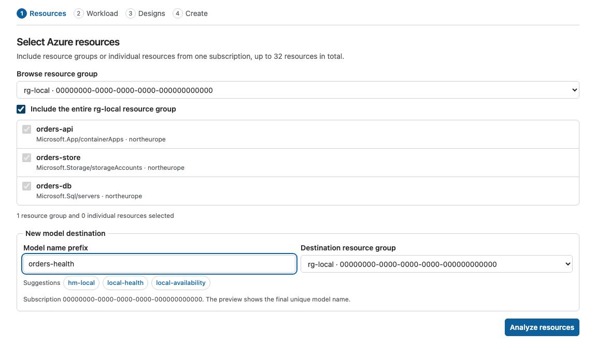

## Read the design before creating it

Select **Analyze resources**. Under **Workload**, inspect the CPU signal for `orders-api`. The sample in the plan is 12%. The card explains how the proposed model will evaluate future readings.

> Microsoft.App/containerApps · Average over 5 minutes. Unhealthy when above 80% (proposed threshold).

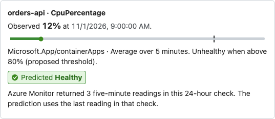

Select **Confirm and suggest models**, choose **Workload operation**, then **Preview selected model**. The preview flags gaps in signal coverage for `orders-store` and `orders-db`. Select **Complete an order** to see which component the flow depends on.

> Depends on Order processing.

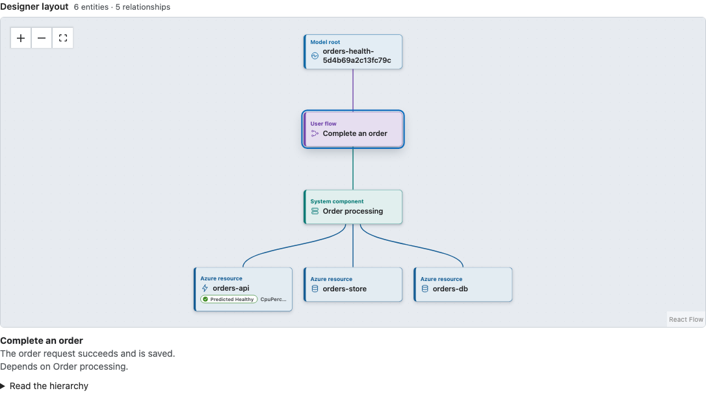

## Create the model and open its tour

Select **Create health model** and review the destination and signal sources. On an Azure deployment, analysis and design use the hosted agent and can incur charges. **Confirm creation in Azure** writes the model, its entities and signals to the destination group using your Azure permissions. In this example it writes them to the local fixture.

<details>
<summary>Watch the builder create the model (GIF)</summary>

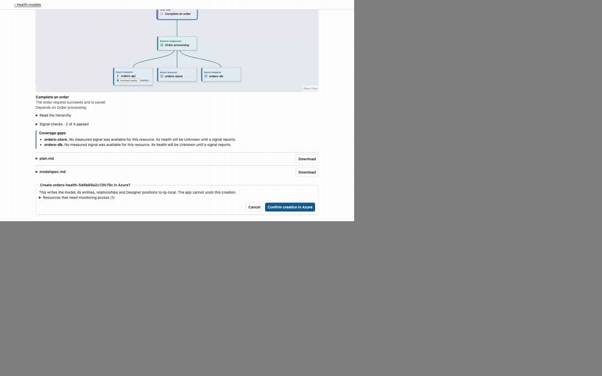

</details>

Once **Health model created** appears, select **Tour this model**. To take the same tour later, reopen the completed builder Session from **History** and use its receipt again.

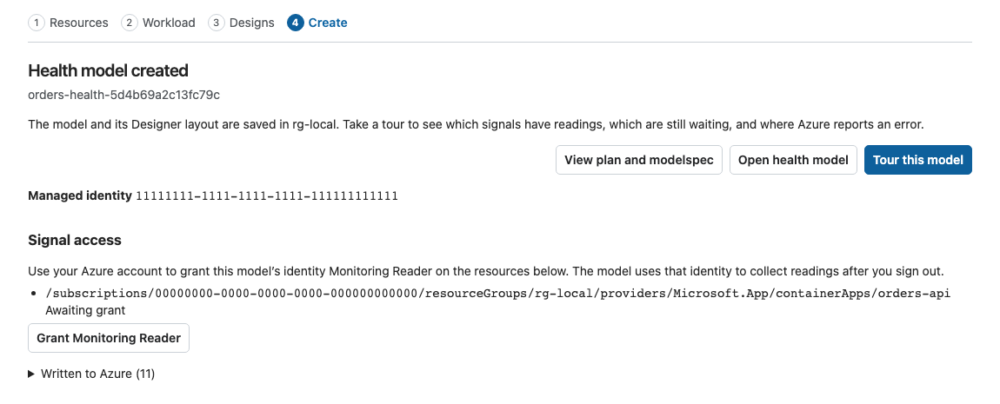

## Find the first reading

The tour opens the model named on your receipt. **Where next?** offers branches based on that model.

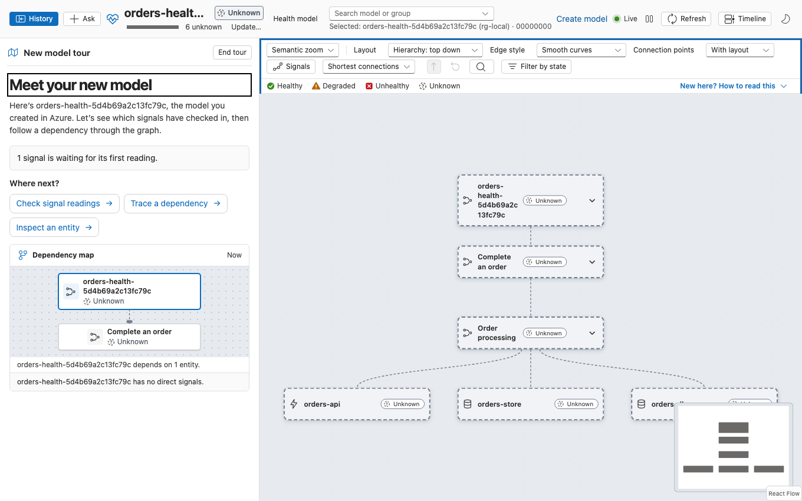

Choose **Trace a dependency**. The tour highlights the connection it describes and names both ends. Select **Back**, then choose **Check signal readings** to follow a different branch.

> orders-health-5d4b69a2c13fc79c depends on Complete an order. The highlighted line joins the two. A change in the child can help explain what you see higher up.

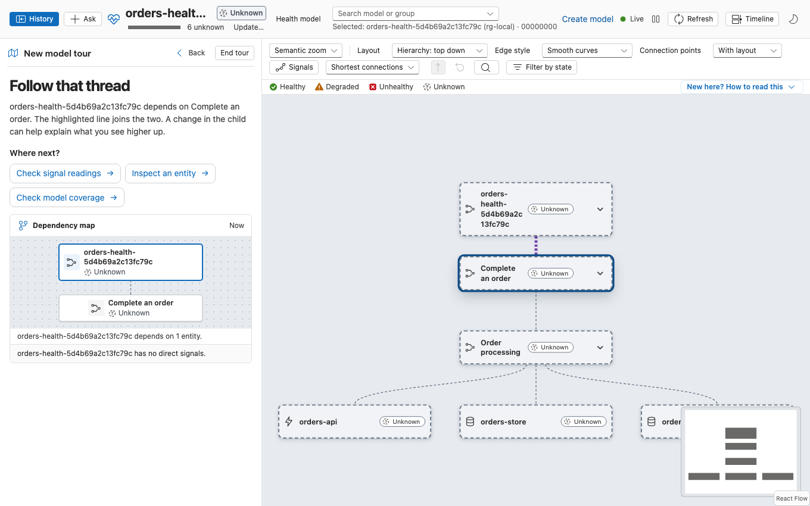

<details>
<summary>Watch the tour start and follow two branches (GIF)</summary>

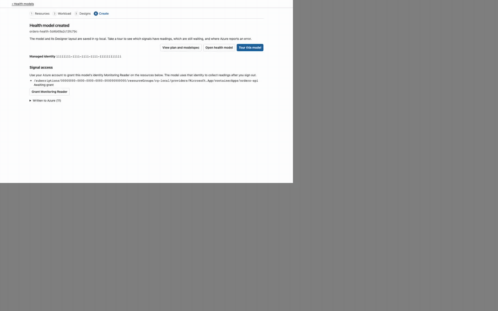

</details>

Look for `CpuPercentage` on `orders-api`. The builder has finished, but this signal still needs its first evaluation. Leave the tour open for live updates, or select **Check readings now** to refresh. If you have pinned a past moment, choose **Show latest readings** to return to the live model.

> 1 signal is waiting for its first reading.

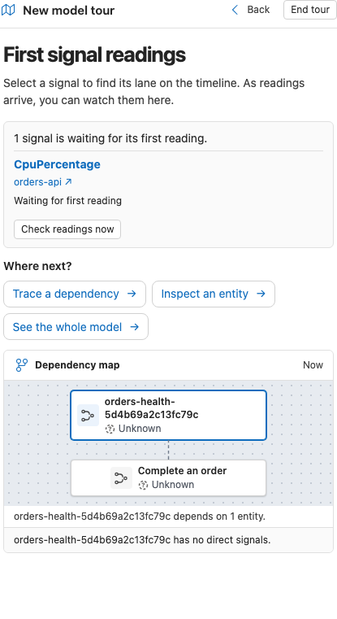

## Investigate an evaluation error

The example now simulates Azure denying a metric read. Expand **Azure error details** on the affected signal to see the operation and resource scope from the error message.

> Evaluation error · Azure couldn’t read this metric. Check that the signal points to the right resource and that the model identity has Monitoring Reader access there.

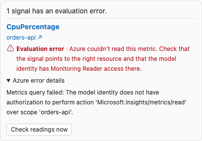

Select the signal name. The timeline opens the lane for that signal on that entity, even when another entity has a signal with the same name.

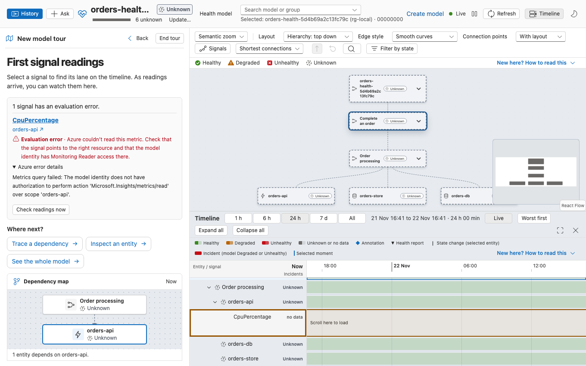

On a live deployment, check the resource named in the error. If the model identity needs **Monitoring Reader**, reopen the builder receipt and review **Signal access**. **Grant Monitoring Reader** uses your account to assign that role on the listed signal sources. You need permission to assign roles there. Then wait for a new evaluation or check the readings again.

<details>
<summary>Watch the signal error, timeline and recovery (GIF)</summary>

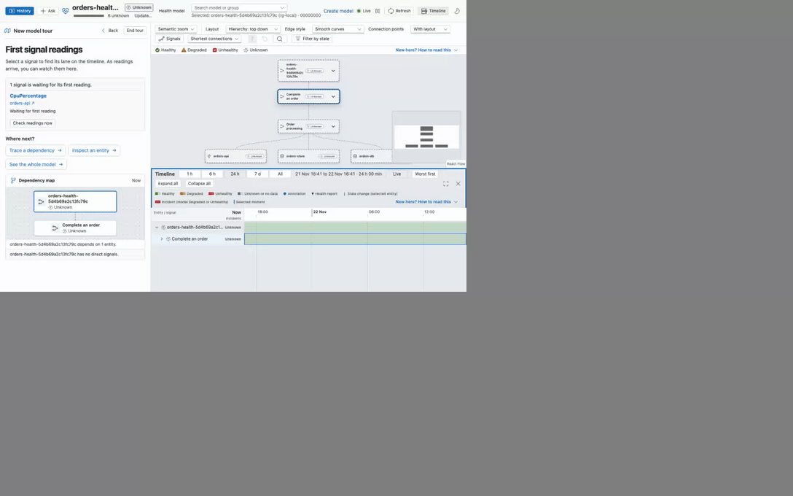

</details>

## Recognize recovery

In the recording, the next scripted evaluation reports zero. The tour removes the error and shows the measured value. For this CPU signal, zero falls in the healthy range.

> Reported · Healthy · 0

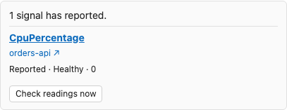

Choose **Back** to retrace your tour, try another suggestion, or select **End tour** to explore the model on your own.

## Regenerate the walkthrough

From the repository root, run the following command with Node.js 26, `uv`, `make` and FFmpeg (`ffmpeg` on your path).

```bash
make onboarding-tour
```

The command installs the project dependencies and Playwright Chromium, starts the local fixture app, and drives the builder and tour in a browser. Open `docs/onboarding/tour/README.md` for the refreshed screenshots, GIFs and excerpts. To try the app yourself, follow the [local startup instructions](https://github.com/abossard/ahm-model-demo/blob/main/docs/development.md#without-azure).

On GitHub, **Actions → Onboarding tour** runs when relevant files change on `main`. To regenerate it manually, choose **Run workflow**. Open a successful run and download the guide and media together under **Artifacts**. [Onboarding tour runs](https://github.com/abossard/ahm-model-demo/actions/workflows/onboarding-tour.yml)
