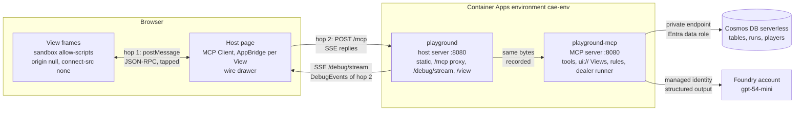
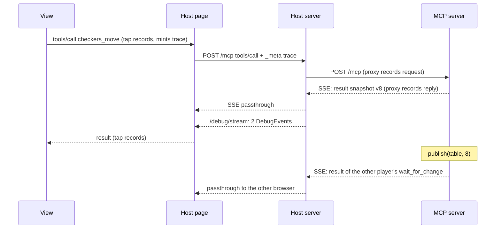

# MCP App Playground: architecture

The build contract for the playground of [vision.md](vision.md). Reasons are in ADR
[0012](../adr/0012-playground-as-two-public-apps-with-a-model-as-dealer.md),
[0013](../adr/0013-playground-state-in-cosmos-db-serverless.md) and
[0014](../adr/0014-a-view-learns-of-a-change-by-a-long-poll-tool.md).
Where this file and the code in `src/playground/contracts` disagree, the code wins.

## Decisions at a glance

- Two Container Apps in `cae-<env>`, both public, no sign-in: `playground` (host) and `playground-mcp` (MCP server).
- TypeScript on Node 24. One npm workspace at `src/playground`, one lockfile. Servers run their TypeScript with `tsx`, in development and in the container: no compile step, no stale `dist`.
- `@modelcontextprotocol/sdk` 1.32.2 and `@modelcontextprotocol/ext-apps` 1.7.5, the versions that the web UI already uses. `ext-apps` 2.x needs the split SDK packages and is out of scope.
- The browser is the MCP host: it runs the SDK `Client` and one `AppBridge` per View. The host server is a transparent proxy that records.
- The MCP server is stateless Streamable HTTP. Every reply is an SSE response on the POST. There is no session and no standalone GET stream.
- State: Azure Cosmos DB serverless, API for NoSQL, behind a private endpoint, Entra data role only. Local runs and tests use an in-memory adapter of the same `Store`.
- Live turns: the View calls the long-poll tool `wait_for_change`. An in-process emitter wakes it.
- The dealer: `gpt-54-mini` orders the shoe and plays the dealer's hand. Code checks every reply and never picks a card. A reply that fails is a misdeal: bets returned.
- Game rules are calculations in `mcp/src/games`. Actions live in `mcp/src/tables.ts` and the adapters. Views render snapshots and never work out a rule.

## Terms

| Term | Meaning |
|------|---------|
| Host | The page at `playground` in the browser. It owns the MCP client, the bridges and the wire drawer. |
| Host server | The Node process of `playground`: static files, the MCP proxy, the debug feed, the View documents. |
| View | A single-file HTML document served by the MCP server as a `ui://` resource and rendered in a sandboxed frame. |
| Layer | One of the five steps of the career. `LAYERS` in `contracts/src/career.ts`. |
| Job | The action that opens the next layer. |
| Table | One game in progress: a checkers game, a blackjack table, a Drift Ledger run. One document. |
| Snapshot | The whole table as one player may see it, with its `version`. Returned by every table tool. |
| Notice | A rule that did not apply ("not your turn"). Returned beside the unchanged snapshot. Not an error. |
| Wire | Every JSON-RPC message on both hops, as `DebugEvent`s. |
| Hop | `view-host` (postMessage) or `host-server` (HTTP and SSE). |
| Trace | One chain of cause: a click and every message it sets off, on both hops. |
| Dealer | The language model at the blackjack table. |
| Misdeal | A round ended without a result because the dealer failed. Bets returned. |

## Components



One turn at a table, with the two capture points:



## Layout and ownership

`WP` is the work package that owns the path. `me` is written and frozen (see [Frozen files](#frozen-files)).

```text
src/playground/
  package.json  package-lock.json  tsconfig.base.json  .dockerignore          me
  compose.yaml                                                                WP3
  contracts/                         @playground/contracts                    me
    src/ids.ts career.ts checkers.ts trader.ts blackjack.ts tools.ts wire.ts index.ts contracts.test.ts
  mcp/                               @playground/mcp
    package.json tsconfig.json                                                me
    Dockerfile                                                                WP3
    vitest.config.ts                                                          WP2
    src/ports.ts                     Store, Changes, Clock, GameRules, dealer  me
    src/games/                       calculations only                        WP1
      checkers.ts trader.ts blackjack.ts fakeDealer.ts rng.ts *.test.ts
    src/main.ts                      read config, wire adapters, listen       WP2
    src/config.ts log.ts
    src/http.ts                      express app: /mcp, /healthz
    src/tools.ts                     registers TOOLS, maps each to tables.ts
    src/tables.ts                    the one place rules meet store, clock, changes, dealer
    src/dealer.ts                    runs pending DealerRequests
    src/changes.ts                   in-process Changes
    src/careers.ts                   career per player, write-through cache
    src/views.ts                     reads views/dist/*.html, serves ui:// resources
    src/store/memory.ts cosmos.ts check.ts check.cli.ts *.test.ts
    src/llm/azure.ts fake.ts broken.ts
  host/                              @playground/host
    package.json tsconfig.json                                                me
    Dockerfile vite.config.ts                                                 WP3
    index.html                                                                WP4
    src/server/                      main.ts config.ts log.ts proxy.ts feed.ts views.ts sse.ts *.test.ts   WP3
    src/web/wire/                    wire.ts tap.ts mcp.ts mount.ts identity.ts index.ts *.test.ts         WP3
    src/web/                         main.tsx app/ ladder/ stage/ drawer/ lab/ design/                     WP4
  views/                             @playground/views
    package.json tsconfig.json                                                me
    vite.config.ts hello.html lab.html checkers.html                          WP5
    src/kit/ src/hello/ src/lab/ src/checkers/                                WP5
    trader.html blackjack.html src/trader/ src/blackjack/                     WP6
  e2e/                               @playground/e2e
    package.json tsconfig.json                                                me
    playwright.config.ts playwright.deployed.config.ts tests/ screenshots/    WP7
infra/modules/playground.bicep                                                me (validated)
infra/main.bicep  infra/main.parameters.json  infra/README.md  azure.yaml     WP3
Makefile  tests/test_infra.py  docs/development.md  AGENTS.md                 WP3
```

### Frozen files

- Frozen: `contracts/**`, `mcp/src/ports.ts`, every `package.json`, `package-lock.json`, `tsconfig*.json`, `infra/modules/playground.bicep`, this folder and the ADRs.
- No new dependencies and no `npm install`. `node_modules` is already installed from the lockfile. A fresh checkout runs `npm ci --prefix src/playground`.
- A package that needs a change to a frozen file adds one line to `docs/playground/contract-requests.md` (what, why, the workaround it used) and carries on with a local type. WP7 applies the requests.
- Imports are extensionless (`./tables`), `import type` for types (`verbatimModuleSyntax`). No enums, no namespaces, no parameter properties.

## Commands

| Command (from the repo root) | Does |
|------|------|
| `npm ci --prefix src/playground` | Install from the lockfile. |
| `npm run typecheck --prefix src/playground` | `tsc --noEmit` in every package. |
| `npm test --prefix src/playground` | vitest in every package. |
| `npm run build --prefix src/playground` | Build the five Views into `views/dist`, then the host page into `host/dist`. |
| `npm run dev --prefix src/playground` | MCP server on 8091, host server on 8090, vite on 5273 with a proxy to 8090. Memory store, fake dealer. |
| `npm run start --prefix src/playground` | Both servers from built assets. What e2e runs. |
| `npm run e2e --prefix src/playground` | Playwright against servers it starts on 18090 and 18091. |
| `npm run store-check -w @playground/mcp --prefix src/playground` | The store contract against `PLAYGROUND_STORE` (the emulator in `compose.yaml`). |
| `make playground-up` | `docker compose up --build`: the Cosmos emulator and both images, as they run in Azure. |

One package: `npm test -w @playground/mcp --prefix src/playground`. One file: `npx vitest run src/games/checkers.test.ts` inside the package.

## Configuration

### playground-mcp

| Variable | Local default | Azure | Meaning |
|----------|---------------|-------|---------|
| `PORT` | `8091` | `8080` | Listen port. |
| `PLAYGROUND_STORE` | `memory` | `cosmos` | `memory`, `emulator` or `cosmos`. |
| `COSMOS_ENDPOINT` | `http://localhost:8081` for `emulator` | account endpoint | Required for `cosmos`. |
| `COSMOS_DATABASE` | `playground` | `playground` | |
| `PLAYGROUND_LLM` | `fake` | `azure` | `fake` (known cards), `broken` (always invalid, for the misdeal test) or `azure`. |
| `DEALER_ENDPOINT` | none | `https://<foundry account>.openai.azure.com` | Required for `azure`. |
| `DEALER_DEPLOYMENT` | `gpt-54-mini` | `gpt-54-mini` | |
| `AZURE_CLIENT_ID` | none | client id of `id-<env>-playground-mcp` | Picked up by `DefaultAzureCredential`. |
| `VIEWS_DIR` | `../views/dist` from the package | `/app/views/dist` | Where the built Views are. |
| `LOG_LEVEL` | `debug` | `info` | |
| `PLAYGROUND_FAST` | unset | unset | `1` in e2e: betting 3 s, turn 5 s, settled 2 s, long-poll 5 s. Read once in `config.ts`. `tables.ts` passes `fast: true` in the options of `create`, and the game stores the shorter deadlines in its state. |

### playground (host)

| Variable | Local default | Azure | Meaning |
|----------|---------------|-------|---------|
| `PORT` | `8090` | `8080` | Listen port. |
| `MCP_URL` | `http://127.0.0.1:8091` | `https://<mcp fqdn>` | Origin of the MCP server. The proxy calls `${MCP_URL}/mcp`. |
| `WEB_DIR` | `dist` from the package | `/app/host/dist` | The built host page. |
| `LOG_LEVEL` | `debug` | `info` | |

A missing required variable stops the process at start with one line naming it.

### Health

- `GET /healthz` on both. Always 200 once the process listens, so a starting app is reachable and its state is readable.
- MCP: `{ ok, svc: "playground-mcp", store: { driver, ready, check }, llm: { driver, lastOk, lastError }, views: ["hello", ...], uptimeSec }`. `check` is `"passed"`, `"running"` or the first failed case of the store contract.
- Host: `{ ok, svc: "playground-host", mcp: { url, reachable }, feeds, uptimeSec }`. `reachable` is a cached 5 s probe of the MCP `/healthz`.
- `ok` is false while the store check has not passed. The deployed spec waits for `ok: true` on both.

## MCP server

### Transport

- `POST /mcp`: a new `McpServer` and a new `StreamableHTTPServerTransport({ sessionIdGenerator: undefined })` per request, `enableJsonResponse` left false. Body limit 256 KB.
- `GET /mcp` and `DELETE /mcp`: 405 with a JSON-RPC error body. The SDK client tries the GET after `initialize` and carries on. The wire drawer shows the 405, which is the truth about a stateless server.
- Capabilities: `tools`, `resources`, `logging`, and `extensions["io.modelcontextprotocol/ui"] = { mimeTypes: ["text/html;profile=mcp-app"] }`.
- Views: `registerAppResource` for each of `VIEWS`, read from `VIEWS_DIR/<name>.html` at start, `_meta.ui = { csp: {}, prefersBorder: false }`. A missing file fails `/healthz` and logs which.
- One more resource for the Lab: `playground://lab/notes`, `text/markdown`, a short static text.
- No CORS headers. The browser only ever calls the host origin.

### Tools

Names, input and output schemas are `TOOLS` in `contracts/src/tools.ts`. `tools.ts` in the server loops over it: `registerAppTool(server, name, { title, description, inputSchema: spec.input.shape, outputSchema: spec.output.shape, annotations: { readOnlyHint: spec.readOnly }, _meta: toolMeta(name) }, handler)`.

| Tool | View | Visibility | Input (besides `player`) | Output | Notes |
|------|------|-----------|--------------------------|--------|-------|
| `career_get` | none | model, app | | `{ career }` | Called by the host on load. |
| `career_cheat` | none | model, app | `code` | `{ career, notice }` | Wrong code: notice `bad_code`. |
| `hello_show` | hello | model, app | `name?` | `{ greeting, serverTime, pings }` | Entry tool of layer 1. |
| `hello_ping` | hello | app | | `{ pings, serverTime }` | The job of layer 1. |
| `lab_open` | lab | model, app | | `{ exhibits, done }` | Entry tool of layer 2. |
| `lab_echo` | lab | app | `text` | `{ text, length, serverTime }` | |
| `lab_countdown` | lab | app | `from` 1..10 | `{ ticks }` | One `notifications/progress` every 400 ms when the request has a `progressToken`. |
| `lab_checkpoint` | lab | app | `exhibit` | `{ done }` | Three distinct exhibits are the job of layer 2. |
| `table_list` | none | app | `game` (no `player`) | `{ tables }` | Newest 30. |
| `wait_for_change` | none | app | `tableId`, `sinceVersion` | `{ changed, snapshot, notice }` | Long-poll, at most 25 s. Checkers and blackjack. |
| `checkers_open` | checkers | model, app | `tableId?` | `{ lobby, snapshot, notice }` | Entry tool of layer 3. |
| `checkers_create` | checkers | app | `opponent` | `{ snapshot, notice }` | Creator is black. |
| `checkers_join` | checkers | app | `tableId` | `{ snapshot, notice }` | Takes white, else watches. |
| `checkers_move` | checkers | app | `tableId`, `version`, `from`, `path` | `{ snapshot, notice }` | A capture is the job of layer 3. |
| `checkers_resign` | checkers | app | `tableId` | `{ snapshot, notice }` | |
| `trader_open` | trader | model, app | | `{ snapshot, notice }` | Entry tool of layer 4. Starts a run when there is none. |
| `trader_buy`, `trader_sell` | trader | app | `good`, `qty` | `{ snapshot, notice }` | A sale above average cost is the job of layer 4. |
| `trader_travel` | trader | app | `to` | `{ snapshot, notice }` | |
| `trader_refuel` | trader | app | `units` | `{ snapshot, notice }` | |
| `trader_new_run` | trader | app | | `{ snapshot, notice }` | |
| `trader_scores` | trader | app | none | `{ scores }` | Ten richest of the newest 200 runs. |
| `blackjack_open` | blackjack | model, app | `tableId?` | `{ lobby, snapshot, notice }` | Entry tool of layer 5. |
| `blackjack_create` | blackjack | app | `title?` | `{ snapshot, notice }` | Creator takes seat 0. |
| `blackjack_sit`, `blackjack_leave` | blackjack | app | `tableId` | `{ snapshot, notice }` | |
| `blackjack_bet` | blackjack | app | `tableId`, `amount` | `{ snapshot, notice }` | |
| `blackjack_act` | blackjack | app | `tableId`, `action` | `{ snapshot, notice }` | `hit`, `stand`, `double`. A win is the last job. |

Rules every handler follows:

- The result is `{ structuredContent: <output>, content: [{ type: "text", text: <one plain sentence> }], _meta }`.
- Every tool that takes `player` puts the caller's career in `_meta["playground/career"]`, every time. The host compares it with its copy and shows the unlock band when it grew.
- A rule that does not apply is a `notice` beside the current snapshot, `isError` false. Examples: a move out of turn, a stale `version`, a bet outside the limits (fitted to them, no notice), a full table (you watch), an unknown or expired table (`snapshot: null`, notice `table_gone`).
- `isError: true` has one cause: the store or the process cannot serve (`"The table store is not ready. Try again."`). Nothing that a player does can produce it.
- Input the schema rejects is the SDK's protocol error. A View never sends it, because it builds arguments from `ToolInput<N>`.
- Each handler logs one line: `{ msg: "tool", tool, ms, sid, trace, player, table, version, outcome }`, `outcome` being `ok`, `notice:<code>` or `error`.

### tables.ts

The deep module. Tools call five functions and use no store, version, clock or dealer directly.

```ts
interface Tables {
  open(game: GameId, player: Player, tableId?: string): Promise<{ lobby: LobbyRow[]; snapshot: Snapshot | null; notice: Notice | null }>;
  create(game: GameId, player: Player, options: Record<string, unknown>): Promise<TableResult>;
  act(game: GameId, tableId: string, action: unknown, player: Player, expectVersion?: number): Promise<TableResult>;
  wait(tableId: string, sinceVersion: number, player: Player, signal: AbortSignal): Promise<TableResult & { changed: boolean }>;
  list(game: GameId): Promise<LobbyRow[]>;
}
```

- Table ids: `c` or `b` and nine base-36 characters for checkers and blackjack, so `wait` knows the game from the id. A Drift Ledger run uses the player id.
- Kinds: checkers and blackjack tables are `tables` with partition key the game, runs are `runs` with partition key `trader`, players are `players` with partition key the player id.
- `act` is one `store.update`: `body => rules.apply(rules.tick(body, now).state, action, player, now).state`. The clock is read once before the update. The update keeps the notice and the events of the last run of the calculation.
- `expectVersion` differing from the stored version returns notice `stale` and the current snapshot without calling the rules.
- After a commit: `changes.publish(tableId, version)`, then each event to `careers.advance(playerId, event)`, then `dealer.kick(tableId)` when the rules report a pending request.
- `create` checks the lobby size against `TABLE_LIMITS` and answers `city_full` at the cap.
- `wait`: read, tick, commit if the tick changed something. Newer than `sinceVersion`: return now. Else `changes.next(tableId, min(now + 25 s, nextDeadline + 50 ms), signal)`, then read, tick and return. More than `MAX_WAITERS` open waits: return at once with `changed: false`, and the View's loop backs off.
- `open` with a table id returns that snapshot, and starts the dealer (`kick`) if a request is pending and no runner is active, which is how a table recovers after a restart.

### Store

`Store` in `mcp/src/ports.ts`: `get`, `update`, `list`, `remove`. `update` is the only writer and hides the compare-and-swap.

- Document: `{ id, pk, version, updatedAt, body }`. `version` starts at 1 and grows by one per commit. `updatedAt` is epoch ms.
- `memory.ts`: a `Map` per kind. Expiry is checked on read: `updatedAt + TTL_SECONDS[kind] * 1000 < now` reads as absent. Bodies are `structuredClone`d in and out, so a caller cannot change stored state by reference.
- `cosmos.ts`: `new CosmosClient({ endpoint, aadCredentials: new DefaultAzureCredential() })`, containers `tables`, `runs`, `players` of database `COSMOS_DATABASE`, partition key `/pk`.
  - `get`: `container.item(id, pk).read()`, 404 is null.
  - `update`: read, run `change`. Null or the same reference: return what was read. New document: `items.create`, and 409 starts over. Existing: `item.replace(next, { accessCondition: { type: "IfMatch", condition: etag } })`, and 412 starts over. Six rounds with 10 to 60 ms of jitter, then `StoreBusy`.
  - `list`: `SELECT TOP @n * FROM c WHERE c.pk = @pk ORDER BY c.updatedAt DESC`, with `partitionKey: pk`.
  - The containers index `/updatedAt` only, and carry the TTL. The adapter creates nothing: its role cannot.
- `emulator`: the same adapter with `{ endpoint, key: <the public emulator key>, connectionPolicy: { enableEndpointDiscovery: false } }`, and it creates the database and containers if missing.
- `check.ts`: `checkStore(store): Promise<string | null>`, the store contract as one function over the interface. Cases: create then get, update bumps the version by one, an unchanged `change` writes nothing, two interleaved updates both land (the second re-runs), list returns one partition newest first, remove then get is null. It writes under `pk = "selfcheck"` in `tables` and removes what it wrote.
  - vitest runs it against `memory`.
  - `check.cli.ts` runs it against `PLAYGROUND_STORE` and exits non-zero on a failure.
  - `main.ts` runs it at start and every 10 s until it passes, and reports it on `/healthz`. A role assignment that has not spread yet shows as `check: "... 403 ..."` and clears by itself.

### Changes

`changes.ts`: a `Map<tableId, Set<resolver>>`. `publish` resolves and clears the set. `next` adds a resolver, a timer for the deadline and an abort listener, and removes all three whichever fires first. One process, one writer: ADR 0014.

### Careers

`careers.ts`: `get(player)` and `advance(playerId, event)`. Both go through `store.update("players", id, id, ...)` with `advanceCareer` from the contracts. A `Map` of at most 5,000 careers caches reads and is written through on change. `get` also keeps the stored handle current.

### The dealer runner

`dealer.ts`: `kick(tableId)`, one run per table at a time.

```text
loop
  read the table; request = rules.pending(state); none: stop
  over DEALER_LIMITS.perMinute in this process: resolve "unavailable", continue
  attempt 1..2:
    reply = llm.ask(request, prompt, AbortSignal.timeout(8000))      prompt = rules.prompt(request)
    problems = rules.validate(request, reply.output)                  attempt 2 adds "Your last reply was rejected: ..." to the user text
    none: stop attempts
  store.update: rules.resolve(state, request.id, reply or "invalid" or "unavailable", attempts, now)
  publish
```

- `llm/azure.ts`: `POST ${DEALER_ENDPOINT}/openai/deployments/${DEALER_DEPLOYMENT}/chat/completions?api-version=2024-10-21`, bearer token for `https://cognitiveservices.azure.com/.default`, body `{ messages, response_format: { type: "json_schema", json_schema: { name: "dealer", strict: true, schema: DEALER_OUTPUT_SCHEMA } }, max_completion_tokens: 2000, reasoning_effort: "low" }`. Plain `fetch`, no client library. This exact request was run against the deployed model: 200, valid JSON, under one second of model time.
- The adapter parses `choices[0].message.content` and rejects anything that is not `{ cards: string[], action, say }`. Token counts and time go to the log line `{ msg: "llm", kind, attempt, ok, ms, table, promptTokens, completionTokens }`.
- `llm/fake.ts` answers from `games/fakeDealer.ts`. `llm/broken.ts` answers `{ cards: ["ZZ"], action: "hit", say: "" }`.

## Rules

All of `mcp/src/games` is calculations: no clock, no randomness, no I/O, no imports outside the contracts and `ports.ts`. Time comes in as `now`, randomness as `seed`. State types are private to each file. Every game exports one object typed by `ports.ts` (`CheckersRules<S>`, `TraderRules<S>`, `BlackjackRules<S>`). `rng.ts` is `mulberry32(seed)` and a string hash.

### Checkers

- Board, squares and `Move` as in `contracts/src/checkers.ts`. Black moves first.
- `legalMoves(board, color)`: if any jump exists, only jump sequences are legal. A sequence continues from each landing square until no jump is left, and every branch is its own move. A man that reaches the far row is crowned and its move ends there.
- Men step and jump forward only. Kings step and jump one square in all four directions.
- `apply(move)`: the move must equal one of `legalMoves` in `from` and `path`. Else notice `illegal_move`. Not your colour's turn: `not_your_turn`. White not seated yet: `wrong_phase`.
- A capture emits `{ playerId, event: { type: "checkers_capture" } }` for the mover (`PlayerEvent` in `ports.ts`). The bot earns nothing.
- Over when the side to move has no pieces (`no_pieces`) or no legal move (`no_moves`), on `resign`, on 80 plies without a capture or a crowning (`draw_rule`), or when the turn deadline of 120 s passes (`timeout`, by `tick`).
- The house bot is white with id `house-bot`. After a human move, `apply` plays the bot's reply in the same step: the jump sequence with the most captures, else a move that crowns, else the first legal move by `from` then `path`.
- `view`: `legal` only for the viewer whose turn it is. `lastMoves` holds the last one or two moves.
- Tests, each one `it.each` table: opening has seven legal moves for black, a forced capture removes every other move, a double jump is one move and its half is illegal, crowning ends a jump, kings move backward, each way a game ends, the bot's choice for five fixed boards.

### Drift Ledger

- Map, goods and limits as in `contracts/src/trader.ts`. State: seed, day, credits, fuel, location, cargo with average cost per good, profitable sales, log.
- Distance is the straight line on the 100 by 100 map. `fuelCost = max(1, round(distance / 8))`, `days = max(1, round(distance / 16))`.
- `price = max(1, round(base * affinity[planet][good] * (1 + 0.15 * noise)))`, `noise` in -1..1 from `mulberry32(seed ^ hash(planet, good, day))`. Prices change only when the day does.
- Affinity (below 1 is where a good is made):

| | ice | seed | salt | glass | gel |
|--|--|--|--|--|--|
| vesper | 1.10 | 1.15 | 1.45 | 1.15 | 1.10 |
| kiln | 1.60 | 1.20 | 1.30 | 0.60 | 1.20 |
| tallow | 1.00 | 0.55 | 1.00 | 1.30 | 1.35 |
| brine | 0.55 | 1.05 | 1.10 | 1.10 | 1.00 |
| halcyon | 1.25 | 1.50 | 1.20 | 1.55 | 0.70 |
| cinder | 1.40 | 1.45 | 0.60 | 1.00 | 1.50 |

- Fuel price per unit: vesper 4, brine 6, kiln 7, tallow 7, halcyon 9, cinder 8.
- `buy` and `refuel` are fitted to what the credits and the space allow. Nothing fits: `insufficient_funds` or `cargo_full`. `sell` is fitted to what is held, none held: `not_enough_cargo`.
- A sale above the average cost of the units sold adds to `profitableSales` and emits `trader_profit`.
- `travel`: `same_planet`, `not_enough_fuel`, else fuel and days pass. Reaching day 30 ends the run. Every action but `new_run` on an ended run: `run_over`.
- `netWorth = credits + sum(held * local price)`. The view carries `pilot`, the handle the run was started under. `trader_scores` lists the newest 200 runs, takes `pilot`, `netWorth` and `day` from each view and returns the ten richest.
- Tests: the price table for one seed and three days, every planet has a good that sells dearer somewhere else, fitting of buy, sell and refuel, average cost over two buys, the profit event, the run ending.

### Blackjack

Six seats, a four-deck shoe, bets 10 to 500 in steps of 10, 1,000 chips on sitting down, hit, stand and double. No split, no insurance.

What the model does, and what code does:

- The model orders the shoe (`shuffle`): it gets how many copies of each card are left and returns `count` cards in order. It does not know who gets which card.
- The model plays the dealer's hand (`decide`): it gets its own cards and the totals still in play, and returns `hit` or `stand`. It does not know the next card. The prompt names the house custom (draw to 16, stand on 17) and says the choice is the dealer's.
- Code deals from the ordered slice, adds up hands, and pays. It never picks a card and never decides for the dealer.
- `validate`: a shuffle must have exactly `count` cards, each a card code, together not more copies than `remaining`. A decide must have no cards, and must be `stand` once the dealer has hit five times. `say` is cut to 120 characters, never a reason to reject.

| Phase | Entered when | In it | Leaves when |
|-------|--------------|-------|-------------|
| `waiting` | Table created, or a round was cleared | Sit, leave, bet. Seats with no chips get 1,000 back. | The first bet: `betting`, deadline now + 15 s. |
| `betting` | First bet | Bets placed and changed, fitted to the limits and the chips | Every seated player has bet, or the deadline (`tick`): `shuffling`. A seat without a bet sits the round out, and is unseated after two in a row. |
| `shuffling` | Bets closed, or the slice ran out | `pending` is a `shuffle` for `min(40, 5 * bettors + 5)` cards (10 mid-round). The shoe is renewed first when fewer than 60 cards are left. | `resolve`: at the start of a round, deal seat by seat then the dealer, twice. A dealer natural settles at once. Else `players`. Mid-round: back to the phase that needed a card. |
| `players` | Dealt | The seat at `turn` acts. 21 stands by itself, over 21 is bust, `double` needs two cards and the chips. | Each seat done or its 20 s deadline passed (`tick` stands for it). All bust or natural: `settled`. Else `dealer`. |
| `dealer` | Players done | Hole card shown. `pending` is a `decide`. `hit` draws the next card and asks again. | `stand`, bust, or five hits: `settled`. |
| `settled` | Round over | Natural pays 3 to 2 rounded down, a win 1 to 1, a push 0. `blackjack_win` for each winning seat. | Deadline now + 6 s (`tick`): hands cleared, `round + 1`, `waiting`. |

- Misdeal: `resolve` with `"invalid"` or `"unavailable"`, a `pending` older than 25 s (`tick`), more than 10 requests in the round, or more than 120 in the table's hour. The round goes to `settled` with `misdeal: true`, every outcome `misdeal`, every delta 0.
- `view` hides the hole card as `"??"` until the dealer phase, never includes the slice, and shows `dealerLog` without undealt cards: `note` is "ordered 15 cards", "hit on 14", "reply rejected: KS is not left in the shoe".
- A `hit` while a shuffle is pending answers `dealer_busy`.
- `fakeDealer(request)`: shuffle walks `T 7 9 5 K 6 A 8 3 Q 4 2 J` across suits `S H D C`, starting at `(cards left in the shoe) mod 52` and skipping cards that are gone. Decide hits below 17. So the hands in a test are known in advance.
- Tests: totals with soft aces, the deal order for one, two and six bettors, each `validate` problem, each row of the phase table, the misdeal causes, payouts including 3 to 2 on an odd bet, the view never leaking the hole card or the slice (asserted for every phase), `fakeDealer` always passing `validate`.

## Host server

Express 5, four routes and static files.

| Route | Does |
|-------|------|
| `ALL /mcp` | Proxy to `${MCP_URL}/mcp`. Records hop 2. |
| `GET /debug/stream?sid=` | SSE feed of that tab's hop-2 `DebugEvent`s. |
| `GET /view/:sha256` | A View document the proxy relayed, with the View policy. |
| `GET /healthz` | Health. |
| everything else | `WEB_DIR`, falling back to `index.html`, with the page policy. |

- Page policy: `default-src 'self'; script-src 'self'; style-src 'self' 'unsafe-inline'; font-src 'self'; img-src 'self' data:; connect-src 'self'; frame-src 'self'; base-uri 'none'; form-action 'none'; frame-ancestors 'none'`.
- View policy: `default-src 'none'; script-src 'unsafe-inline'; style-src 'unsafe-inline'; img-src data:; font-src data:; connect-src 'none'; base-uri 'none'; form-action 'none'; frame-ancestors 'self'; sandbox allow-scripts`. The frame also has `sandbox="allow-scripts"` and `referrerpolicy="no-referrer"`.

### proxy.ts

- Reads the body raw (`express.raw({ type: "*/*", limit: "1mb" })`), forwards the same bytes with `content-type`, `accept`, `mcp-protocol-version`, `mcp-session-id`, `last-event-id` and `x-playground-sid`. Aborts the upstream call when the browser goes away, which is how a cancelled long-poll frees its waiter.
- Request body: each JSON-RPC message in it becomes a `DebugEvent` (`toDebugEvent`, `from: "host", to: "server"`) before the upstream call starts.
- Response `application/json`: each message becomes an event, the bytes pass through.
- Response `text/event-stream`: headers are flushed at once, chunks are written through as they arrive, and `sse.ts` (a calculation: chunks in, complete events out) yields each `data:` payload, which becomes an event at the moment it arrived, with `http.streamed: true`.
- Anything else (202 for a notification, 405 for the GET): one `toHttpEvent`.
- Every event passes through one `createPairing()` per tab, then goes to `feed.publish(sid, event)` and to the log as `{ t, level, svc: "playground-host", msg: "wire", ...wireFields(event) }`.
- A View document: a `resources/read` result with a content of `mimeType` `text/html;profile=mcp-app` is stored in `views.ts` under the SHA-256 of its text, 50 documents at most. The proxy relays, it never fetches by itself.
- No `x-playground-sid`: the request is proxied and logged with `sid: "none"`, and no feed gets it.
- Upstream unreachable: 502 with a JSON-RPC error body, and an `http` event with status 502.

### feed.ts

- Per `sid` (`/^[a-z0-9-]{8,40}$/`): a ring of the last 500 events and the open SSE responses. Events are kept whether or not a feed is open, so a feed that opens late replays.
- `GET /debug/stream`: `id: <seq>`, `event: wire`, `data: <DebugEvent JSON>`. Replays after `Last-Event-ID`. A comment line every 15 s keeps the ingress from closing the stream as idle.
- At most 300 tabs, the least recently active dropped first. A tab is dropped after 10 minutes with no traffic and no feed.

## Host page

### wire core (`host/src/web/wire`, WP3)

The plumbing that WP4 builds on. Nothing in it renders.

```ts
// identity.ts: the player and the career copy in localStorage (playground.player, playground.career)
getPlayer(): Player
// wire.ts: the events of this tab
interface Wire {
  sid: string;
  events(): readonly DebugEvent[];                 // newest 2,000
  subscribe(listener: () => void): () => void;     // for useSyncExternalStore
  record(event: DebugEvent): void;                 // pairs, stores, writes wireLine(event) to the console
  setPaused(paused: boolean): void;                // paused: events are kept in a side buffer, the list does not change
  clear(): void;
}
createWire(): Wire                                 // also opens EventSource(/debug/stream?sid=...)
// mcp.ts: one MCP client per tab
connect(wire: Wire): Promise<Client>               // StreamableHTTPClientTransport("/mcp", { requestInit: { headers: { "x-playground-sid": sid } } })
callTool<N extends ToolName>(client, wire, name: N, args: ToolInput<N>, trace?: string):
  Promise<{ output: ToolOutput<N>; career: Career | null; result: CallToolResult }>
// mount.ts: one View in one frame
mountView(options: {
  client: Client; wire: Wire; frame: HTMLIFrameElement; tool: ToolName; args: Record<string, unknown>;
  theme: "light" | "dark";
  onHost(event: HostEvent): void;                  // what the View asked of the host
}): Promise<{ viewId: string; setTheme(theme): void; viewTools(): Promise<Tool[]>; callViewTool(name, args): Promise<CallToolResult>; close(): Promise<void> }>
type HostEvent =
  | { type: "ready" } | { type: "size"; height: number } | { type: "career"; career: Career }
  | { type: "message"; text: string } | { type: "context"; value: unknown } | { type: "link"; url: string }
  | { type: "display"; mode: "inline" | "fullscreen" } | { type: "log"; level: string; data: unknown }
  | { type: "error"; message: string };
```

`mountView` in order:

1. `tools/list` (cached per tab), find the tool, read `_meta.ui.resourceUri`.
2. `resources/read` of that URI. The proxy keeps the document.
3. SHA-256 of the text in the browser. `new AppBridge(client, { name: "MCP App Playground", version: "1" }, { openLinks: {}, serverTools: {}, serverResources: {}, logging: {}, message: { text: {} }, updateModelContext: { text: {}, structuredContent: {} } }, { hostContext: { theme, displayMode: "inline", availableDisplayModes: ["inline", "fullscreen"] } })`.
4. `bridge.connect(tap(new PostMessageTransport(frame.contentWindow, frame.contentWindow), ...))`, then `frame.src = "/view/" + digest`. This order is the one `src/web/ui/src/diagram/DiagramHost.tsx` uses.
5. `bridge.oninitialized`: `sendToolInput({ arguments: args })`, call the entry tool through `callTool`, `sendToolResult(result)`.
6. Handlers: `onsizechange`, `onmessage`, `onupdatemodelcontext`, `onopenlink` (https only, the page confirms, then `window.open` with `noopener`), `onrequestdisplaymode`, `onloggingmessage`. Each calls `onHost`.
7. `bridge.oncalltool` is replaced so that the View's call carries the trace and its progress comes back:
   - the trace of the View's request is looked up by `extra.requestId` and sent as `_meta["playground/trace"]`
   - if the View sent a `progressToken`, the host passes `onprogress` to `client.callTool` and relays each one with `extra.sendNotification({ method: "notifications/progress", params: { ...progress, progressToken } })`
   - the career in the result's `_meta` goes to `onHost`
8. `close`: `bridge.teardownResource({})` with a 500 ms limit, then `bridge.close()`.

`tap.ts` wraps any `Transport`: `send` records `host → view`, `onmessage` records `view → host`, both with `toDebugEvent` and the `viewId`. It mints a trace for each request from the View and keeps it by `rpcId`. Messages that the host starts (tool input, tool result) carry the trace of the entry call.

### UI (`host/src/web`, WP4)

- Routes, by the History API with a 30-line router: `/`, `/briefing`, `/lab`, `/checkers`, `/checkers/:tableId`, `/trader`, `/blackjack`, `/blackjack/:tableId`.
- State in one zustand store: `player`, `career`, `route`, `drawer`, `offer`, `hostLog`. Only `app/actions.ts` calls the wire core. Components read state and call actions.
- `ladder/`: the home collage and the rail. `stage/`: `ViewFrame` (the chrome and `mountView`), `UnlockBand`, `OfferCard`, `HostLog` (what the View asked of the host). `lab/`: `ToolRunner` (a list of tools as a model would see them and as app-only, a JSON editor seeded from the input schema, and the raw result) and the list of tools the View offers. `drawer/`: `WireDrawer`, `Lanes`, `MessageDetail`, `Filters`, `JsonTree`. `design/`: `tokens.css`, `fonts.css`, base components.
- The table id in the URL: a game View tells the host which table it is on with `app.updateModelContext({ structuredContent: { tableId } })`. The host puts it in the URL and offers "Copy invite link" in the frame chrome. A route with a table id passes it to the entry tool.
- The cheat: a key listener outside inputs matches `opencity` and calls `career_cheat`.
- Selectors that the e2e tests rely on: `data-testid` `ladder`, `rung-1`..`rung-5` with `data-state="open|locked"`, `view-frame` (the iframe), `unlock-band`, `offer-go`, `offer-stay`, `wire-chip`, `wire-drawer`, `wire-row` with `data-hop`, `data-kind`, `data-method`, `data-tool`, `wire-detail`, `wire-pause`, `wire-clear`, `wire-filter-text`, `wire-filter-hop`, `wire-copy`, `host-log`, `invite-link`, `tool-runner`.

## Views

Single-file HTML, React 19, built one at a time by `vite` with `vite-plugin-singlefile` (`VIEW=<name> vite build`, input `<name>.html`, `emptyOutDir: false`). Fonts are inlined as data URLs, Latin subset only. A View has no storage and no network: its origin is opaque and its policy forbids both.

### kit (`views/src/kit`, WP5, used by WP6)

```ts
connect(name: string): Promise<{ app: App; args: Record<string, unknown>; first: CallToolResult; theme: "light" | "dark" }>
  // registers ontoolinput and ontoolresult before app.connect(), resolves when both have arrived
call<N extends ToolName>(app: App, name: N, args: ToolInput<N>): Promise<ToolOutput<N>>
  // app.callServerTool, throws on isError with the text of the result
useTable<S extends LiveSnapshot>(app: App, player: Player, initial: S | null):
  { snapshot: S | null; notice: Notice | null; busy: boolean; offline: boolean; act<N extends ToolName>(name: N, args: ToolInput<N>): Promise<void>; leave(): void }
  // act: call, then take the snapshot and the notice of the answer
  // the loop: wait_for_change(tableId, sinceVersion) with a 40 s limit, again at once after an answer,
  // after 1, 2, then 5 s on a failure. A snapshot is taken only if its version is newer.
tokens.css fonts.css Frame Button NoticeBar Lobby
```

- The player comes from the entry tool's arguments (`args.player`). The host owns identity.
- Every View calls `app.updateModelContext` when its table changes, and handles `onhostcontextchanged` for the theme.
- Views use `autoResize`. Views ask for 1600 px of height at most and scroll inside.
- Selectors for e2e: hello `hello-ping`; lab `exhibit-<id>` and `exhibit-<id>-done`; lobby `lobby-create`, `lobby-create-bot`, `lobby-row`; checkers `square-<n>` with `data-piece`, `data-legal`, `turn`, `status`; trader `planet-<id>`, `buy-<good>`, `sell-<good>`, `credits`, `day`, `fuel`; blackjack `seat-<n>`, `bet-<amount>`, `act-hit`, `act-stand`, `act-double`, `phase`, `dealer-cards`, `dealer-log`, `chips`.

## The wire

The most important feature. One event type, two recorders, one drawer.

| Hop | Recorder | Where | Sees |
|-----|----------|-------|------|
| `view-host` | `tap.ts` | Browser, around `PostMessageTransport` | Every message of every View, both directions, the moment it is sent or received. |
| `host-server` | `proxy.ts` | Host server | Every HTTP exchange with the MCP server and every JSON-RPC message in it, with real bytes, status, and whether it arrived on a stream. |

- `DebugEvent`, `classify`, `clip`, `toDebugEvent`, `toHttpEvent`, `createPairing`, `wireLine` and `wireFields` are in `contracts/src/wire.ts`. Both recorders use them, so the shape cannot drift.
- Strings over 2,000 characters are shortened in the event (`truncated: true`), `bytes` keeps the real size. A View document is 300 KB of HTML and would fill the feed.
- Hop 2 reaches the drawer through `GET /debug/stream`. Hop 1 is recorded in the same tab and needs no round trip.
- Order in the drawer is arrival order. Each row shows the recorder's clock. The two clocks differ, so durations are only computed within one hop.
- Correlation:
  - `sid`: one browser tab. The header `x-playground-sid` on every MCP request, the query of the feed, a field of every log line of both servers.
  - `trace`: minted by the tap for a View request, or by `callTool` for a host call. Travels in `params._meta["playground/trace"]`, so the proxy and the MCP server read it from the message itself.
  - `rpcId`: pairs a reply with its request on one hop. The View and the host number their requests separately, which is why the two hops of one call have different ids and need the trace.
- Console in the browser: `console.debug(wireLine(event), event)`, so the line is greppable and the object opens. One group per View mount.
- Console of the servers: one JSON line per message or action on stdout. Fields: `t` (ISO), `level`, `svc`, `msg`, then the fields of that `msg`. The `msg` values: `wire`, `tool`, `llm`, `store` (debug level), `store.check`, `dealer`, `start`, `error`. Container Apps ships stdout to `ContainerAppConsoleLogs_CL` in `law-<env>`. No telemetry SDK: Application Insights here accepts only Entra tokens.
- To follow one click across everything: copy the trace from the drawer, then `ContainerAppConsoleLogs_CL | where Log_s has "<trace>"`.

## Infrastructure and deploy

`infra/modules/playground.bicep` is written and has passed `az deployment group validate` against the demo's resource group (17 resources, no policy denial).

- Parameters: `location`, `namePrefix`, `resourceToken`, `tags`, `environmentId`, `registryName`, `foundryAccountName`, `vnetId`, `privateEndpointSubnetId`, and optional `modelDeploymentName`, `playgroundImage`, `playgroundMcpImage`, `placeholderImage`.
- Creates: two identities (`id-<env>-playground` pulls images only, `id-<env>-playground-mcp` also holds Cognitive Services OpenAI User on the Foundry account and Cosmos DB Built-in Data Contributor on the account), the Cosmos account `cosmos-<env>-<token>` (serverless, `disableLocalAuth`, `publicNetworkAccess: Disabled`), database `playground`, containers `tables` (TTL 6 h), `runs` (7 d), `players` (30 d), the private endpoint `pe-<env>-cosmos` (group `Sql`), the zone `privatelink.documents.azure.com` with its link and zone group, and both Container Apps through `container-app.bicep`.
- The TTLs are also `TTL_SECONDS` in `mcp/src/ports.ts`: change both.
- No Application Insights parameter. Logs go to stdout.

WP3 wires it:

- `infra/main.bicep`: `module playground 'modules/playground.bicep'` with `scope: rg`, parameters from `foundation` and `foundry` outputs (`environmentId`, `registryName`, `vnetId`, `privateEndpointSubnetId`, `foundry.outputs.accountName`), `playgroundImage` and `playgroundMcpImage` from new parameters, and outputs `PLAYGROUND_URL`, `PLAYGROUND_MCP_URL`, `SERVICE_PLAYGROUND_NAME`, `SERVICE_PLAYGROUND_MCP_NAME`.
- `infra/main.parameters.json`: `playgroundImage` from `${SERVICE_PLAYGROUND_IMAGE_NAME}`, `playgroundMcpImage` from `${SERVICE_PLAYGROUND_MCP_IMAGE_NAME}`.
- `azure.yaml`: services `playground` (`project: ./src/playground/host`) and `playground-mcp` (`project: ./src/playground/mcp`), both `language: docker`, `host: containerapp`, `docker: { path: ./Dockerfile, context: .., remoteBuild: true }`.
- Both Dockerfiles build from the context `src/playground`: `node:24-alpine`, copy the root manifests and all five `package.json` files, `npm ci --no-audit --no-fund`, copy sources. The MCP image builds the Views and runs `npx tsx mcp/src/main.ts`. The host image builds the page and runs `npx tsx host/src/server/main.ts`. Both `EXPOSE 8080`, `ENV NODE_ENV=production`, run as user `node`.
- Deploy: `azd up` provisions and deploys it with the rest. `azd deploy playground playground-mcp` redeploys only the two apps. Then `deployed.spec.ts` against `PLAYGROUND_URL`.
- `tests/test_infra.py` pins the shape of the deployment. `playground.bicep` is already in its module list. Update the rest in the style of the file: the new scripts in the scripts list, the new targets in the `.PHONY` line and the help text, the two new Container Apps where the compiled template is counted. Add: the module is wired, the Cosmos account has local auth and public access off, the TTLs match `ports.ts`.
- The same file rejects some words in `infra/`, `scripts/`, `azure.yaml` and the `Makefile` (`REMOVED_TERMS`: among them `postgres`, `queue`, `shop`, `survey`, `AZURE_OPENAI`). That is why the model variables are `DEALER_ENDPOINT` and `DEALER_DEPLOYMENT`. Keep those words out of the files you add there.
- `compose.yaml`: `cosmos` (`mcr.microsoft.com/cosmosdb/linux/azure-cosmos-emulator:vnext-latest`, ports `8081:8081` and `18080:8080`, `GATEWAY_PUBLIC_ENDPOINT=cosmos`, `ENABLE_EXPLORER=false`), `mcp` (built from `mcp/Dockerfile`, `PLAYGROUND_STORE=emulator`, `COSMOS_ENDPOINT=http://cosmos:8081`, `PLAYGROUND_LLM=fake`, port `8091:8080`), `host` (built from `host/Dockerfile`, `MCP_URL=http://mcp:8080`, port `8090:8080`).

## Testing

- Unit, vitest, tables with `it.each`: the rules (above), the store contract on `memory`, `changes`, `careers`, the dealer runner with a scripted `DealerLlm` (valid first try, invalid then valid, invalid twice, timeout, over the cap), `sse.ts` with chunks split in every position, the proxy against a stub upstream (JSON, stream, 405, 502), `tap.ts` with a fake transport, the contracts (written, 76 cases).
- Store on the emulator: `make playground-up`, then the MCP container's `/healthz` shows `check: "passed"`. This is the only run of `cosmos.ts` before Azure.
- End to end, Playwright, Chromium, `src/playground/e2e`. `playwright.config.ts` builds, then starts the MCP server on 18091 (`memory`, `fake`, `PLAYGROUND_FAST=1`) and the host on 18090. A second project starts a pair on 18190 and 18191 with `PLAYGROUND_LLM=broken`. `reuseExistingServer: false`, traces kept on failure.

| Spec | Proves |
|------|--------|
| `career.spec.ts` | A new visitor sees one open rung. The hello View renders in the frame, the button inside it opens layer 2, the band and the offer show, `Go to` navigates. Three lab exhibits open layer 3. `opencity` opens all. |
| `wire.spec.ts` | One click in the hello View gives four rows in order (`view→host` request, `host→server` request, `server→host` reply, `host→view` reply) with one trace. Filter by hop and by text, pause stops the list from changing, clear empties it, a row opens to JSON, copy puts JSON on the clipboard, a long-poll row shows a running timer. The browser console has a `[wire]` line for each. |
| `lab.spec.ts` | Each exhibit has its effect on the host (`host-log`) and its rows on the wire. The countdown shows progress notifications on both hops. The tool runner calls `lab_echo` and renders the result. |
| `checkers.spec.ts` | Two browser contexts: A creates, B opens the invite link and joins, A moves and B's board shows it within 2 s without a reload, B's illegal move gets a notice. Against the bot: a capture opens layer 4. |
| `trader.spec.ts` | Buy at one port, jump, sell dearer, layer 5 opens. Fuel and day change. A reload restores the run. |
| `blackjack.spec.ts` | Two contexts at one table: both bet, the phase goes `shuffling` to `players`, the fake dealer's known cards are on the felt, A hits and stands, B stands, the dealer plays, chips change by the known amounts on both screens. The dealer's hole card is `??` in every wire row before the dealer phase. A third context watches without a seat. |
| `misdeal.spec.ts` | With the broken dealer the round ends as a misdeal and both players keep their chips. |
| `deployed.spec.ts` (`playwright.deployed.config.ts`, `PLAYGROUND_URL`) | Against Azure: `/healthz` ok, the hello flow, one blackjack round with the real model ends in `settled` (played or misdeal) within 60 s, the drawer shows both hops. |

- Screenshots: every spec saves named full-page PNGs to `e2e/screenshots/` at the moments that matter (home, each layer at rest, the unlock band, the drawer open with a message expanded, both players' tables mid-round, the settled table, 390 px wide home and blackjack). WP7 opens each one and checks it against the art direction in [vision.md](vision.md): faces loaded, no overflow, nothing clipped, the lanes legible, colours as specified.

## Work packages

Seven packages. WP1 to WP6 run in parallel. WP7 starts when they report done. Every agent reads [vision.md](vision.md), this file, `src/playground/contracts/src` and, for the MCP server, `mcp/src/ports.ts`. WP4, WP5 and WP6 apply the impeccable and anti-slop-design skills.

### WP1 Rules

- Owns: `src/playground/mcp/src/games/**`.
- Provides: `checkers`, `trader`, `blackjack` (objects typed by `ports.ts`), `fakeDealer`.
- Consumes: contracts, `ports.ts`.
- Done: every rule and test of [Rules](#rules). No import of anything but the contracts and `ports.ts`. No `Date`, no `Math.random`, no `crypto`.
- Run: `npm test -w @playground/mcp --prefix src/playground -- src/games`, `npm run typecheck -w @playground/mcp --prefix src/playground`.

### WP2 MCP server

- Owns: `src/playground/mcp/**` except `src/games/**`, `src/ports.ts`, `Dockerfile`, `package.json`, `tsconfig.json`.
- Provides: the server of [MCP server](#mcp-server): every tool of `TOOLS`, the five View resources, `/healthz`.
- Consumes: the rules through the `ports.ts` types (`main.ts` is the only file that imports `./games/*`), `views/dist` through `VIEWS_DIR`.
- Until WP1 lands, test `tables.ts` and `dealer.ts` with a counter game of ten lines that implements `GameRules`.
- Done: the unit tests of [Testing](#testing) for its files. `npm run start -w @playground/mcp` answers `initialize`, `tools/list` (28 tools, each with its `_meta.ui`) and a `hello_show` call over `curl`. With WP1 present, a scripted checkers game and a blackjack round with the fake dealer pass as a vitest integration test over HTTP. The store check passes on `memory`, and on the emulator when Docker runs.
- Run: `npm test -w @playground/mcp --prefix src/playground`, typecheck, `PLAYGROUND_STORE=emulator npm run store-check -w @playground/mcp --prefix src/playground`.

### WP3 Host server, wire core and platform

- Owns: `src/playground/host/src/server/**`, `src/playground/host/src/web/wire/**`, `src/playground/host/{Dockerfile,vite.config.ts}`, `src/playground/mcp/Dockerfile`, `src/playground/compose.yaml`, `infra/main.bicep`, `infra/main.parameters.json`, `infra/README.md`, `azure.yaml`, `scripts/playground/**`, `Makefile`, `tests/test_infra.py`, `docs/development.md`, `AGENTS.md`.
- Provides: the routes of [Host server](#host-server), the API of the wire core exactly as written, both images, the deploy and smoke scripts, the Make targets, a "Playground" section in `docs/development.md` and one pointer line in `AGENTS.md`.
- Consumes: the MCP server over HTTP. Until WP2 runs, a stub upstream in its tests.
- `vite.config.ts`: root the package, `build.outDir: "dist"`, dev port 5273, proxy `/mcp`, `/debug`, `/view`, `/healthz` to 8090.
- Does not deploy.
- Done: its unit tests. `curl -N` on `/debug/stream` shows events while another shell posts to `/mcp`. `docker compose build` builds both images. `az bicep build --file infra/main.bicep` is clean. `.venv-health-ui/bin/python -m unittest tests.test_infra` passes. `bash -n` and `shellcheck` (if installed) on the scripts.
- Run: `npm test -w @playground/host --prefix src/playground`, typecheck, the commands above.

### WP4 Host page

- Owns: `src/playground/host/index.html`, `src/playground/host/src/web/**` except `wire/**`, `src/playground/host/public/**`.
- Provides: the page of [vision.md](vision.md): home, ladder, stage, unlock band, offer, host log, tool runner, and the wire drawer with every control and selector listed above.
- Consumes: the wire core API. Until WP3 lands it, code against the signatures in this file with a fixture `Wire` that replays `src/web/drawer/fixture.json` (make 40 realistic events, both hops, a long-poll, an error, a truncated one).
- Done: typecheck, component tests for the filters, the pairing of rows to lanes and the JSON tree (`it.each`), and a screenshot of the drawer on the fixture at 1440 and at 390 wide that it has looked at.
- Run: `npm run dev --prefix src/playground`, `npm test -w @playground/host --prefix src/playground`.

### WP5 View kit, hello, lab, checkers

- Owns: `src/playground/views/{vite.config.ts,hello.html,lab.html,checkers.html}`, `src/playground/views/src/{kit,hello,lab,checkers}/**`.
- Provides: the kit API exactly as written, first, within its first half hour and before any View, then the three Views.
- Consumes: the tools by name through `call`. Until the server runs, a fixture `App` in `kit/testing.ts` that answers from recorded outputs.
- Done: `npm run build -w @playground/views` writes `hello.html`, `lab.html`, `checkers.html`, each one file with no external request and under 900 KB. Each View opens in the running playground. The ten lab exhibits work. Checkers renders every `CheckersView` field and highlights `legal`.
- Run: `npm run build -w @playground/views --prefix src/playground`, typecheck, `npm run dev --prefix src/playground`.

### WP6 Drift Ledger and blackjack Views

- Owns: `src/playground/views/{trader.html,blackjack.html}`, `src/playground/views/src/{trader,blackjack}/**`.
- Provides: the two Views.
- Consumes: the kit. Until WP5 lands it, build the components against `TraderView` and `BlackjackView` fixtures and wire them last.
- Done: both build as single files under 900 KB. The trader shows the chart, the ledger, the gauges, the log and the scores. Blackjack shows six seats, the dealer, chips, the phase with its countdown, the bet and action controls only when they apply, the misdeal state, and the dealer's mind. Both render every field of their view type.
- Run: as WP5.

### WP7 Integration, QA and deploy

- Owns: `src/playground/e2e/**`, `docs/playground/contract-requests.md` once the others are done, and from then on any file of the playground to fix what the tests find.
- Order:
  1. Apply the contract requests. `npm run typecheck`, `npm test`, `npm run build` at the workspace root, all green.
  2. Write and pass the specs of [Testing](#testing). Look at every screenshot.
  3. `make playground-up`, the store check passes on the emulator, the e2e run passes against the containers (`PLAYGROUND_URL=http://localhost:8090`).
  4. The repo's checks for what changed: `.venv-health-ui/bin/python -m unittest discover -s tests`.
  5. `azd up`. Then `deployed.spec.ts` against `PLAYGROUND_URL`.
  6. Report: the URL, the test counts, the screenshots folder, what is not done.
- Does not commit.

## Risks that are designed for

| Risk | Answer |
|------|--------|
| `snet-private-endpoints` has two free addresses and the Cosmos endpoint takes two | The endpoint already holds them in `anboahmdemo`; a fresh environment has three free. |
| The Cosmos adapter cannot be reached from a laptop | The emulator run before deploy, the store check at start and on `/healthz` after. |
| A role assignment has not spread when the app starts | The store check repeats every 10 s. The dealer's first failure is a misdeal, the next round works. |
| The model is slow, wrong or filtered | 8 s limit, two attempts, then a misdeal. Caps per round, per table and per minute. |
| A public page that spends on a model | 60 dealer calls a minute for the whole app, 50 blackjack tables, 120 calls per table and hour. |
| Two revisions for a moment during a deploy | A wait on the old revision misses a commit on the new one. It answers within 25 s, and the next call sees the change. |
| The process restarts mid-round | State is in the store. The pending dealer request is picked up by the next `open` or `wait`, or becomes a misdeal after 25 s. |
| A View asks for something that the host does not do | The bridge answers method-not-found, the drawer shows it. |
