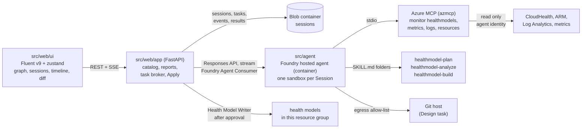
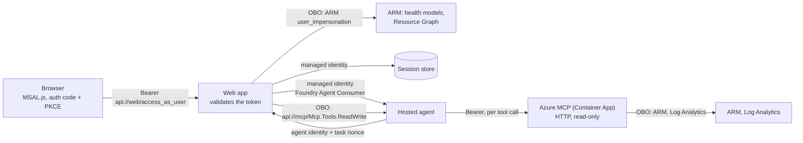

# Architecture and build plan: tasks run by a Foundry hosted agent

One web app, one Foundry hosted agent, one application health model. Agent work starts as a **Task** in a shared
**Session**, shows a live **Activity timeline**, and ends in a structured result such as a **Health model diff**
that the web app verifies, shows and applies. Terms follow [GLOSSARY.md](../../GLOSSARY.md). Decisions are in
[docs/adr](../adr/).

## Shape



- The web app is the only caller of the hosted agent and the only writer of health models.
- The hosted agent only reads. Its tools: Azure MCP in read-only mode, the three health model skills, a shell in the
  Session sandbox, and `submit_result`.
- Blob Storage is the record of Sessions. A Foundry conversation and its sandbox are a cache that may expire.
- The web app reaches the session store through a private endpoint in a small VNet, because tenant policy disables
  public network access on storage accounts. Local runs keep Sessions in memory.
- Removed from the project: the survey app, the shop demo model, the request journey (PostgreSQL, Storage Queue),
  the `agent-web` and `agent-app` Container Apps, CopilotKit.

## Components

| Path | What it is |
|------|------------|
| `src/web/app` | FastAPI: model catalog across subscriptions, graph and entity reads, health reports, Sessions and Tasks, Apply. |
| `src/web/ui` | React SPA: Fluent UI v9, zustand, React Flow graph, Session workspace. |
| `src/agent` | Hosted agent image: Agent Framework agent, `azmcp` built from `abossard/mcp@abossard/healthmodels-inspect`, vendored skills. |
| `infra` | Bicep: Container App, Foundry account, project and model, ACR, session store, `hm-<env>`, `hm-<env>-design`, roles. |

## Contracts

All JSON is camelCase. A model reference is `{subscriptionId, resourceGroup, name}` everywhere.

### Task

```text
Task = {
  id, sessionId, seq,
  type: "review" | "explain" | "design",
  target: ModelRef & { entity?: string },          // explain needs entity; design targets hm-<env>-design
  workload?: { resourceGroup, repositoryUrl? },     // design only; resourceGroup is this deployment's
  instruction: string,                              // optional free text, may be ""
  status: "running" | "done" | "failed",
  base?: { modelId, fingerprint, capturedAt },      // review and design: set by the web app at start
  result?: TaskResult, error?: { code, message },
  createdAt, finishedAt?
}
```

- A Task's `id` is its `seq`. One running Task per Session: a second `POST` while one runs returns 409 `task_running`.
- A Task left `running` by a restarted web app is marked `failed` with code `interrupted` at startup.

### Task result (what the agent passes to `submit_result`)

```text
TaskResult =
  | { kind: "explain", entity, state, summary,
      causes: [{ entity, signal: string|null, state, threshold: string|null, value: string|number|null,
                 rollup: string|null, note }] }      // ordered from the asked entity down to the root cause
  | { kind: "diff", summary,
      changes: [{ id, op: "add"|"change"|"remove",
                  kind: "entity"|"signalDefinition"|"relationship",
                  name,                               // ARM resource name inside the model
                  after: object|null,                 // ARM `properties` to PUT at api-version 2026-11-01; null for remove
                  reason }],
      verification: [{ entity, signal, status: "verified"|"failing"|"not_run",
                       query: string|null, value: string|number|null, error: string|null }],
      findings: [{ severity: "high"|"medium"|"low", entity: string|null, text, changeIds: [string] }] }
```

- Changes are at ARM resource granularity. An entity's signals travel inside the entity's `properties`.
- The agent never sends `before` or a base. The web app owns the **Base model**: it snapshots the target when the
  Task starts and derives `before`, the **Proposed model** and per-field details itself.
- The JSON Schema lives in `src/agent/src/contracts/task-result.schema.json`. `src/web/app/contracts/` holds a
  byte-identical copy (a test compares them). Both sides validate.
- `submit_result` validates and returns the errors to the model, so it can correct and resubmit. The web app takes
  the last accepted submission from the response stream.

### Activity event

```text
ActivityEvent = { seq, ts, kind: "status"|"text"|"tool_call"|"tool_result"|"result"|"error", summary, payload }
```

- Derived by the web app from the Responses stream: output text, `function_call`, `mcp_call` and their outputs.
- Appended to the Task's event blob and fanned out over SSE. `GET .../events` replays from `Last-Event-ID`.

### Fingerprint

SHA-256 over the normalized model: entities, signal definitions and relationships sorted by name, with system
fields removed (health state, provisioning state, signal status and values, timestamps, system data, etag).
A pure function in the web app. Apply refuses when the live fingerprint differs from the Task's base.

### HTTP API (web app)

| Method | Path | Result |
|--------|------|--------|
| GET | `/api/health-models` | `{models: [ModelRef + id, location, provisioningState], default}` |
| GET | `/api/health-model?model&resourceGroup&subscription` | graph DTO (entities, relationships, report options) |
| GET | `/api/entities/{name}` + selector | entity, transitions, report signal history |
| POST | `/api/entities/{name}/health-reports` + selector | 202 |
| GET | `/api/sessions` | `{sessions: [{id, title, createdAt, taskCount, lastTaskAt}]}` |
| POST | `/api/sessions` | 201 Session. Body `{title?}` |
| GET | `/api/sessions/{sid}` | `{session, tasks: [Task without result]}` |
| POST | `/api/sessions/{sid}/tasks` | 202 Task. Body `{type, target, workload?, instruction}`. 409 `task_running` |
| GET | `/api/sessions/{sid}/tasks/{tid}` | Task with result |
| GET | `/api/sessions/{sid}/tasks/{tid}/events` | SSE: `event: activity` with `id: <seq>`, then `event: done` |
| GET | `/api/sessions/{sid}/tasks/{tid}/diff` | `{base, proposed, changes, verification, findings, summary, target, appliable, applies}` for a done diff Task |
| POST | `/api/sessions/{sid}/tasks/{tid}/apply` | Body `{changeIds}`. 200 `{outcome, written, failed, expanded}`, 409 `base_changed`, 403 `forbidden` |

- `diff.base` and `diff.proposed` are graph DTO snapshots (same shape as `/api/health-model` entities and
  relationships) so the UI renders both with the existing Topology. Each change adds `before`, `details`
  (`[{path, before, after}]`), `dependsOn` (change ids applied with it) and its verification rows.
- Errors use the existing envelope `{error: {code, message, retryable, operationId}}`.

### Session store (blob container `sessions`)

```text
<sid>/session.json                 { id, title, createdAt, conversationId }
<sid>/tasks/<seq>/task.json        Task (with base and result)
<sid>/tasks/<seq>/base.json        raw Base model (entities, signalDefinitions, relationships)
<sid>/tasks/<seq>/events.jsonl     append blob, one ActivityEvent per line
<sid>/tasks/<seq>/applies.jsonl    append blob, one Apply outcome per line
```

The Session summary (title, createdAt, taskCount, lastTaskAt, open task) is kept in blob metadata on `session.json`, so listing Sessions is one call.

No delete path exists, so Sessions are never deleted by construction.

### Agent input

The web app sends one user message per Task into the Session's Foundry conversation: a short instruction line plus
the Task envelope as JSON (`{task: {id, type, target, workload, instruction}, relationships: [{name, parent, child}]}`).
`relationships` lists the Base model's relationships for review and design, because `healthmodels inspect` walks
them but does not return them. Earlier Tasks stay visible to the agent through the conversation history.

### Telemetry the health model reads

- Web app CLIENT spans: `foundry.agent.respond` (one per Task run, failed when the Task fails), `sessions.store.*`,
  `healthmodel.*`.
- Server requests come from FastAPI auto-instrumentation.

## Sign-in and on-behalf-of access

Users sign in with Entra ID (single tenant). Everything the app and the agent do in Azure happens as the
signed-in user (OAuth 2.0 on-behalf-of). Decision: [ADR 0006](../adr/0006-entra-sign-in-and-on-behalf-of.md).



- Two app registrations, created in Bicep with the Microsoft Graph extension, both trusting the workload managed
  identity through a federated credential (no client secret):
  - `web`: the SPA and its API. Scope `access_as_user`. Delegated: ARM `user_impersonation`, the `mcp` scope.
  - `mcp`: the Azure MCP server. Scope `Mcp.Tools.ReadWrite`, pre-authorizes `web`. Delegated: ARM
    `user_impersonation`, Log Analytics `Data.Read`.
  - A deploy hook grants admin consent for both. OBO has no interactive consent.
- Browser: MSAL.js redirects to sign in before anything renders, sends `Authorization: Bearer` on every `/api/*`
  call, and reads the activity stream with `fetch` (an `EventSource` cannot send the header).
  `GET /api/config` (no token) returns tenant id, client id and scope.
- Web app: every other `/api/*` route needs a valid token (issuer, audience, `scp`, signature). The caller is the
  token's `oid`. Health model reads, the catalog, health reports and Apply use an OBO credential for that user.
  The managed identity is used only for the session store, for calling the hosted agent, and as the client
  credential of the OBO exchange. It has no health model roles.
- Sessions are private: blobs live under `users/<oid>/`, and a Session or Task of another user answers 404.
- Apply writes wherever the user may write. The "this resource group only" rule is gone; Azure RBAC decides.
- Agent: Azure MCP no longer runs inside the agent. It runs as its own Container App in HTTP mode with
  `--outgoing-auth-strategy UseOnBehalfOf --read-only`. For each tool call the agent sends a user token whose
  audience is the MCP server only. It gets that token from the web app: `POST /api/agent/token` with the agent
  identity's bearer token and the Task's nonce (a random value in the Task envelope, valid while the Task runs);
  the web app answers with an OBO token for `api://mcp/Mcp.Tools.ReadWrite`. No ARM token ever enters the
  agent sandbox, and a leaked MCP token can only call read-only tools as that user until it expires.
- The agent identity has no Azure roles. Its egress allow-list shrinks to the Foundry account hosts, the web app,
  the MCP server and GitHub.
- Foundry's native route (an `AgentBlueprint` endpoint with an `AgentOnBehalfOfUser` toolbox connection) keeps
  the user token out of the sandbox entirely, but is preview with open questions. Move to it when it is GA.
- Local development has no managed identity, so no OBO: `AUTH_MODE=local` makes the web app act as the
  developer's `az login` identity with no sign-in. It is refused when the app runs in a Container App.

## Hosted agent

- Image: stage 1 builds `azmcp` (`dotnet publish ... -r linux-x64 --self-contained`) from build args `AZMCP_REPO`
  and `AZMCP_REF`; stage 2 is Python with the agent code and the vendored skill folders. Port 8088, linux/amd64.
- Code: `FoundryChatClient` + `SkillsProvider.from_paths` (approvals disabled, `.bicep` resources enabled) +
  `MCPStdioTool` running `azmcp server start --transport stdio --read-only` with the identity env forwarded and
  `AZURE_TOKEN_CREDENTIALS=ManagedIdentityCredential`, hosted by `ResponsesHostServer`.
- No tool needs approval: every tool is read-only or local to the sandbox.
- Each agent version references the egress policy `FOUNDRY_AGENT_EGRESS_POLICY_ID`. A missing reference fails open.
- After the agent exists, the deploy step grants its identity Reader, Monitoring Reader, Log Analytics Reader and
  the custom Health Model Reader role on the catalog scope. Bicep cannot do this: the identity is created with
  the agent.

## Apply

1. Write as the signed-in user. Azure RBAC decides; a missing role answers 403 `forbidden`.
2. Load the live model, compare fingerprints, 409 `base_changed` on mismatch.
3. Expand the selection with dependent changes: an added entity brings its relationships and the signal
   definitions it references; a removed entity brings its relationships.
4. Write in order: signal definitions, entities, relationships; removals in reverse.
5. Append the outcome to `applies.jsonl`. Stop at the first failure and report what was written.

## Checks

- `.venv-health-ui/bin/python -m unittest discover -s tests`
- `npm --prefix src/web/ui run typecheck`, `npm --prefix src/web/ui test`, the Playwright specs
- `uv run --project src/agent python -m unittest discover -s src/agent/tests`
- `az bicep build --file infra/main.bicep`

## Risks

- `agent-framework-foundry-hosting` is pre-release. Versions are pinned and the hosting code stays in one module.
- The egress policy is preview. Without it, sandbox egress is open; the read-only identity still bounds what a
  generated script can change.
- `azd provision` restores Bicep-defined entities and overwrites Applies to them (ADR 0002).
- An expired Foundry conversation loses the sandbox files and the agent's memory of earlier Tasks. Results and
  timelines survive in Blob Storage; the web app starts a new conversation for the Session.
- The app has no sign-in: every visitor shares Sessions and can Apply (ADR 0002).
