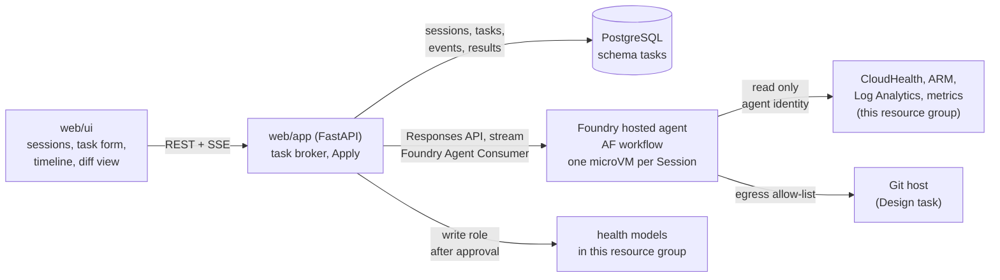

# Build plan: task-based agents in Foundry

Turns the chat copilot into **Tasks** run by one Foundry hosted agent, with shared **Sessions**, a live
**Activity timeline**, and **Health model diffs** that the web app verifies, shows and applies.
Terms follow [GLOSSARY.md](../../GLOSSARY.md). Decisions are in [docs/adr](../adr/).

## Target shape

- The web app is the only component that talks to the hosted agent and the only one that writes models.
- The hosted agent only reads, and its sandbox runs in the Session's microVM.
- PostgreSQL is the record of Sessions. A Foundry session is a cache that may expire after 30 days idle.

## Assumed defaults (not grilled, change before Phase 0 if wrong)

- Foundry account and project in `swedencentral` (`foundryLocation`, `AZURE_FOUNDRY_LOCATION`). The rest stays where it is.
- One running Task per Session. A second Task waits until the first ends.
- Agents send no health reports. `send_health_report` is dropped.
- Review and Explain targets are limited to models in this resource group, matching what the agent identity can read.
- A Design task applies into a pre-provisioned empty model `hm-<env>-design`, created in Bicep with its own
  identity and access roles. The web app then never needs `healthmodels/write` or `roleAssignments/write`.
- Hosted agent code is deployed as a source ZIP (`python_3_14`) from an azd `postdeploy` hook via `az rest`,
  not from web app startup. The web app identity then needs only Foundry Agent Consumer.
- `src/agent-app` is rewritten in place as the hosted agent source.
- Specialist instructions are derived from the healthmodel-plan, healthmodel-analyze and healthmodel-build skills.

## Contracts (write first, used by every phase)

- **Health model diff** (JSON Schema at `src/contracts/health-model-diff.schema.json`, validated by both the
  hosted agent and the web app):
  - `base`: model id, fingerprint, captured at.
  - `changes[]`: `id`, `op` (add, change, remove), `kind` (entity, signal, relationship), `name`,
    `entity` (owner for signals and relationships), `before`, `after`, `reason`.
  - `verification` per signal change: `verified`, `failing` or `not_run`, with the query, the value and the error.
  - `findings[]` (Review only): severity, entity, text, linked change ids.
- **Explain result**: entity, state, and an ordered cause chain (signal, threshold, value, rollup step, impact),
  each step pointing at a graph node.
- **Activity event**: `seq`, `ts`, `agent`, `kind` (agent_started, tool_call, query, sandbox_run, file, agent_done,
  error), `summary`, `payload`.
- **Fingerprint**: hash of the normalized model (sorted entities, signal definitions, relationships; system data
  stripped). Pure function in the web app; Apply refuses on mismatch.

## Phase 0: Foundry platform (infra only, done)

- `infra/modules/foundry.bicep` replaces `copilot.bicep`: AIServices account `aif-<env>-<token>` with
  `allowProjectManagement`, project `proj-<env>`, the `gpt-5.4-mini` deployment, public network, `disableLocalAuth`.
  Hosted agents need no capability host.
- Roles in Bicep:
  - Project identity: Foundry User on the account. It is infrastructure only; agent code never runs as it.
  - Web app UAMI: Foundry Agent Consumer on the project, and the custom `AHM Demo Health Model Writer` role on the
    resource group (entities, signal definitions, relationships: write and delete; no model writes).
  - Deploying user: Foundry Project Manager on the project, to create agent versions.
  - Custom `AHM Demo Health Model Reader` role (reads plus history, annotations and signal recommendations).
    Reader alone covers none of the CloudHealth actions.
- Egress: RAI policy `agent-egress` (`2026-05-15-preview`), enforced, default deny, allowing ARM, Entra login,
  Log Analytics, Foundry and OpenAI endpoints, App Insights ingestion and GitHub.
- `hm-<env>-design` exists empty, with its own identity and read grants.
- The chat copilot keeps working until Phase 2: Cognitive Services OpenAI User and `AZURE_OPENAI_*` stay.
- Outputs: `FOUNDRY_PROJECT_ENDPOINT`, `FOUNDRY_PROJECT_NAME`, `FOUNDRY_ACCOUNT_NAME`,
  `FOUNDRY_MODEL_DEPLOYMENT_NAME`, `FOUNDRY_AGENT_EGRESS_POLICY_ID`, `HEALTH_MODEL_READER_ROLE_ID`,
  `HEALTH_MODEL_DESIGN_NAME`, `HEALTH_MODEL_DESIGN_ID`.
- Not verified against Azure: no what-if or deployment has run.

## Phase 1: Hosted agent skeleton with the Explain task

- Upgrade `agent-framework-foundry-hosting` to 1.0.0b261002 or later and host the workflow with
  `ResponsesHostServer(workflow=factory)`.
- Workflow: a router executor picks the branch by task type. Explain branch: state tracer (entity, history,
  signal history) then explanation composer, emitting the Explain result.
- Read-only tools: CloudHealth inventory and history, Resource Graph, Log Analytics query, metrics query.
- Session files under `$HOME/tasks/<task-id>/`.
- `postdeploy` hook: deterministic flat ZIP, `x-ms-code-zip-sha256`, create or version the agent with
  `rai_config.rai_policy_name` set to `FOUNDRY_AGENT_EGRESS_POLICY_ID`, poll until `active`.
- The same hook grants the agent's `instance_identity.principal_id` Reader, Monitoring Reader, Log Analytics Reader
  and `HEALTH_MODEL_READER_ROLE_ID` on the resource group. Each hosted agent gets its own Entra agent identity
  when it is created, so Bicep cannot grant these. The deploying user needs Owner or RBAC Administrator for it.
- **Spike (blocks Phase 2 timeline design)**: confirm which workflow events reach the client through the Responses
  stream (executor start and end, function calls, outputs). If executor events do not surface, emit activity events
  as explicit workflow outputs.
- Tests: unittest with `subTest` for tool argument validation and result shaping, a scripted chat client as in
  `tests/test_report_approval_runtime.py`.

## Phase 2: Sessions, Tasks and the Activity timeline

- Persistence: `src/web/migrations/001_tasks.sql` (schema `tasks`, migration table behind an advisory lock, as in
  `src/survey/migrations`), applied by `postprovision.sh`.
  - `sessions(id, title, created_at, foundry_session_id)`
  - `tasks(id, session_id, seq, type, target, instruction, status, base jsonb, result jsonb, error, created_at, finished_at)`
  - `activity_events(task_id, seq, ts, agent, kind, summary, payload jsonb)`
  - `applies(id, task_id, change_ids, outcome, created_at)`
  - Grant the UAMI SELECT, INSERT, UPDATE only. No DELETE, so Sessions are never deleted by construction.
- Web app modules (flat, like the existing ones):
  - `foundry_agent.py`: create a Foundry session, stream a response, read session files. Scope `https://ai.azure.com/.default`.
  - `tasks_store.py`: database actions.
  - `task_runner.py`: one background runner per Task. Streams the response, writes each event, stores the result,
    marks the Task done or failed. Recreates the Foundry session if it expired, passing earlier results as context.
- API:
  - `GET /api/sessions`, `POST /api/sessions`, `GET /api/sessions/{id}`
  - `POST /api/sessions/{id}/tasks` (type, target, instruction). 409 while a Task is running.
  - `GET /api/tasks/{id}`, `GET /api/tasks/{id}/events` (SSE, resumes from `Last-Event-ID` out of the database)
- UI (`src/web/ui`):
  - Slices `sessions` and `tasks`; an EventSource middleware feeds timeline events.
  - Views: session list (create and open only), session workspace (ordered Tasks, task form with type, target and
    instruction), task detail (timeline, result). Selection stays in the URL via `history.replaceState`.
  - Explain result highlights the cause chain on the existing Topology.
- Health model topology: replace the `agent-web-app` and `agent-app` entities with one hosted-agent entity and
  rewire relationships. Read [infra/README.md](../../infra/README.md) first.
- Remove the chat stack (ADR 0001): `src/agent-web`, the two Container Apps and their outputs, the OpenAI User grant, the `/agent` routes and proxy in `main.py` and
  `agent_proxy.py`, `AGENT_*` and `HEALTH_COPILOT_ENABLED` config, the agent CSP, `ChatPanel`, `tests/test_streaming_proxy.py`
  and the fake agent web, the `agent-web` and `agent-app` services in `azure.yaml`, Makefile `dev` wiring, and the docs
  that point at them (README, AGENTS.md, docs/development.md, postup.sh).
- The health report form on entities stays; it is not part of the chat stack.
- Tests: unittest with `subTest` for the store, runner state transitions, SSE resume, the 409 rule. Vitest for the
  slices. Playwright with a fake Foundry stream replacing `fake-agent.mjs`.

## Phase 3: Review task, diff view and Verification

- Workflow Review branch: inventory reader, then concurrent specialists (coverage, signals and thresholds,
  topology and rollup), then a diff composer, then a verifier.
- Verifier runs each new or changed signal's query in the sandbox with the agent identity and records the
  verification. A failing signal is flagged, not removed.
- Web app: `model_diff.py` with pure functions: validate against the schema, fingerprint, compute the
  Proposed model from Base model plus diff, group changes so an entity carries its signals and relationships.
- UI: side-by-side Topology (Base model, Proposed model) sharing one layout seed, change badges on nodes and edges,
  change list with per-change checkboxes, verification chips, findings list.
- Tests: parametrized `subTest` cases for add, change and remove per kind, grouping, fingerprint stability under
  reordering. Vitest for the diff view model.

## Phase 4: Apply

- `POST /api/tasks/{id}/apply` with selected change ids.
  1. Load the live model, compare fingerprints, 409 `base_changed` on mismatch.
  2. Expand the selection with dependent changes (an entity with its signals and relationships).
  3. Write in order: signal definitions, entities, relationships; removals in reverse.
  4. Record the outcome in `applies`. Stop at the first failure and report what was written.
- Refuse any target outside this resource group.
- **Spike**: CloudHealth write coverage of `azure-mgmt-cloudhealth` at `2026-05-01-preview` against the GA
  `2026-11-01`. If the SDK lacks a write, use ARM REST for that resource type. Bicep keeps its own version.
- UI: Apply button with the count of selected changes and a warning that there is no undo; after Apply, reload the
  model.
- Tests: parametrized ordering cases, fingerprint refusal, partial failure reporting, scope refusal, with the
  existing `RecordingCloudClient` fakes.

## Phase 5: Design task

- Form: resource group (this one) and an optional public Git repository URL.
- Workflow Design branch: workload discoverer (resources in the group, repo cloned in the sandbox), planner,
  diff composer against an empty Base model, verifier.
- Apply goes to `hm-<env>-design`.
- Tests: discoverer result shaping, empty-base diffs.

## Checks per phase

- `.venv-health-ui/bin/python -m unittest discover -s tests`
- `npm --prefix src/web/ui run typecheck` and `npm --prefix src/web/ui test`
- Hosted agent tests under `src/agent-app/tests`
- `az bicep build --file infra/main.bicep` for infra changes

## Risks

- Hosted workflow hosting is beta (`foundry-hosting` 1.0.0b26xxxx). Pin versions and keep the workflow factory
  thin so a protocol change stays in one module.
- The egress policy is preview. Without it, sandbox egress is open; the read-only identity still bounds what a
  generated script can change.
- `azd provision` restores Bicep-defined entities and overwrites Applies to them. This is accepted in ADR 0002.
- A Foundry session expiring loses its files. Results and timelines survive in PostgreSQL.
