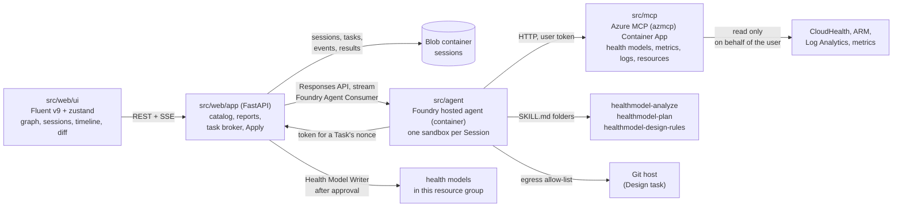
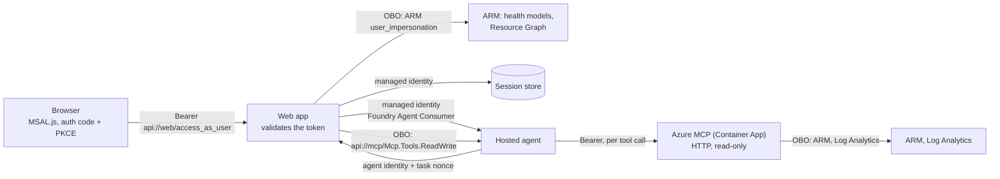

# Architecture and build plan: tasks run by a Foundry hosted agent

One web app, one Foundry hosted agent, one application health model. Agent work starts as a **Task** in a shared
**Session**, shows a live **Activity timeline**, and ends in a structured result such as a **Health model diff**
that the web app verifies, shows and applies. Terms follow [GLOSSARY.md](../../GLOSSARY.md). Decisions are in
[docs/adr](../adr/).

## Shape



- The web app is the only caller of the hosted agent and the only writer of health models.
- The hosted agent only reads. Its tools: Azure MCP in read-only mode, the health model skills of its Task type,
  `submit_result`, and for a Design Task a shell in the Session sandbox and `clone_repository`.
- Blob Storage is the record of Sessions. A Foundry conversation and its sandbox are a cache that may expire.
- The web app reaches the session store through a private endpoint in a small VNet, because tenant policy disables
  public network access on storage accounts. Local runs keep Sessions in memory.
- Removed from the project: the survey app, the shop demo model, the request journey (PostgreSQL, Storage Queue),
  the `agent-web` and `agent-app` Container Apps, CopilotKit.

## Components

| Path | What it is |
|------|------------|
| `src/web/app` | FastAPI: model catalog across subscriptions, graph and entity reads, health reports, Sessions and Tasks, Apply. |
| `src/web/ui` | React SPA: Fluent UI v9, zustand, React Flow graph, Session workspace. |
| `src/agent` | Hosted agent image: Agent Framework agent, vendored skills, the checks a result must pass. |
| `src/mcp` | Azure MCP server image: `azmcp` built from `abossard/mcp@abossard/healthmodels-inspect`, HTTP, read-only, on behalf of the user. |
| `infra` | Bicep: Container App, Foundry account, project and model, ACR, session store, `hm-<env>`, `hm-<env>-design`, roles. |

## Contracts

All JSON is camelCase. A model reference is `{subscriptionId, resourceGroup, name}` everywhere.

### Task

```text
Task = {
  id, sessionId, seq,
  type: "review" | "explain" | "design",
  target: ModelRef & { entity?: string },          // explain needs entity; design targets hm-<env>-design
  workload?: { resourceGroup, repositoryUrl? },     // design only; resourceGroup is this deployment's
  instruction: string,                              // optional free text, may be ""
  status: "running" | "done" | "failed",
  base?: { modelId, fingerprint, capturedAt },      // review and design: set by the web app at start
  result?: TaskResult, error?: { code, message },
  createdAt, finishedAt?
}
```

- A Task's `id` is its `seq`. One running Task per Session: a second `POST` while one runs returns 409 `task_running`.
- A Task left `running` by a restarted web app is marked `failed` with code `interrupted` at startup.

### Task result (what the agent passes to `submit_result`)

```text
TaskResult =
  | { kind: "explain", entity, state, summary,
      confidence?: "high"|"medium"|"low",
      window?: { from, to },                          // ISO. Present exactly when the run read history
      causes: [{ entity, signal: string|null, state, threshold: string|null, value: string|number|null,
                 rollup: string|null, note }] }      // ordered from the asked entity down to the root cause
  | { kind: "diff", summary,
      confidence?: "high"|"medium"|"low",
      changes: [{ id, op: "add"|"change"|"remove",
                  kind: "entity"|"signalDefinition"|"relationship",
                  name,                               // ARM resource name inside the model
                  after: object|null,                 // ARM `properties` to PUT at api-version 2026-11-01; null for remove
                  reason }],
      verification: [{ entity, signal, status: "verified"|"failing"|"not_run",
                       query: string|null, value: string|number|null, error: string|null }],
      findings: [{ severity: "high"|"medium"|"low", entity: string|null, text, changeIds: [string] }] }
```

- Changes are at ARM resource granularity. An entity's signals travel inside the entity's `properties`.
- `summary` is written for the user: the answer in one sentence of at most 30 words, then at most one sentence of
  evidence, at most 360 characters, with display names and no ids.
- The agent never sends `before` or a base. The web app owns the **Base model**: it snapshots the target when the
  Task starts and derives `before`, the **Proposed model** and per-field details itself.
- The JSON Schema lives in `src/agent/src/contracts/task-result.schema.json`. `src/web/app/contracts/` holds a
  byte-identical copy (a test compares them). Both sides validate.
- `submit_result` validates and returns the errors to the model, so it can correct and resubmit. The web app takes
  the last accepted submission from the response stream.

### Activity event

```text
ActivityEvent = { seq, ts, kind: "status"|"text"|"tool_call"|"tool_result"|"result"|"error", summary, payload }
```

- Derived by the web app from the Responses stream: output text, `function_call`, `mcp_call` and their outputs.
- Appended to the Task's event blob and fanned out over SSE. `GET .../events` replays from `Last-Event-ID`.

### Fingerprint

SHA-256 over the normalized model: entities, signal definitions and relationships sorted by name, with system
fields removed (health state, provisioning state, signal status and values, timestamps, system data, etag).
A pure function in the web app. Apply refuses when the live fingerprint differs from the Task's base.

### HTTP API (web app)

| Method | Path | Result |
|--------|------|--------|
| GET | `/api/health-models` | `{models: [ModelRef + id, location, provisioningState], default: ModelRef selector or null}` |
| GET | `/api/health-model?model&resourceGroup&subscription` | graph DTO (entities, relationships, report options) |
| GET | `/api/entities/{name}` + selector | entity, transitions, report signal history |
| GET | `/api/health-model/stream` + selector | `text/event-stream` of the model as it changes, see [Live model data](#live-model-data) |
| GET | `/api/timeline` + selector | history of the selected model for the signal timeline, see [Timeline history](#timeline-history) |
| POST | `/api/entities/{name}/health-reports` + selector | 202 |
| GET | `/api/sessions` | `{sessions: [{id, title, createdAt, taskCount, lastTaskAt}]}` |
| POST | `/api/sessions` | 201 Session. Body `{title?}` |
| GET | `/api/sessions/{sid}` | `{session, tasks: [Task without result]}` |
| POST | `/api/sessions/{sid}/tasks` | 202 Task. Body `{type, target, workload?, instruction}`. 409 `task_running` |
| GET | `/api/sessions/{sid}/tasks/{tid}` | Task with result |
| GET | `/api/sessions/{sid}/tasks/{tid}/events` | SSE: `event: activity` with `id: <seq>`, then `event: done` |
| GET | `/api/sessions/{sid}/tasks/{tid}/diff` | `{base, proposed, changes, verification, findings, summary, target, appliable, applies}` for a done diff Task |
| POST | `/api/sessions/{sid}/tasks/{tid}/apply` | Body `{changeIds}`. 200 `{outcome, written, failed, expanded}`, 409 `base_changed`, 403 `forbidden` |

- `diff.base` and `diff.proposed` are graph DTO snapshots (same shape as `/api/health-model` entities and
  relationships) so the UI renders both with the existing Topology. Each change adds `before`, `details`
  (`[{path, before, after}]`), `dependsOn` (change ids applied with it) and its verification rows.
- Errors use the existing envelope `{error: {code, message, retryable, operationId}}`. Any `/api` route also answers 401
  `unauthenticated` (retried once with a fresh token), 403 `personal_account` or `tenant_not_allowed` for a signed-in
  user the app does not serve, and 403 `consent_required` when the user's directory has not approved the app.

### Timeline history

`GET /api/timeline?model&resourceGroup&subscription&from&to&include&entity&resolution`, as the signed-in user.
Every parameter is optional. The route is a plain `def`, so Starlette runs it in its thread pool and the event loop never waits on Azure.

| Parameter | Meaning |
|-----------|---------|
| `from`, `to` | ISO 8601, UTC when no offset. Default: the last 24 hours. `to` is clamped to now, `from` to 30 days back (the service refuses older). A range under one minute is `invalid_range`. |
| `include` | Comma list of `states` (state transitions of every entity), `annotations`, `reports` (health reports, read from the report signal of the entities that have one), `signals` (state and value of every signal). Default `states,annotations,reports`. |
| `entity` | Repeatable. Only these entities (their rows, signals and history). Default: all. Unknown names are `unknown_entity`. |
| `resolution` | Seconds, 0 to 86400, default 0. Thins `series` to at most min, max and worst state per bucket. It saves bytes, not Azure calls: the service returns every point. |

Response (all times are epoch milliseconds, states are codes `0` Unknown, `1` Healthy, `2` Degraded, `3` Unhealthy, `4` Deleted):

```text
{ model, observedAt, retentionDays: 30, resolution, apiVersion, partial,
  range: {from, to},                        // ISO. The window actually read: snapped outwards, `to` is now when live
  entities: [{name, displayName, parents, state,   // state is the current one
              signals: [{name, displayName, kind, unit, refreshInterval,
                         rules: {degraded: {operator, threshold}|null, unhealthy: {...}|null, dynamic: bool}}]}],
  states:  [{entity, transitions: [{t, from, to, reason}], complete, earliest, error?}],
  series:  [{entity, signal, points: [[t, value|null, state]], complete, earliest, error?}],
  annotations: [{entity, id, t, description, details}],
  reports:     [{entity, t, state, value, reason, reportId}],
  failures:    [{entity, part, error}] }      // annotations and reports that failed or were cut
```

- Transitions and points are oldest first. The state of an entity before its first transition in the range is that transition's `from`. With no transition in the range it is the current `state`.
- A point has `value: null` and state `0` when the signal had no data. External signals and log queries return the same shape as metrics.
- `error` is `{code, message, retryable}` with `forbidden`, `not_found`, `busy`, `unavailable`, `deadline` or `call_budget`. One failing series never fails the response (`partial: true`). When every history fails, the route answers like `/api/entities/{name}` (403, 404, 503).
- `complete: false` means the page budget cut the series at its old end: `earliest` is the oldest point returned. Zoom in and ask for the narrower range to read it in full.
- The service returns the newest points first, 1000 per page (100 for annotations), and a `nextMarker` that cannot be combined with a window. The app follows markers up to 4 pages per signal, 5 per entity state history and 3 per annotation list. A signal that refreshes every minute fills a page in 17 hours, so a 7 day range of such a signal is cut. Entity transitions are sparse and almost always complete.
- Fan-out: 8 concurrent calls per request, 24 across the app, 400 calls and 40 seconds per request, 120 signals per request (more is `too_many_series`: pass `entity`). The UI asks for `states,annotations,reports` once and then `signals` for the entities it shows.
- Every route that takes a model checks that the caller can read it, as the caller, before anything is served: also the app's own model, which a user of the app's directory gets when the request has no selector. A model the caller cannot read answers `unknown_model`, whatever a warm hub or a cache holds.
- An Azure or sign-in-exchange failure that a route does not map itself answers the usual envelope with 503 `health_model_unavailable` (retryable), never a plain 500.
- `POST .../tasks` refuses a `workload.repositoryUrl` that the agent would not clone with 400 `invalid_repository_url`: `https://github.com/<owner>/<repository>`, optionally ending in `.git` and `/`, an owner of 1 to 39 letters, digits and hyphens that starts with a letter or digit, a repository of up to 100 letters, digits, `_`, `.` and `-` that does not start with `.` or `-`. A session title or an instruction with a lone surrogate is refused with `invalid_title` or `invalid_instruction`.
- Every response carries `Strict-Transport-Security: max-age=31536000` besides the other security headers.
- Caching: per user, per entity, signal and window. The window is snapped outwards to 1 minute (up to 6 hours), 5 minutes (up to 2 days) or 15 minutes, so a moving window hits the cache. A window that reaches now lives 30 seconds, a closed one 5 minutes. Failures are not cached. The entity list lives 30 seconds.
- Errors: `unsupported_query`, `invalid_include`, `invalid_resolution`, `invalid_range`, `unknown_entity`, `too_many_series`, `unknown_model` with the usual envelope.

### Live model data

[ADR 0007](../adr/0007-warm-while-watched.md): the app keeps a model warm and pushes its changes only while someone has it open.

`GET /api/health-model/stream?model&resourceGroup&subscription`, with an optional `Last-Event-ID` header. Refusals before the stream starts are the usual envelope: `unknown_model`, `unsupported_query`, `invalid_last_event_id` (400), `too_many_streams` (429), `too_many_subscribers` and `live_unavailable` (503, retryable; also while a write of the app is not read back yet), and the Azure errors of the first read. `/api/health-model` answers from the hub, without a call to Azure, while the model is warm.

| Event | `id` | `data` |
|-------|------|--------|
| `snapshot` | `<epoch>-<seq>` | the `/api/health-model` body. Sent first, unless the `Last-Event-ID` can be resumed |
| `delta` | `<epoch>-<seq>` | only what changed since the previous event, below |
| `resync` | none | `{reason: "slow"}`. The viewer fell behind its queue and was dropped: connect again without an id |
| `reconnect` | none | `{reason: "token_expired"}`. Connect again with a fresh token and the last id |
| `error` | none | `{reason, error: {code, message, retryable}}`. The viewer lost access: do not retry |
| comment `: keep-alive` | none | every 15 s. `retry: 3000` is sent first |

```text
delta = { observedAt?, model?: {changed fields}, reportOptions?,
          entities?: {upsert: [whole entity], remove: [names]},
          relationships?: {upsert: [...], remove: [names]},
          order?: [entity names],             // only when entities were added or removed
          timeline?: { transitions: [{entity, t, from, to, reason}],      // epoch ms, state codes as in Timeline history
                       points: [{entity, signal, points: [[t, value|null, state]]}],
                       annotations: [{entity, id, t, description, details}],
                       reports: [{entity, t, state, value, reason, reportId}] } }
```

- An empty delta is never sent. `epoch` names one life of the hub: an id of another epoch, or one the ring of the last 256 events no longer reaches, gets a `snapshot`. A viewer is registered in the same step that reads what it missed, so no event falls between catch-up and subscribe.
- **The hub** (`model_hub.py`) is one per `(subscription, resource group, model)`. Its poller starts with the first viewer and stops 20 s after the last. It reads every 30 s as one current viewer, with that viewer's on-behalf-of credential, and moves to another viewer when that one leaves, its token is within 5 s of expiry, or its exchange fails (401, `ClientAuthenticationError`, consent or interaction required; that viewer is not used again for 5 min). A viewer is admitted only after `has_model` as that user; the check is repeated every 5 min and a viewer that fails it gets `error`. A viewer whose token expires gets `reconnect`.
- After a write of the app (Apply, a health report) the hub reads the model at once and does not serve its snapshot, to a route or a new viewer, until a read that began after the write has succeeded: a poll that was already reading when the write happened cannot clear that.
- Every poll reads the entity list and the relationships (with the model: 3 calls). New points and reports come from the status of each signal in that snapshot, so they cost no call. The history of an entity is read only when its state changed (from its last transition minus 2 min, merged by `(entity, t, from, to)`; a failed read is retried on the next poll, but after a 429 or 503 only once the `Retry-After` has passed, at least a minute and at most 5; an entity that answers 404 adds nothing and does not fail the read of the others), annotations of all entities every 5 min. A failure backs off 30 s, 60 s, up to 5 min; 429 and 503 wait at least a minute.
- Limits: 8 hubs, 50 viewers per hub, 6 streams per user (tenant and user), a queue of 64 events per viewer, 4 concurrent reads toward Azure.
- **History cache** (`history_store.py`): closed days of a signal and closed weeks of transitions and annotations (closed means ended 15 min ago) are kept per model in memory (4096 buckets, least recently used out) and, when a Sessions container is configured, in that container under `history/v1/<subscription>/<resource group>/<model>/<kind>/<entity>/<signal>/<bucket start ms>.json`. A bucket is kept only when read in full and wholly inside the 30 days the service keeps; the open tail is always read. The store never deletes (set a lifecycle rule on the prefix) and a blob that cannot be read is a miss. It is read only after the route admitted the caller, and it is keyed by model, not by user: a subscription id belongs to one directory, so a key never names the data of two directories. It does keep the history of every directory's models in the app's storage account.
- The browser: one stream per selected model, closed when the model changes; the model in the store is changed in place (`model/live.ts`), so entities a delta does not touch keep their identity and the arrays of a view do not change unless its structure did. A change is announced to a screen reader and the node is outlined for 2 s (still under `prefers-reduced-motion`). The Live control pauses and resumes; a 503 `live_unavailable` falls back to reading the model every minute. The timeline follows now (`?timeline=1&live=1&span=<ms>`) and keeps the last overview of each model in IndexedDB (schema 1) for a first paint.

### Session store (blob container `sessions`)

```text
<sid>/session.json                 { id, title, createdAt, conversationId }
<sid>/tasks/<seq>/task.json        Task (with base and result)
<sid>/tasks/<seq>/base.json        raw Base model (entities, signalDefinitions, relationships)
<sid>/tasks/<seq>/events.jsonl     append blob, one ActivityEvent per line
<sid>/tasks/<seq>/applies.jsonl    append blob, one Apply outcome per line
```

The Session summary (title, createdAt, taskCount, lastTaskAt, open task) is kept in blob metadata on `session.json`, so listing Sessions is one call.

No delete path exists, so Sessions are never deleted by construction.

### Agent input

The web app sends one user message per Task into the Session's Foundry conversation: a short instruction line plus
the Task envelope as JSON (`{task: {id, type, target, workload, instruction}, relationships: [{name, parent, child}]}`).
`relationships` lists the Base model's relationships for review and design, because `healthmodels inspect` walks
them but does not return them. Earlier Tasks stay visible to the agent through the conversation history.

### Telemetry the health model reads

- Web app CLIENT spans: `foundry.agent.respond` (one per Task run, failed when the Task fails), `sessions.store.*`,
  `healthmodel.*`.
- Server requests come from FastAPI auto-instrumentation.

## Sign-in and on-behalf-of access

Users of any Entra directory, and personal Microsoft accounts through a directory they belong to, sign in with Entra ID.
Everything the app and the agent do in Azure happens as the signed-in user, in that user's directory (OAuth 2.0
on-behalf-of). Decisions: [ADR 0006](../adr/0006-entra-sign-in-and-on-behalf-of.md) and
[ADR 0008](../adr/0008-sign-in-for-any-microsoft-account.md).



- Two multitenant app registrations (`AzureADandPersonalMicrosoftAccount`, token version 2), created in Bicep with the
  Microsoft Graph extension, both trusting the workload managed identity through a federated credential (no client
  secret):
  - `web`: the SPA and its API. Scope `access_as_user`. Delegated: ARM `user_impersonation`, the `mcp` scope.
  - `mcp`: the Azure MCP server. Scope `Mcp.Tools.ReadWrite`, pre-authorizes `web` and lists it as a known client.
    Delegated: ARM `user_impersonation`, Log Analytics `Data.Read`.
  - OBO has no interactive consent. A deploy hook grants admin consent for both in the directory the app belongs to.
    In any other directory the first sign-in asks `api://<web>/.default`: the consent covers `web`, and through the
    known client the MCP server's service principal and its permissions, so one consent is enough. Users of another
    directory cannot give it for this app (no verified publisher, and ARM access goes beyond basic sign-in), so an
    administrator of that directory consents once: [infra/README.md](../../infra/README.md#another-directory).
- Browser: a sign-in page offers "Sign in with Microsoft" (authority `organizations`, any work or school directory)
  and "Personal account or a specific directory". The second takes a subscription ID, a directory domain or a
  directory ID and signs in at that directory's authority. A subscription ID is resolved by an anonymous `GET
  https://management.azure.com/subscriptions/<id>?api-version=2022-12-01`: the 401 names the directory in
  `WWW-Authenticate: Bearer authorization_uri="https://login.windows.net/<tenant id>"`, and a GUID Azure does not know
  as a subscription is taken as a directory ID. A personal account that signs in at `organizations` or `common` lands
  in the personal-account tenant, which has no Azure: the page says so and asks for the directory, with the account
  offered first. After sign-in MSAL.js sends `Authorization: Bearer` on every `/api/*` call, renews it silently at the
  account's own directory, and reads the activity stream with `fetch` (an `EventSource` cannot send the header).
  `GET /api/config` (no token) returns the client id and scope.
- Web app: every other `/api/*` route needs a valid token: the issuer `https://login.microsoftonline.com/<tid>/v2.0`
  of the token's own `tid`, audience, `scp`, signature (one common key set). A token of the personal-account tenant
  answers 403 `personal_account`, and a directory outside `ENTRA_ALLOWED_TENANTS` (empty means any; the app's own
  directory is always allowed) 403 `tenant_not_allowed`. The caller is the token's `tid` and `oid`. Health model
  reads, the catalog, health reports and Apply use an OBO credential for that user, exchanged at the token's
  directory (one MSAL client per directory, 64 at most). The managed identity is used only for the session store,
  for calling the hosted agent, and as the client credential of the OBO exchange. It has no health model roles.
- The catalog is one Resource Graph query as that user: every health model they can read in every subscription of
  their directory. The app's own model is the default for users of its directory, which is also the list when the
  catalog cannot be read; another user gets the first model listed and, when they can read none, `default: null` and
  a message. A failed catalog query of another directory is an error, never the deployment's model, and a request that
  omits the subscription does not borrow the deployment's.
  A Design Task is the app's own directory only (403 `design_unavailable`): its target model and workload are the
  deployment's.
- Sessions are private: blobs live under `users/<oid>/` for a user of the app's own directory (where Sessions were
  kept before other directories could sign in, so none moved) and under `users/<tid>/<oid>/` for a user of any other.
  The same key (`<oid>` or `<tid>/<oid>`) names the user in the task runner, the live hubs' stream limit and the
  caches of Azure clients, catalogs and timelines. A Session or Task of another user answers 404.
- Apply writes wherever the user may write. The "this resource group only" rule is gone; Azure RBAC decides.
- Agent: Azure MCP no longer runs inside the agent. It runs as its own Container App in HTTP mode with
  `--outgoing-auth-strategy UseOnBehalfOf --read-only`. For each tool call the agent sends a user token whose
  audience is the MCP server only. It gets that token from the web app: `POST /api/agent/token` with the agent
  identity's bearer token and the Task's nonce (a random value in the Task envelope, valid while the Task runs);
  the web app answers with an OBO token for `api://mcp/Mcp.Tools.ReadWrite`, exchanged in the directory of the user
  who started the Task. The agent identity belongs to the app's own directory, and the broker accepts only a token of
  that directory. No ARM token ever enters the agent sandbox, and a leaked MCP token can only call read-only tools as
  that user until it expires. The MCP server takes `AzureAd__TenantId=organizations`: it validates the issuer of each
  token by its `tid` and exchanges at that directory.
- The agent identity has no Azure roles. Its egress allow-list shrinks to the Foundry account hosts, the web app,
  the MCP server and GitHub.
- Foundry's native route (an `AgentBlueprint` endpoint with an `AgentOnBehalfOfUser` toolbox connection) keeps
  the user token out of the sandbox entirely, but is preview with open questions. Move to it when it is GA.
- Local development has no managed identity, so no OBO: `AUTH_MODE=local` makes the web app act as the
  developer's `az login` identity with no sign-in. It is refused when the app runs in a Container App.

## Hosted agent

- Image: Python with the agent code, the skill folders and `jq`. Port 8088,
  linux/amd64. `azmcp` is not in it: the MCP server is the Container App built from `src/mcp`.
- Code: `FoundryChatClient`, a skills provider and `MCPStreamableHTTPTool` against `MCP_URL`, hosted by
  `ResponsesHostServer`. Every MCP request carries the signed-in user's token from the token broker.
- Per Task type the agent gets its own prompt, tools and skills:

  | Type | Tools | Skills | Model calls | Seconds |
  |------|-------|--------|-------------|---------|
  | explain | `submit_result`, `load_skill`, 8 Azure tools | analyze | 12 | 240 |
  | review | the same | analyze, design-rules | 20 | 360 |
  | design | `submit_result`, `load_skill`, `run_shell`, `clone_repository`, 7 Azure tools (no activity log) | plan, design-rules | 30 | 420 |

- Azure calls stay in the Task: the subscription, resource groups, health model and resource ids of a call must be
  the Task's. A call that names others is answered `Error: refused.`
- History is bounded: only an Explain reads it, only for the asked entity, from now minus 24 hours, or the period
  the instruction names (30 days at most). The result's `window` says what was read.
- `clone_repository` downloads a public `https://github.com/<owner>/<repository>` as an archive from
  `codeload.github.com`, without history, and unpacks it into the Task folder. The image has no `git`.
- A Task ends with a result. Every model call must call a tool, and the last call a type may make must be
  `submit_result`. A rejected result gets its problems back; when the same problems come back a third time, or a
  budget runs out, the agent submits a reduced result itself: the changes that pass every check, the rest as findings.
- No tool needs approval: every tool is read-only or local to the sandbox.
- Each agent version references the egress policy `FOUNDRY_AGENT_EGRESS_POLICY_ID`. A missing reference fails open.
- The agent's identity holds no Azure role. The deploy step hands its principal id to the web app as
  `FOUNDRY_AGENT_PRINCIPAL_ID`, which is how the token broker knows the caller.
- [src/agent/README.md](../../src/agent/README.md) has the details and the accepted limits.

## Apply

1. Write as the signed-in user. Azure RBAC decides; a missing role answers 403 `forbidden`.
2. Load the live model, compare fingerprints, 409 `base_changed` on mismatch.
3. Expand the selection with dependent changes: an added entity brings its relationships and the signal
   definitions it references; a removed entity brings the relationships that name it, whether the diff removes
   them or changes them to name another entity.
4. Write in order: signal definitions, entities, relationships; removals in reverse.
5. Append the outcome to `applies.jsonl`. Stop at the first failure and report what was written.

## Checks

- `.venv-health-ui/bin/python -m unittest discover -s tests`
- `npm --prefix src/web/ui run typecheck`, `npm --prefix src/web/ui test`, the Playwright specs
- `uv run --project src/agent python -m unittest discover -s src/agent/tests`
- `az bicep build --file infra/main.bicep`

## Risks

- `agent-framework-foundry-hosting` is pre-release. Versions are pinned and the hosting code stays in one module.
- The egress policy is preview. Without it, sandbox egress is open; the read-only identity still bounds what a
  generated script can change.
- `azd provision` restores Bicep-defined entities and overwrites Applies to them (ADR 0002).
- An expired Foundry conversation loses the sandbox files and the agent's memory of earlier Tasks. Results and
  timelines survive in Blob Storage; the web app starts a new conversation for the Session.
- Anyone with a Microsoft account can sign in and spend the Foundry model capacity of this deployment. What bounds it:
  one running Task per user, three across the app, the per-user Session and Task caps, the Task timeout, the model
  quota, and the optional list of directories. What does not: a user count (an attacker's own directory can hold any
  number of users, each with its own caps), a share per directory of the three running Tasks, and a spend limit.
