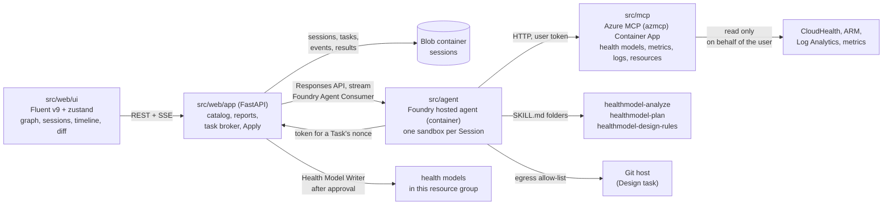
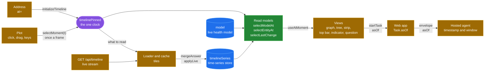
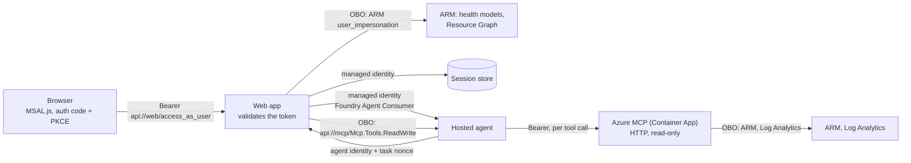

# Architecture and build plan: tasks run by a Foundry hosted agent

One web app, one Foundry hosted agent, one application health model. Agent work starts as a **Task** in a shared
**Session**, shows a live **Activity timeline**, and ends in a structured result such as a **Health model diff**
that the web app verifies, shows and applies. Terms follow [GLOSSARY.md](../../GLOSSARY.md). Decisions are in
[docs/adr](../adr/).

## Shape



- The web app is the only caller of the hosted agent and the only writer of health models.
- The hosted agent only reads. Its tools: Azure MCP in read-only mode, the health model skills of its Task type,
  `submit_result`, and for a Design Task a shell in the Session sandbox and `clone_repository`.
- Blob Storage is the record of Sessions. A Foundry conversation and its sandbox are a cache that may expire.
- The web app reaches the session store through a private endpoint in a small VNet, because tenant policy disables
  public network access on storage accounts. Local runs keep Sessions in memory.
- Removed from the project: the survey app, the shop demo model, the request journey (PostgreSQL, Storage Queue),
  the `agent-web` and `agent-app` Container Apps, CopilotKit.

## Components

| Path | What it is |
|------|------------|
| `src/web/app` | FastAPI: model catalog across subscriptions, graph and entity reads, health reports, Sessions and Tasks, Apply. |
| `src/web/ui` | React SPA: Fluent UI v9, zustand, React Flow graph, Session workspace. |
| `src/agent` | Hosted agent image: Agent Framework agent, vendored skills, the checks a result must pass. |
| `src/mcp` | Azure MCP server image: `azmcp` built from `abossard/mcp@abossard/healthmodels-inspect`, HTTP, read-only, on behalf of the user. |
| `infra` | Bicep: Container App, Foundry account, project and model, ACR, session store, `hm-<env>`, `hm-<env>-design`, roles. |

## Contracts

All JSON is camelCase. A model reference is `{subscriptionId, resourceGroup, name}` everywhere.

### Task

```text
Task = {
  id, sessionId, seq,
  type: "review" | "explain" | "design",
  target: ModelRef & { entity?: string },          // explain needs entity; design targets hm-<env>-design
  workload?: { resourceGroup, repositoryUrl? },     // design only; resourceGroup is this deployment's
  instruction: string,                              // optional free text, may be ""
  asOf?: string,                                    // explain only: the past moment it is about, ISO, UTC, to the second
  status: "running" | "done" | "failed",
  base?: { modelId, fingerprint, capturedAt },      // review and design: set by the web app at start
  result?: TaskResult, error?: { code, message },
  createdAt, finishedAt?
}
```

- A Task's `id` is its `seq`. One running Task per Session: a second `POST` while one runs returns 409 `task_running`.
- `asOf` is the moment the page showed when the question was asked ([One clock](#timeline-data-in-the-browser)). Without it
  an Explain is about now. The web app takes an ISO 8601 time with an offset that is not after now (up to 2 minutes ahead
  counts as now) and not older than the 30 days the service keeps, keeps it in UTC, and refuses anything else, and any
  `asOf` on a Review or a Design, with 400 `invalid_as_of`. A Review and a Design are always about the model now.
- A Task left `running` by a restarted web app is marked `failed` with code `interrupted` at startup.

### Task result (what the agent passes to `submit_result`)

```text
TaskResult =
  | { kind: "explain", entity, state, summary,
      confidence?: "high"|"medium"|"low",
      window?: { from, to },                          // ISO. Present exactly when the run read history
      causes: [{ entity, signal: string|null, state, threshold: string|null, value: string|number|null,
                 rollup: string|null, note }] }      // ordered from the asked entity down to the root cause
  | { kind: "diff", summary,
      confidence?: "high"|"medium"|"low",
      changes: [{ id, op: "add"|"change"|"remove",
                  kind: "entity"|"signalDefinition"|"relationship",
                  name,                               // ARM resource name inside the model
                  after: object|null,                 // ARM `properties` to PUT at api-version 2026-11-01; null for remove
                  reason }],
      verification: [{ entity, signal, status: "verified"|"failing"|"not_run",
                       query: string|null, value: string|number|null, error: string|null }],
      findings: [{ severity: "high"|"medium"|"low", entity: string|null, text, changeIds: [string] }] }
```

- Changes are at ARM resource granularity. An entity's signals travel inside the entity's `properties`.
- `summary` is written for the user: the answer in one sentence of at most 30 words, then at most one sentence of
  evidence, at most 360 characters, with display names and no ids.
- The result of an Explain about a past moment has no field for the moment: the Task's `asOf` says it, and the UI
  words the answer from there. Its `state` is the state the entity had then, and a `window` it carries ends at `asOf`.
- The agent never sends `before` or a base. The web app owns the **Base model**: it snapshots the target when the
  Task starts and derives `before`, the **Proposed model** and per-field details itself.
- The JSON Schema lives in `src/agent/src/contracts/task-result.schema.json`. `src/web/app/contracts/` holds a
  byte-identical copy (a test compares them). Both sides validate.
- `submit_result` validates and returns the errors to the model, so it can correct and resubmit. The web app takes
  the last accepted submission from the response stream.

### Activity event

```text
ActivityEvent = { seq, ts, kind: "status"|"text"|"tool_call"|"tool_result"|"result"|"error", summary, payload }
```

- Derived by the web app from the Responses stream: output text, `function_call`, `mcp_call` and their outputs.
- Appended to the Task's event blob and fanned out over SSE. `GET .../events` replays from `Last-Event-ID`.

### Fingerprint

SHA-256 over the normalized model: entities, signal definitions and relationships sorted by name, with system
fields removed (health state, provisioning state, signal status and values, timestamps, system data, etag).
A pure function in the web app. Apply refuses when the live fingerprint differs from the Task's base.

### HTTP API (web app)

| Method | Path | Result |
|--------|------|--------|
| GET | `/api/health-models` | `{models: [ModelRef + id, location, provisioningState], default: ModelRef selector or null}` |
| GET | `/api/health-model?model&resourceGroup&subscription` | graph DTO (entities, relationships, report options) |
| GET | `/api/entities/{name}` + selector | entity, transitions, report signal history |
| GET | `/api/health-model/stream` + selector | `text/event-stream` of the model as it changes, see [Live model data](#live-model-data) |
| GET | `/api/timeline` + selector | history of the selected model for the signal timeline, see [Timeline history](#timeline-history) |
| POST | `/api/entities/{name}/health-reports` + selector | 202 |
| GET | `/api/sessions` | `{sessions: [{id, title, createdAt, taskCount, lastTaskAt}]}` |
| POST | `/api/sessions` | 201 Session. Body `{title?}` |
| GET | `/api/sessions/{sid}` | `{session, tasks: [Task without result]}` |
| POST | `/api/sessions/{sid}/tasks` | 202 Task. Body `{type, target, workload?, instruction, asOf?}`. 409 `task_running`, 400 `invalid_as_of` |
| GET | `/api/sessions/{sid}/tasks/{tid}` | Task with result |
| GET | `/api/sessions/{sid}/tasks/{tid}/events` | SSE: `event: activity` with `id: <seq>`, then `event: done` |
| GET | `/api/sessions/{sid}/tasks/{tid}/diff` | `{base, proposed, changes, verification, findings, summary, target, appliable, applies}` for a done diff Task |
| POST | `/api/sessions/{sid}/tasks/{tid}/apply` | Body `{changeIds}`. 200 `{outcome, written, failed, expanded}`, 409 `base_changed`, 403 `forbidden` |

- `diff.base` and `diff.proposed` are graph DTO snapshots (same shape as `/api/health-model` entities and
  relationships) so the UI renders both with the existing Topology. Each change adds `before`, `details`
  (`[{path, before, after}]`), `dependsOn` (change ids applied with it) and its verification rows.
- Errors use the existing envelope `{error: {code, message, retryable, operationId}}`. Any `/api` route also answers 401
  `unauthenticated` (retried once with a fresh token), 403 `personal_account` or `tenant_not_allowed` for a signed-in
  user the app does not serve, and 403 `consent_required` when the user's directory has not approved the app.

### Timeline history

`GET /api/timeline?model&resourceGroup&subscription&from&to&include&entity&signal&resolution`, as the signed-in user.
Every parameter is optional. The route is a plain `def`, so Starlette runs it in its thread pool and the event loop never waits on Azure.

| Parameter | Meaning |
|-----------|---------|
| `from`, `to` | ISO 8601, UTC when no offset. Default: the last 24 hours. `to` is clamped to now, `from` to 30 days back (the service refuses older). A range under one minute is `invalid_range`. |
| `include` | Comma list of `structure` (the entities with their signals, rules and current state), `states` (state transitions), `annotations`, `reports` (health reports, read from the report signal of the entities that have one), `signals` (state and value of every signal). Default `structure,states,annotations,reports`. |
| `entity` | Repeatable. Only these entities (their rows, signals and history). Default: all. Unknown names are `unknown_entity`. |
| `signal` | Repeatable. Only the series of the signals with these names, of the entities asked for. Default: all. A name nothing has reads nothing. |
| `resolution` | Seconds, 0 to 86400, default 0. Thins `series` to at most five real points per slot of that length, slots counted from the epoch: the last point of each half of the slot, the lowest and the highest value, and the worst state when none of those has it. A slot of five points or fewer is kept whole. It saves bytes, not Azure calls: the service returns every point. |

Response (all times are epoch milliseconds, states are codes `0` Unknown, `1` Healthy, `2` Degraded, `3` Unhealthy, `4` Deleted):

```text
{ model, observedAt, retentionDays: 30, resolution, apiVersion, partial,
  range: {from, to},                        // ISO. The window actually read: snapped outwards, `to` is now when live
  entities: [{name, displayName, parents, state,   // only with `structure`, else []. state is the current one
              signals: [{name, displayName, kind, unit, refreshInterval,
                         rules: {degraded: {operator, threshold}|null, unhealthy: {...}|null, dynamic: bool}}]}],
  states:  [{entity, transitions: [{t, from, to, reason}], complete, earliest, error?}],
  series:  [{entity, signal, points: [[t, value|null, state]], complete, earliest, error?}],
  annotations: [{entity, id, t, description, details}],
  reports:     [{entity, t, state, value, reason, reportId}],
  failures:    [{entity, part, error}] }      // annotations and reports that failed or were cut
```

- Transitions and points are oldest first. The state of an entity before its first transition in the range is that transition's `from`. With no transition in the range it is the current `state`.
- A point has `value: null` and state `0` when the signal had no data. External signals and log queries return the same shape as metrics.
- A thinned series keeps real evaluations with their own times, values and states. The points stay evenly spaced (never further apart than half a slot plus one evaluation), so a reader that joins each point to the next sees no hole that the data does not have. `decimate` in `timeline.py` and in `src/web/ui/src/model/timelineTiles.ts` are the same rule: change both.
- `error` is `{code, message, retryable}` with `forbidden`, `not_found`, `busy`, `unavailable`, `deadline` or `call_budget`. One failing series never fails the response (`partial: true`). When every history fails, the route answers like `/api/entities/{name}` (403, 404, 503).
- `complete: false` means the page budget cut the series at its old end: `earliest` is the oldest point returned.
- The service returns the newest points first, 1000 per page (100 for annotations), and a `nextMarker` that cannot be combined with a window. The app follows markers up to 4 pages per signal, 5 per entity state history and 3 per annotation list. The app reads a signal a day at a time and the states and annotations of an entity a week at a time (see the history store under [Live model data](#live-model-data)), so a day of a signal that refreshes every minute is two pages and is read in full.
- Fan-out: 8 concurrent calls per request, 24 across the app (a fill in the background takes at most 4 of them, and only while no call of a request waits), 400 calls and 40 seconds per request, 120 signals per request (more is `too_many_series`: pass `entity`). The open tail and every closed piece the store lacks, of every history of a request, are read side by side within those 8 calls, so a week of one signal costs the time of one day. A history is joined newest first and ends at the first piece that was cut or not read; a piece read in full is kept even when it is older than that. One request for a month of a model of about 30 entities passes the 400 calls and comes back `partial`. The UI never asks that way: it asks tile by tile (below), so every request fits and the month of a model of 60 entities is 5 or 6 requests of 120 calls each.
- **Windows that never change.** A window that ended 15 minutes ago or more is closed. An answer for a closed window without `structure`, with no failure and nothing cut, carries `ETag` and `Cache-Control: private, no-cache`: the browser keeps it and asks again with `If-None-Match` on every use. The app admits the caller first, as for any request, and then answers `304` with no body and no history call. The ETag names the request (model, window, parts, entities, signals, resolution, API version), not the bytes, so it is known before anything is read. Every other answer of the app is `Cache-Control: no-store`.
- Every route that takes a model checks that the caller can read it, as the caller, before anything is served: also the app's own model, which a user of the app's directory gets when the request has no selector. A model the caller cannot read answers `unknown_model`, whatever a warm hub, a cache or the browser holds.
- An Azure or sign-in-exchange failure that a route does not map itself answers the usual envelope with 503 `health_model_unavailable` (retryable), never a plain 500.
- `POST .../tasks` refuses a `workload.repositoryUrl` that the agent would not clone with 400 `invalid_repository_url`: `https://github.com/<owner>/<repository>`, optionally ending in `.git` and `/`, an owner of 1 to 39 letters, digits and hyphens that starts with a letter or digit, a repository of up to 100 letters, digits, `_`, `.` and `-` that does not start with `.` or `-`. A session title or an instruction with a lone surrogate is refused with `invalid_title` or `invalid_instruction`.
- Every response carries `Strict-Transport-Security: max-age=31536000` besides the other security headers.
- Caching in the app: per user, per entity, signal, stored level and window. The window is snapped outwards to 1 minute (up to 6 hours), 5 minutes (up to 2 days) or 15 minutes; a tile begins and ends on that grid, so snapping leaves it as it is. A window that reaches now lives 30 seconds, a closed one 5 minutes. Failures are not cached. The entity list lives 30 seconds.
- Errors: `unsupported_query`, `invalid_include`, `invalid_resolution`, `invalid_range`, `unknown_entity`, `too_many_series`, `unknown_model` with the usual envelope.
- What a request cost: its `healthmodel.timeline` span carries `timeline.azure_calls`, `timeline.pieces_stored` (closed pieces served from the history store), `timeline.pieces_read` (closed pieces read from Azure), `timeline.memory`, `timeline.blob` and `timeline.absent` (lookups answered from memory, blobs read from storage, blobs that are not there), `timeline.legacy` (pieces found in the first layout), `timeline.written` (blobs changed in memory and handed to the writers) and `timeline.duration_ms`, and the app logs the same as one line, `timeline read model=… status=… calls=… stored=… read=… memory=… blob=… absent=… legacy=… written=… ms=…`. A 304 has the line too. A fill in the background has its own span, `healthmodel.timeline.prewarm`, and line, `timeline prewarm model=… outcome=… calls=… read=… stored=… written=… ms=…`.

### Timeline data in the browser

[ADR 0009](../adr/0009-timeline-in-tiles.md): the browser reads the timeline in tiles, keeps them, and holds them once.

**Boundaries.** Four layers, each reading only the one before it:

| Layer | Where | What it is |
|-------|-------|------------|
| Loader and cache | `timeline/timelineLoader.ts`, `timeline/tileCache.ts`, planned by `model/timelinePlan.ts` | The only way timeline data reaches the browser. Hides tiles, levels, batches, the cache and the requests |
| Time-series store | `timelineSeries` in the zustand store, `model/timeStore.ts` | Everything held, keyed by what it is. Changed only by `mergeAnswer`, `mergeKept` and `applyLive` |
| Derived read models | `model/timeTravel.ts`, `toTimelineData`, selectors in `store/timelineSlice.ts` | Calculations over the store and the clock: the plot's `timelineData`, the state and values at a moment, the model at a moment, the selected entity at a moment, when it last changed |
| Views | the six graph views, the timeline panel, the strip of the selected entity, the top bar, the indicator of a past moment, the Ask menu and form | Read selectors, call actions. None reads a track, a tile or a series to work out a state |

An update flows one way: a view calls an action (`wantTimeline`, `selectMoment`); the loader reads what is missing; an answer or a live delta changes `timelineSeries` in one `set`, which derives `timelineData` in the same step; selectors give each view the objects that changed and the same objects for what did not.



**The store** (`TimeStore`): `entities` (the reference data, once: names, parents, signals, rules, units), `states`, `annotations` and `reports` by entity name, `series` by entity and signal with one track per resolution level, `now`, `floor`. A track is `{rows, covered, error}`: its rows oldest first and the spans of time they are known for. A tree row, a graph node and a plot lane point at an entry: an entity under five parents is asked for once, held once and drawn five times.

**The loader** has one way in: `want({view, width, lanes, moment, watched})`, what the viewer looks at. The states, annotations and reports of every entity for the 30 days are always part of it. `refresh()` reads the open tiles again, `retry()` asks again for what failed, `open(scope)` starts another model or user, `stop()` cancels, `idle()` resolves when nothing is being read. After every event it plans again from what is held, in flight and settled, so there is no queue to keep right.

- **Tiles** begin at multiples of their size since the epoch (UTC days, weeks that begin on Thursday), the same grid as the app's history cache. States, annotations and reports: a week. Series: by level.

  | Level | Slot | Tile | Used when a slot is at most 2 px wide: for 1000 px |
  |-------|------|------|------|
  | 0 | every point | a day | windows under about 5 days |
  | 1 | 15 min | a day | from about 5 days |
  | 2 | 1 h | a week | from about 21 days |

- **Coverage** is per history and level, as spans. A tile is asked for only where the window needs it and no level at least as fine holds it: a pan or a zoom over what is held asks nothing, and finer points stand in for a coarser level (thinned in the browser to the same slots, so the plot gets evenly dense points).
- **Requests** are the fewest that fit the app's limits: a run of neighbouring tiles is one window, entities travel together, at most 160 history reads (a read is one entity and part for a week, or one signal for a day), 100 signals and 40 entity names a request, 4 requests at a time. A model whose 30 days fit one request gets one. A tile that is in flight is never asked twice; a later demand waits for it. Only a request none of whose tiles is wanted any more is cancelled. The tiles on screen go first, then the rest of the overview newest first, and after 4 seconds of rest the window before the one on screen (and the one after it) is read ahead.
- **Open and closed.** The tile that holds now is read when the model opens, again on `refresh()`, and kept current in between by the live stream's deltas. A tile that was read 15 minutes or more after it ended is never asked for again.
- **The browser's cache** (IndexedDB `ahm-timeline`, schema 2): one entry per history, level and tile, and the structure of each model. The key begins with a SHA-256 of the signed-in user and directory, then the model: nothing is read by another key, and neither the user nor the directory is written down. What was read less than 15 minutes after its end is kept only up to 15 minutes before the read, so a reload reads the rest again. At most 48 MB by estimate; beyond it the least recently used entries go. A reload paints from it before the app answers and then asks only for the open week and day.
- **What the plot gets** (`timelineData`, shape unchanged): per signal one series at the level its window calls for, or the next coarser one that holds the window while the right one is on its way. Level 0 is every evaluation; levels 1 and 2 are real evaluations, at most five a slot. `points` and `rules` keep their identity while a series or a signal did not change.

**One clock.** [ADR 0010](../adr/0010-one-clock.md). `timelinePinned` is the selected moment of the whole page (`selectedMoment`, `selectMoment(t)`; `pinTimeline` is the same action): null is now, and live. While a moment is selected the window stops following now, the live stream keeps filling the store, and nothing a view reads at that moment changes. Clearing it follows now again without a read.

- **Who sets it.** The plot, at most once an animation frame (a click selects, dragging the line moves it, Left and Right step, Shift and an arrow jump to a state change); a link (`at=`); and null by **Back to now**, Escape, closing the timeline, opening a comparison and choosing another model. Hovering reads the lanes under the pointer in the plot's own tooltip and selects nothing: the page follows the selected moment only.
- **The address.** `at=<ISO>` beside `timeline=1`, written once the moment has rested for 250 ms (a drag moves it every frame). A window that followed now when the moment was selected keeps `live=1&span=`, so **Back to now** on a link follows again. A link or a reload restores the moment before the timeline is read; a moment in the future or older than 30 days is no moment.
- **Rendering.** `useAtMoment(selector)` (`timeline/useAtMoment.ts`) is how a component reads anything that depends on the moment. Selecting a moment and returning to now render at once. While the moment moves, every reader is rendered in one React transition a moment, in the time the frames leave, and while that is rendered the moment may move on: the newest is rendered next. The plot draws its line itself, every frame. `modelAt` remembers its last answer, so all readers of one moment get the same objects, and an entity that did not change is the same object, so a view draws again only what changed.

| Read | Signature | Cost |
|------|-----------|------|
| State of an entity at a moment | `stateAt(track, t, now, current) -> StateCode or null` | O(log n) |
| All states at a moment | `statesAt(store, t) -> Map` | O(entities · log n) |
| What was Degraded or Unhealthy at a moment | `troubledAt(store, t) -> [{entity, displayName, state}]` | O(entities · log n) |
| When an entity last changed, as of a moment | `lastChangeAt(track, t) -> ms or null` | O(log n) |
| Signal at a moment | `signalAt(levels, info, t) -> {t, value, state, age, rule, stale, level} or null` | O(log n) |
| Series to read a signal from at a moment | `historyAt(levels, t) -> SeriesHistory` | O(levels · log n) |
| Model at a moment | `modelAt(model, store, t) -> HealthModel`, `selectModelAt(state)` | O(1) while the moment crosses no transition and no evaluation, else O((entities + signals) · log n) |
| An entity of that model | `entityOf(model, name)`, `selectEntityAt(state)` | O(1) after one index per model object |

- The state at a moment is what the last transition before it led to, else what the next one came from, else the current state when the history held reaches now. Where the history held does not say, it is null and a reader shows Unknown.
- A signal at a moment is its last evaluation at or before it, from the finest level that holds the moment. `stale` says it is older than three of the signal's usual intervals (two minutes at least, two hours at most): the plot shows no data there.
- `modelAt` returns the health model the graph views take, with the entities and relationships of now and the states, signal values and evaluation times of the moment. The model's own state is that of its root entity (`rootOf`: the entity named like the model, else the first that has dependencies and no parent). A signal whose history at the moment is not held reads as Unknown with no value, never as its value of now. A null moment gives the live model itself; every entity that did not change between two moments is the same object.
- Selecting a moment asks the loader for the weeks from the moment to now first (the states of every entity then are known from them) and for the raw day around the moment for the lanes on screen, the selected entity and `timelineWatched`. The graph host watches every entity that has a signal (`watchEntities`), because the cards show signal values. In a model of 60 entities, a moment 6 days ago costs 1 request once the overview is read. At once after opening it costs 2 when the moment is in the open week and 3 when it is in the week before. The 300 signals of an 81-entity model are 3 more requests for the day of the moment.

**What follows the clock.** Nothing on the page mixes two times:

| On the page | At a past moment | Read from |
|-------------|------------------|-----------|
| The six graph views, the toolbar's counts, the search, the minimap | The model as it was: states, signal values, cause path, coverage, colours, folds. `GraphView` hands the registry `selectModelAt` | `selectModelAt` |
| Top bar | The model's state then. "As of 11 Nov 23:40:00" in place of "Updated" | `selectModelState`, `selectedMoment` |
| Indicator (`MomentBar`) | "Showing 11 Nov 23:40:00, 2 h 10 min ago" with **Back to now**, under the top bar: above the graph, and above a timeline that fills the window. Escape returns to now after everything else that closes with Escape | `selectedMoment` |
| Strip of the selected entity | State and impact then. The detail of now is not waited for and its failure is not shown. **Send a health report** is disabled: a report is about now | `selectEntityAt` |
| The question | "Why was Service A Unhealthy at 23:40?" (the day too when it is not today), and the Task carries `asOf` | `selectEntityAt`, `selectMomentMinute` |
| Outline, "Last change" | The last change at or before the moment | `selectLastChange` |
| Timeline tree | State and value of every row then, by the same `stateAt` | `stateAt`, `historyAt` |
| Live changes | Kept in the store and neither announced nor flashed, since the page does not show them | `liveSlice` |
| Compare | Not at a past moment: a comparison is of a proposal against the model now. Opening one returns to now, selecting a moment closes it, and both say so | `setCompare`, `selectMoment` |
| Check this model, Design a model | Run for now. The Ask menu and the form say "as it is now" | `buildTaskInput` |
| An answer about a past moment | "State at 11 Nov 23:40", "This answer is about 11 Nov 23:40. The state now may differ." The title in History names the moment | `Task.asOf` |

**One source for each fact.**

- The structure (entities, relationships, impact, names, which signals) is the live model's, `model`, also at a past moment. The browser reads the history of states and values, not the model's earlier versions; an entity that did not exist then reads Unknown. The assistant does read the model as it was: `timestamp` on `monitor_healthmodels_inspect`.
- The states and values of now are the live model's. `timelineSeries.entities[].state` is a copy: the timeline's own read of the structure fills it and `applyLive` keeps it in step with the live model. Two readers use it, both inside the timeline: the tree for a row's state at now, and `stateAt` as the state a quiet history ends in.
- The states and values of a past moment come from the time-series store alone.
- The detail of the selected entity (`GET /api/entities/{name}`) adds what the model does not carry: whether it takes health reports, the reports it got, and its transitions for "Last change" at now. The state it carries is not shown.

**Measured.** Chromium on a 120 Hz screen, the stubbed model of 81 entities and 300 signals with two incidents in the day, the moment dragged over 22.5 hours in 240 moves, in each of the six views (`tests/timetravel.spec.ts` prints the numbers): frames p50 8.3 ms and p95 9.2 ms, the same as when idle; the plot's own work at most 1.3 ms a frame at p95 and 1.8 ms at worst; no task over 50 ms. Everything that follows the moment is one React commit a move: 1.0 commits a move in Coverage, 1.4 in Outline, 1.9 in Swimlanes and Cause path, 2.0 in Tidy arrange and 2.6 in Semantic zoom, where the rest are the canvas library's own for the nodes it was handed.

### Live model data

[ADR 0007](../adr/0007-warm-while-watched.md): the app keeps a model warm and pushes its changes only while someone has it open.

`GET /api/health-model/stream?model&resourceGroup&subscription`, with an optional `Last-Event-ID` header. Refusals before the stream starts are the usual envelope: `unknown_model`, `unsupported_query`, `invalid_last_event_id` (400), `too_many_streams` (429), `too_many_subscribers` and `live_unavailable` (503, retryable; also while a write of the app is not read back yet), and the Azure errors of the first read. `/api/health-model` answers from the hub, without a call to Azure, while the model is warm.

| Event | `id` | `data` |
|-------|------|--------|
| `snapshot` | `<epoch>-<seq>` | the `/api/health-model` body. Sent first, unless the `Last-Event-ID` can be resumed |
| `delta` | `<epoch>-<seq>` | only what changed since the previous event, below |
| `resync` | none | `{reason: "slow"}`. The viewer fell behind its queue and was dropped: connect again without an id |
| `reconnect` | none | `{reason: "token_expired"}`. Connect again with a fresh token and the last id |
| `error` | none | `{reason, error: {code, message, retryable}}`. The viewer lost access: do not retry |
| comment `: keep-alive` | none | every 15 s. `retry: 3000` is sent first |

```text
delta = { observedAt?, model?: {changed fields}, reportOptions?,
          entities?: {upsert: [whole entity], remove: [names]},
          relationships?: {upsert: [...], remove: [names]},
          order?: [entity names],             // only when entities were added or removed
          timeline?: { transitions: [{entity, t, from, to, reason}],      // epoch ms, state codes as in Timeline history
                       points: [{entity, signal, points: [[t, value|null, state]]}],
                       annotations: [{entity, id, t, description, details}],
                       reports: [{entity, t, state, value, reason, reportId}] } }
```

- An empty delta is never sent. `epoch` names one life of the hub: an id of another epoch, or one the ring of the last 256 events no longer reaches, gets a `snapshot`. A viewer is registered in the same step that reads what it missed, so no event falls between catch-up and subscribe.
- **The hub** (`model_hub.py`) is one per `(subscription, resource group, model)`. Its poller starts with the first viewer and stops 20 s after the last. It reads every 30 s as one current viewer, with that viewer's on-behalf-of credential, and moves to another viewer when that one leaves, its token is within 5 s of expiry, or its exchange fails (401, `ClientAuthenticationError`, consent or interaction required; that viewer is not used again for 5 min). A viewer is admitted only after `has_model` as that user; the check is repeated every 5 min and a viewer that fails it gets `error`. A viewer whose token expires gets `reconnect`.
- After a write of the app (Apply, a health report) the hub reads the model at once and does not serve its snapshot, to a route or a new viewer, until a read that began after the write has succeeded: a poll that was already reading when the write happened cannot clear that.
- The hub polls at a fixed rate: the next read begins 30 s after the previous one began, whatever the reads of history in between took. Every poll reads the entity list and the relationships (with the model: 3 calls). New points and reports come from the status of each signal in that snapshot, so they cost no call. The history of an entity is read when its state changed, or a new health report of it came in (from its last transition, or an hour back, but never after the earliest change seen that the history has not shown yet, nor after the read before the report began, minus 2 min; merged by `(entity, t, from, to)`). A seen change stays pending, and is read again on the next polls, until a read that was not cut returns a transition at or after the latest pending change; after 10 polls the hub stops reading for it. A failed read is retried on the next poll, but after a 429 or 503 only once the `Retry-After` has passed, at least a minute and at most 5; an entity that answers 404 adds nothing and does not fail the read of the others. The annotations of all entities are read every 5 min in a read of their own, which backs off the same way and never holds up the transitions. A failure backs off 30 s, 60 s, up to 5 min; 429 and 503 wait at least a minute.
- Limits: 8 hubs, 50 viewers per hub, 6 streams per user (tenant and user), a queue of 64 events per viewer, 4 concurrent reads toward Azure.
- **History store** (`history_store.py`, [ADR 0011](../adr/0011-history-by-tile-recorded-and-read-ahead.md)): closed pieces (a signal for a day, the transitions or the annotations of an entity for a week; closed means ended 15 min ago) are kept per model in memory (64 MB of stored text, least recently used out) and, when a Sessions container is configured, in that container, one blob per tile of the browser:

  ```text
  history/v2/<subscription>/<resource group>/<model>/overview/<week start ms>.json      transitions and annotations of every entity
  history/v2/<subscription>/<resource group>/<model>/series/0/<day start ms>.json       every point of every signal
  history/v2/<subscription>/<resource group>/<model>/series/900/<day start ms>.json     slots of 15 minutes
  history/v2/<subscription>/<resource group>/<model>/series/3600/<week start ms>.json   slots of an hour

  { v: 2, pieces: { <states|annotations|signal>: { <entity>: { <signal, or _>: { <piece start ms>: { src: "azure"|"recorded", rows: "<JSON>" } } } } } }
  ```

  `rows` is the JSON text of the piece's rows as an answer carries them (`{transitions}`, `{items}`, `{points, reports}`; a coarser level holds `{points}` thinned by `decimate`), oldest first, from the piece's start up to but not including its end. The tiles are those of `timelineTiles.ts` (a test compares them): change both. A piece is kept only when read in full and wholly inside the 30 days the service keeps; the open tail and the part of the oldest piece that the service still keeps are always read. A series asked at 900 or 3600 seconds over a window on that grid is served from its level as stored; any other resolution is thinned from every point. A blob is read once while others wait for it, a missing one is remembered as empty, and a read never puts back an older version than a write left in memory meanwhile. Pieces go into memory at once and into blob storage after the answer has gone: 4 writers write blobs side by side, one write at a time for a blob, each over the ETag it was merged onto and merged again when another writer came first (3 tries); pieces for a blob that waits join it, and beyond 256 waiting blobs the pieces stay in memory only. A piece from Azure replaces a recorded one; nothing else replaces a piece. Where the new layout has nothing, the first one (`history/v1/<subscription>/<resource group>/<model>/<kind>/<entity>/<signal>/<bucket start ms>.json`, listed once per model, and again a minute after a listing failed) is read and its piece written into the new one. The store never deletes (set a lifecycle rule on the prefix) and a blob that cannot be read is a miss. It is read only after the route admitted the caller, and it is keyed by model, not by user: a subscription id belongs to one directory, so a key never names the data of two directories. It does keep the history of every directory's models in the app's storage account.
- **Recording** (`recording.py`): a hub that keeps history records the latest evaluation of every signal each poll shows and the transitions it reads, and hands the pieces of a day (or week) to the store at the first poll after it closed. The hub writes what it hands over in a task of its own, so the next poll never waits for the store. A day of a signal is handed over only when the polls covered the day and the 15 minutes after it (from the end of a poll that ended before the day began to the start of one that began after the margin), no poll ending more than 1.5 poll intervals after the previous one began, and only for a signal whose `refreshInterval` is at least two poll intervals (a minute at 30 s; never the report signal) that was there, with only numbers or no data, at every poll. A signal-day is not handed over when two of its evaluations came closer than 90% of the refresh interval (or than the 1.5 poll intervals), nor are the days around an Apply of the app, whose changes may be evaluated out of turn. A week of an entity's transitions is handed over under the same cover unless a change the hub saw in it (from when the read before the change began to the read that showed it) was never found in the history by a read that began before it and was not cut; a new health report whose history read failed counts as such a change. What was not covered is dropped and read from Azure. A hub holds at most 300,000 points and 20,000 transitions; beyond that it gives up the oldest day or week.
- **Read ahead** (`prewarm.py`): a timeline request that passed the access check starts a fill of its model in a background thread unless one runs, one finished since the last day closed, or one stopped less than 10 minutes ago. The fill reads, as that user with that request's credential, the structure (from a warm hub or the user's cache when it can) and then every missing closed piece of the 30 days, newest first: the states and annotations of every entity week by week, then every signal day by day, looked up in the hourly level. It takes 2 calls at a time, at most 4 at a time and 300 a minute across the app, and a call only while no call of a request waits; 2 models are filled at a time. It stops 2 minutes before the sign-in expires, at a 401 or a failed exchange, at a 403, at a 429 or 503 that three waits (Retry-After, at least 60 s, at most 5 min) do not clear, after three failures in a row, or after 8000 calls, and a worker that waits wakes as soon as the fill stops; a history that answers 404 is skipped, and so is a piece that aged out of the 30 days while the fill ran, which is not a failure. A fill that cannot be started is tried again 10 minutes later and never fails the request.
- The browser: one stream per selected model, closed when the model changes; the model in the store is changed in place (`model/live.ts`), so entities a delta does not touch keep their identity and the arrays of a view do not change unless its structure did. A change is announced to a screen reader and the node is outlined for 2 s (still under `prefers-reduced-motion`); while a past moment is shown it is neither, because the page does not show it. The Live control pauses and resumes; a 503 `live_unavailable` falls back to reading the model every minute. The timeline follows now (`?timeline=1&live=1&span=<ms>`); a delta's rows go onto every history that is held and reaches now, and each such history is carried forward to the delta's time, because no row means no change. A delta that arrives while an answer of the timeline is on its way is applied to that answer too (`timelineHeld`, two minutes). What the timeline read is kept in IndexedDB, see [Timeline data in the browser](#timeline-data-in-the-browser).

### Session store (blob container `sessions`)

```text
<sid>/session.json                 { id, title, createdAt, conversationId }
<sid>/tasks/<seq>/task.json        Task (with base and result)
<sid>/tasks/<seq>/base.json        raw Base model (entities, signalDefinitions, relationships)
<sid>/tasks/<seq>/events.jsonl     append blob, one ActivityEvent per line
<sid>/tasks/<seq>/applies.jsonl    append blob, one Apply outcome per line
```

The Session summary (title, createdAt, taskCount, lastTaskAt, open task) is kept in blob metadata on `session.json`, so listing Sessions is one call.

No delete path exists, so Sessions are never deleted by construction.

### Agent input

The web app sends one user message per Task into the Session's Foundry conversation: a short instruction line plus
the Task envelope as JSON (`{task: {id, type, target, workload, instruction, asOf?}, relationships: [{name, parent, child}]}`).
`relationships` lists the Base model's relationships for review and design, because `healthmodels inspect` walks
them but does not return them. Earlier Tasks stay visible to the agent through the conversation history.
Only an Explain about a past moment carries `asOf`, and its instruction line names the moment too
("Explain why this entity had its health state at 2026-11-11T23:40:00Z ...").

### Telemetry the health model reads

- Web app CLIENT spans: `foundry.agent.respond` (one per Task run, failed when the Task fails), `sessions.store.*`,
  `healthmodel.*`.
- Server requests come from FastAPI auto-instrumentation.

## Sign-in and on-behalf-of access

Users of any Entra directory, and personal Microsoft accounts through a directory they belong to, sign in with Entra ID.
Everything the app and the agent do in Azure happens as the signed-in user, in that user's directory (OAuth 2.0
on-behalf-of). Decisions: [ADR 0006](../adr/0006-entra-sign-in-and-on-behalf-of.md) and
[ADR 0008](../adr/0008-sign-in-for-any-microsoft-account.md).



- Two multitenant app registrations (`AzureADandPersonalMicrosoftAccount`, token version 2), created in Bicep with the
  Microsoft Graph extension, both trusting the workload managed identity through a federated credential (no client
  secret):
  - `web`: the SPA and its API. Scope `access_as_user`. Delegated: ARM `user_impersonation`, the `mcp` scope.
  - `mcp`: the Azure MCP server. Scope `Mcp.Tools.ReadWrite`, pre-authorizes `web` and lists it as a known client.
    Delegated: ARM `user_impersonation`, Log Analytics `Data.Read`.
  - OBO has no interactive consent. A deploy hook grants admin consent for both in the directory the app belongs to.
    In any other directory the first sign-in asks `<web client id>/.default` (the bare client id: Entra refuses an app that asks for itself by its URI): the consent covers `web`, and through the
    known client the MCP server's service principal and its permissions, so one consent is enough. Users of another
    directory cannot give it for this app (no verified publisher, and ARM access goes beyond basic sign-in), so an
    administrator of that directory consents once: [infra/README.md](../../infra/README.md#another-directory).
- Browser: a sign-in page offers "Sign in with Microsoft" (authority `organizations`, any work or school directory,
  which signs a user in to their own organisation), "Sign in to this app's directory" (the authority of the directory
  the app is registered in, for its members and guests, taken from `homeDirectory` in `GET /api/config`)
  and "Guest, personal account or a specific directory". The last takes a subscription ID, a directory domain or a
  directory ID and signs in at that directory's authority. A subscription ID is resolved by an anonymous `GET
  https://management.azure.com/subscriptions/<id>?api-version=2022-12-01`: the 401 names the directory in
  `WWW-Authenticate: Bearer authorization_uri="https://login.windows.net/<tenant id>"`, and a GUID Azure does not know
  as a subscription is taken as a directory ID. A personal account that signs in at `organizations` or `common` lands
  in the personal-account tenant, which has no Azure: the page says so and asks for the directory, with the account
  offered first. After sign-in MSAL.js sends `Authorization: Bearer` on every `/api/*` call, renews it silently at the
  account's own directory, and reads the activity stream with `fetch` (an `EventSource` cannot send the header).
  `GET /api/config` (no token) returns the client id, the scope and `homeDirectory`, the directory the app is registered in.
- Web app: every other `/api/*` route needs a valid token: the issuer `https://login.microsoftonline.com/<tid>/v2.0`
  of the token's own `tid`, audience, `scp`, signature (one common key set). A token of the personal-account tenant
  answers 403 `personal_account`, and a directory outside `ENTRA_ALLOWED_TENANTS` (empty means any; the app's own
  directory is always allowed) 403 `tenant_not_allowed`. The caller is the token's `tid` and `oid`. Health model
  reads, the catalog, health reports and Apply use an OBO credential for that user, exchanged at the token's
  directory (one MSAL client per directory, 64 at most). The managed identity is used only for the session store,
  for calling the hosted agent, and as the client credential of the OBO exchange. It has no health model roles.
- The catalog is one Resource Graph query as that user: every health model they can read in every subscription of
  their directory. The app's own model is the default for users of its directory, which is also the list when the
  catalog cannot be read; another user gets the first model listed and, when they can read none, `default: null` and
  a message. A failed catalog query of another directory is an error, never the deployment's model, and a request that
  omits the subscription does not borrow the deployment's.
  A Design Task is the app's own directory only (403 `design_unavailable`): its target model and workload are the
  deployment's.
- Sessions are private: blobs live under `users/<oid>/` for a user of the app's own directory (where Sessions were
  kept before other directories could sign in, so none moved) and under `users/<tid>/<oid>/` for a user of any other.
  The same key (`<oid>` or `<tid>/<oid>`) names the user in the task runner, the live hubs' stream limit and the
  caches of Azure clients, catalogs and timelines. A Session or Task of another user answers 404.
- Apply writes wherever the user may write. The "this resource group only" rule is gone; Azure RBAC decides.
- Agent: Azure MCP no longer runs inside the agent. It runs as its own Container App in HTTP mode with
  `--outgoing-auth-strategy UseOnBehalfOf --read-only`. For each tool call the agent sends a user token whose
  audience is the MCP server only. It gets that token from the web app: `POST /api/agent/token` with the agent
  identity's bearer token and the Task's nonce (a random value in the Task envelope, valid while the Task runs);
  the web app answers with an OBO token for `api://mcp/Mcp.Tools.ReadWrite`, exchanged in the directory of the user
  who started the Task. The agent identity belongs to the app's own directory, and the broker accepts only a token of
  that directory. No ARM token ever enters the agent sandbox, and a leaked MCP token can only call read-only tools as
  that user until it expires. The MCP server takes `AzureAd__TenantId=organizations`: it validates the issuer of each
  token by its `tid` and exchanges at that directory.
- The agent identity has no Azure roles. Its egress allow-list shrinks to the Foundry account hosts, the web app,
  the MCP server and GitHub.
- Foundry's native route (an `AgentBlueprint` endpoint with an `AgentOnBehalfOfUser` toolbox connection) keeps
  the user token out of the sandbox entirely, but is preview with open questions. Move to it when it is GA.
- Local development has no managed identity, so no OBO: `AUTH_MODE=local` makes the web app act as the
  developer's `az login` identity with no sign-in. It is refused when the app runs in a Container App.

## Hosted agent

- Image: Python with the agent code, the skill folders and `jq`. Port 8088,
  linux/amd64. `azmcp` is not in it: the MCP server is the Container App built from `src/mcp`.
- Code: `FoundryChatClient`, a skills provider and `MCPStreamableHTTPTool` against `MCP_URL`, hosted by
  `ResponsesHostServer`. Every MCP request carries the signed-in user's token from the token broker.
- Per Task type the agent gets its own prompt, tools and skills:

  | Type | Tools | Skills | Model calls | Seconds |
  |------|-------|--------|-------------|---------|
  | explain | `submit_result`, `load_skill`, 8 Azure tools | analyze | 12 | 240 |
  | review | the same | analyze, design-rules | 20 | 360 |
  | design | `submit_result`, `load_skill`, `run_shell`, `clone_repository`, 7 Azure tools (no activity log) | plan, design-rules | 30 | 420 |

- Azure calls stay in the Task: the subscription, resource groups, health model and resource ids of a call must be
  the Task's. A call that names others is answered `Error: refused.`
- History is bounded: only an Explain reads it, only for the asked entity, from now minus 24 hours, or the period
  the instruction names (30 days at most). The result's `window` says what was read.
- An Explain with `asOf` is about that moment, end to end. The agent sets the arguments itself (`history.py`), whatever
  the model passes, so no read is made for now by mistake:

  | Tool | What the agent sets for `asOf` = T |
  |------|------------------------------------|
  | `monitor_healthmodels_inspect` | `timestamp` = T on every call: entities, relationships, states and each signal's `status` as they were at T. With `History`, `SignalHistory` or `Annotations`: `start-at` = T minus 24 hours (or the period the instruction names), `end-at` = T. `SignalHistory` and `Annotations` need no words about the past |
  | `monitor_metrics_query` | `start-time` and `end-time`: the same window. A start or an end the model names inside it is kept |
  | `monitor_workspace_log_query` | `hours` reaches back from now to the start of the window (the tool has no end). In `query`, `now()` is `datetime(T)`, `ago(x)` is `datetime(T) - x`, and `TimeGenerated > ago(x)` is `TimeGenerated between ((datetime(T) - x) .. datetime(T))`. A query that still has no upper bound on `TimeGenerated` is answered with a refusal that names the clause to add; `getschema` passes |
  | `monitor_activitylog_list` | `hours` reaches back to the start of the window. It has no end: the instructions tell the model that later events do not count |

  The window never begins before what the service keeps. The model is told this in place of the rule for history
  (`EXPLAIN_MOMENT` in `instructions.py`): the question is about that instant, the state now may differ, and the answer is
  written in the past tense without a clock time, which the UI shows.
- `clone_repository` downloads a public `https://github.com/<owner>/<repository>` as an archive from
  `codeload.github.com`, without history, and unpacks it into the Task folder. The image has no `git`.
- A Task ends with a result. Every model call must call a tool, and the last call a type may make must be
  `submit_result`. A rejected result gets its problems back; when the same problems come back a third time, or a
  budget runs out, the agent submits a reduced result itself: the changes that pass every check, the rest as findings.
- No tool needs approval: every tool is read-only or local to the sandbox.
- Each agent version references the egress policy `FOUNDRY_AGENT_EGRESS_POLICY_ID`. A missing reference fails open.
- The agent's identity holds no Azure role. The deploy step hands its principal id to the web app as
  `FOUNDRY_AGENT_PRINCIPAL_ID`, which is how the token broker knows the caller.
- [src/agent/README.md](../../src/agent/README.md) has the details and the accepted limits.

## Apply

1. Write as the signed-in user. Azure RBAC decides; a missing role answers 403 `forbidden`.
2. Load the live model, compare fingerprints, 409 `base_changed` on mismatch.
3. Expand the selection with dependent changes: an added entity brings its relationships and the signal
   definitions it references; a removed entity brings the relationships that name it, whether the diff removes
   them or changes them to name another entity.
4. Write in order: signal definitions, entities, relationships; removals in reverse.
5. Append the outcome to `applies.jsonl`. Stop at the first failure and report what was written.

## Checks

- `.venv-health-ui/bin/python -m unittest discover -s tests`
- `npm --prefix src/web/ui run typecheck`, `npm --prefix src/web/ui test`, the Playwright specs
- `uv run --project src/agent python -m unittest discover -s src/agent/tests`
- `az bicep build --file infra/main.bicep`

## Risks

- `agent-framework-foundry-hosting` is pre-release. Versions are pinned and the hosting code stays in one module.
- The egress policy is preview. Without it, sandbox egress is open; the read-only identity still bounds what a
  generated script can change.
- `azd provision` restores Bicep-defined entities and overwrites Applies to them (ADR 0002).
- An expired Foundry conversation loses the sandbox files and the agent's memory of earlier Tasks. Results and
  timelines survive in Blob Storage; the web app starts a new conversation for the Session.
- Anyone with a Microsoft account can sign in and spend the Foundry model capacity of this deployment. What bounds it:
  one running Task per user, three across the app, the per-user Session and Task caps, the Task timeout, the model
  quota, and the optional list of directories. What does not: a user count (an attacker's own directory can hold any
  number of users, each with its own caps), a share per directory of the three running Tasks, and a spend limit.
