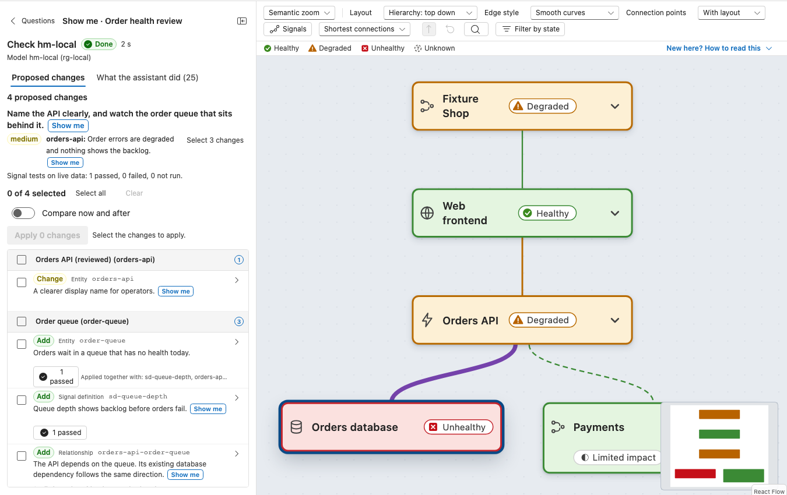
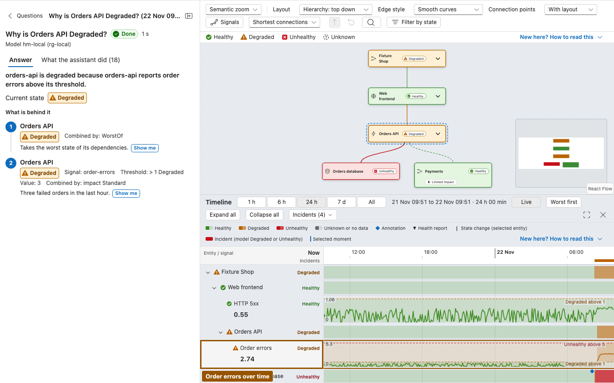
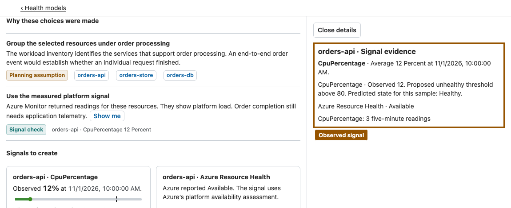

# Follow a Show me button

Choose **Show me** beside a claim to see what the assistant is referring to. The answer stays on screen while the app highlights the destination. On a phone, the answer and destination stack vertically. You can also reach a button with Tab and open it with Enter.

To follow these examples, start the local app with its scripted agent and select the **hm-local** model. [Local setup without Azure](development.md#without-azure)

## Trace a dependency on the graph

Choose **Ask**, then **Check this model**. In **Proposed changes**, find the relationship named `orders-api-order-queue`. Its explanation says that the API’s existing database dependency follows the same direction. Choose **Show me** beside that sentence. The graph brings **Orders API** and **Orders database** into view and traces their connection in violet.

In the same answer, the button beside the queue-depth signal definition opens the proposed queue entity’s before-and-after fields. Inspecting a change leaves your selections as they were. **Apply** is a separate action.

## Find the reading behind an explanation

Select **Orders API** on the graph and click **Why is Orders API Degraded?**. Under **What is behind it**, find the step reporting three failed orders in the last hour. Choose **Show me** there. The timeline expands **Orders API** and highlights the **Order errors** row across its label and plot.

## Inspect the evidence for a builder decision

Choose **Create model**, include the **rg-local** resource group, and choose **Analyze resources**. In **Workload**, find **Use the measured platform signal** under **Why these choices were made**. Its **Show me** button opens the signal evidence for **orders-api**. The CPU reading was 12%, and the plan proposes marking the resource unhealthy above 80%. **Close details** returns you to the decision.

Reopen the question from **History** to use its buttons again. If the model has changed and a destination is gone, the button reports that it is unavailable. For the reusable button and a standalone guided-tour example, see the [module specification and playground](../src/web/ui/src/showMe/README.md).
