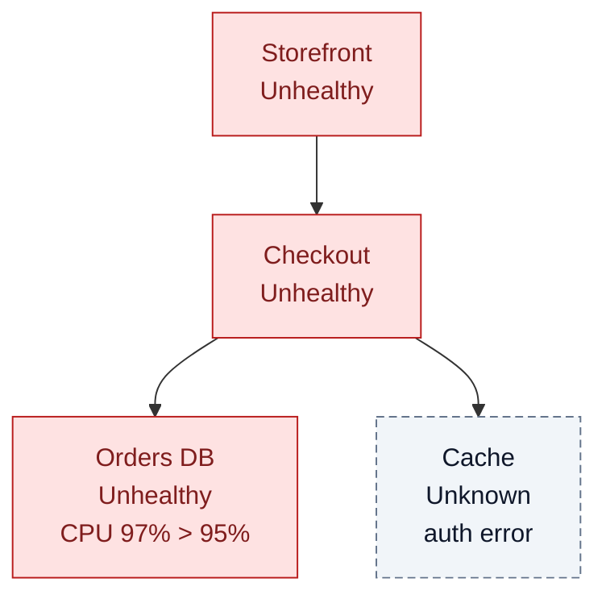

# Analyze a health model

Answer "what is the health, and why" from evidence, without changing anything in Azure.

## Where to look things up

Don't guess commands or fields; look them up:

- Domain: [concepts](https://learn.microsoft.com/azure/azure-monitor/health-models/concepts), [rollup](https://learn.microsoft.com/azure/azure-monitor/health-models/rollup), [signals](https://learn.microsoft.com/azure/azure-monitor/health-models/signals), [analyze health](https://learn.microsoft.com/azure/azure-monitor/health-models/analyze-health), [FAQ](https://learn.microsoft.com/azure/azure-monitor/health-models/health-models-faq)
- Reading a model: [REST API](https://learn.microsoft.com/rest/api/health-models/operation-groups) (entities, relationships, signal definitions, authentication settings, discovery rules, entity and signal history), [CLI extension](https://learn.microsoft.com/cli/azure/monitor/health-models)
- Field meanings and evaluation rules: [entity reference](https://learn.microsoft.com/azure/templates/microsoft.cloudhealth/2026-11-01/healthmodels/entities)
- Tools without the extension: [az rest](https://learn.microsoft.com/cli/azure/reference-index#az-rest), [Invoke-AzRestMethod](https://learn.microsoft.com/powershell/module/az.accounts/invoke-azrestmethod)

## Two kinds of answers

- **Observe**: the user wants facts (structure, configuration, current state, history). Return them with sources and gaps. Don't guess causes.
- **Diagnose**: the user wants to know why. Walk the evidence, name the cause, say how sure you are and what to check next.

Neither needs a plan, modelspec or another skill. Use supplied evidence (pasted JSON, screenshots, notes) first; read live only what changes the answer.

## Stay read-only

Analysis must never change what it is analyzing. Use existing tools and login only: no `az login`, no extension installs, no role grants, no health reports, no deployments, no fixes. A POST that only queries (for example a Log Analytics query) is fine. If a fix is needed, describe it and hand off to `healthmodel-build`.

## Workflow

### 1. Pin the target

Get the model (subscription, resource group, name), the entity if any, and the time window. Ask only for what you can't find. Don't scan subscriptions to guess a target.

### 2. Read the model

Read the model, its entities with their signal status, relationships, signal definitions, authentication settings and, for history, the entity and signal history. Use what's already available and install nothing: the `health-models` CLI extension if installed (it pins an older preview API, so newer fields may be missing), otherwise the REST API through `az rest` with `api-version=2026-11-01`, Azure PowerShell, an Azure MCP server or any HTTP client with an ARM token. The history calls are POSTs that only read. For configuration changes over time, read the model's Activity Log.

Page through all results (`nextLink`). Report denied, throttled, partial and empty reads as such: an empty result means "nothing found in this scope", not "doesn't exist".

### 3. Read the evidence correctly

These are the traps that most often lead to a wrong answer:

- **Errors come first.** Every signal has `status: {healthState, value, reportedAt, error}`. If `error` is set, the state says nothing about the workload. The classic case is an authorization error: the model's managed identity lacks a role it needs (see [permissions](https://learn.microsoft.com/azure/azure-monitor/health-models/create#permissions-required)). Azure doesn't assign these automatically, and new assignments take a few minutes to apply. The user's own access proves nothing about the model's access.
- **Unknown is missing evidence**, not healthy and not unhealthy: no signals, failed queries, no data, or stale reports. A leaf entity without signals is always Unknown.
- **Freshness.** Age = now minus `reportedAt`. Compare it to the signal's `refreshInterval`. Several intervals old means the evaluation stopped.
- **Saved, monitored, evaluated.** `provisioningState: Succeeded` says the configuration was saved. Signal bindings and authentication say what is monitored. `healthState` with fresh `reportedAt` and no `error` says how it is evaluated. Never use one layer to answer another.
- **Thresholds.** Compare `value` with `evaluationRules`: the unhealthy rule is checked first, then the degraded rule, otherwise Healthy. Flag rules that can't express the intent, for example availability with `GreaterThan 0` turns 100% availability unhealthy. `dataUnit` is a label, it doesn't convert values.
- **Zero vs no data.** A count of 0 failures is healthy, also without traffic, but say whether there was traffic. A null or missing value is no data, and the signal is Unknown.
- **Rollup.** Health flows from child to parent along relationships. An entity takes the worst of its signals, signal groups and dependency rollup, shaped by the child's impact and the parent's rollup rule (see [rollup](https://learn.microsoft.com/azure/azure-monitor/health-models/rollup)). Two traps: the default worst-of rule doesn't count Unknown children, so a parent can be green while most children are Unknown; and `ignoreUnknown` can hide unresolved members of signal groups. Where the concepts page and the [API reference](https://learn.microsoft.com/rest/api/health-models/entities/get) describe a threshold boundary differently, trust the API and say so when it decides the answer.
- **Nested models.** An entity bound to another health model's resource ID contributes that model's root state. Follow it only if you have its ID and access; otherwise report the boundary as a gap.
- **Discovery.** Discovered entities (`discoveredBy`) are managed by discovery rules, refresh every few minutes and can't be deleted manually. Manual and discovered entities for the same resource are duplicates.
- **History.** Health history is kept 30 days. Current configuration doesn't tell you past configuration; use the Activity Log for that. The current-state view and the history view update independently and can disagree for a while: report both with their times. Expired external reports drop out; that isn't recovery.
- **Health objectives.** Degraded time doesn't count against the objective; only Unhealthy does.

### 4. Diagnose

Start at the entity the user cares about and walk down: which dependency or signal set its state, through which impact and rollup rule, back to the signal value or error. Stop at the first point the evidence runs out and say so. Don't claim causation from timing alone; a deployment near an incident is a lead, not a cause.

### 5. Answer

Keep it short and visual:

1. **Answer** in one or two sentences.
2. **Evidence table**: entity, signal, state, value, `reportedAt` (age), error. Errors first.
3. **Chain diagram** when rollup matters: a small top-down mermaid graph colored by state, so the user sees where the problem enters.
4. **Gaps and confidence**: what you couldn't read and how it limits the answer.
5. **Next step**: the one check that would settle it, and the fix to hand to `healthmodel-build` if one is needed.

Mermaid state colors (readable in dark mode):

Always give full resource IDs, the time window and when you read the data.

## Modelspec

If the user points to a modelspec from `healthmodel-plan`, update only the affected rows: set Status to `done` with the evidence or `problem: <reason>`, add new sources as the next free `S<n>`, and record gaps as `research/lookup` or `user input`. Findings never change the agreed health meaning by themselves; propose the change and let the user accept it. Without a modelspec, write no files unless asked.
