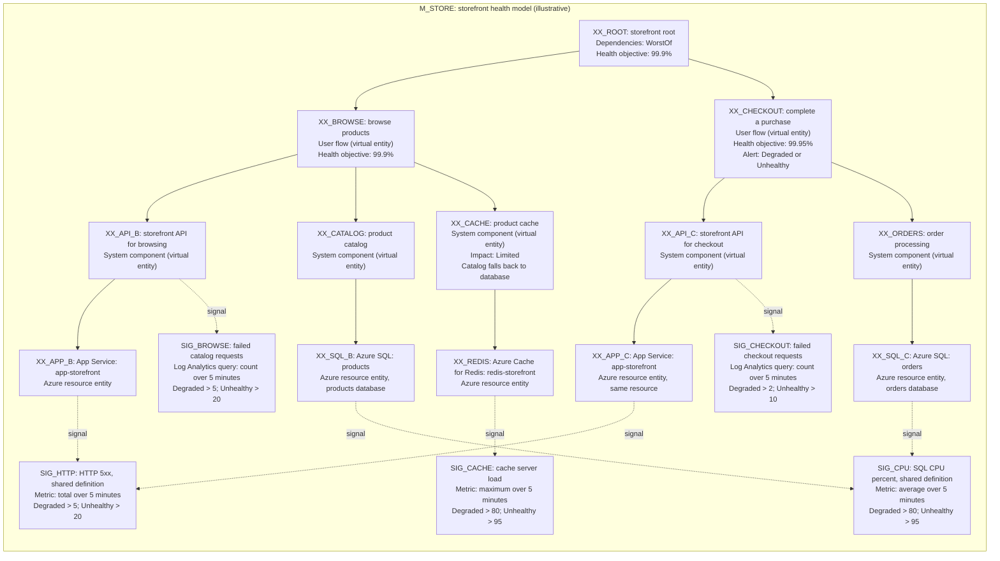

# Health model modelspec: <purpose or model name>

## modelspec CONCEPT
<!-- 
- this modelspec should be looked at like code and transparently represent the reasoning and decisions made.
- change to the purpose and scope section should only be done with explicit user confirmation or when building them out first.
- the main authoring of the modelspec is done in the planning phase
- the modelspec should also expose the argumentation and reasoning behind model decisions

Every item table, including added tables, has a Status column. Initialize identified work as `new`. Use only:

- `new`: identified work not yet completed.
- `done`: the row's scoped work is complete, with a supporting S-ID or evidence reference.
- `problem: <concrete reason>`: blocked work or a failed check, with the specific cause and linked gap.
- other stati are possible if they are needed
- status changes can be done any time as work progresses, the user needs to be notified which items you updated the status on
- you can use temporary JSON files, todo tool or other skills to track and manage the work, but the modelspec needs to stay in sync as well
- To better find and manage references, give every managed item (e.g. health model, entity, relationship, signals, ..) a unique prefix and stable identifier. E.g. M_MYWEBSITE for a model about a website.  -->

## What does health mean for my workload?
<!-- Ask the user or come up with a simple sentence on what health means. Instead of longer sentences, is also fine to use bullet points. 
E.g. for a global AI chat application it could be
- The service is responsive and available to users worldwide.
- User messages are processed correctly and in a timely manner.
- System dependencies, such as databases and APIs, are functioning as expected.
-->

## Health modelling strategy
<!-- From an organization perspective, each team delivering a platform or system that other teams rely on, should manage their own health models. 

As first step, we have to decide which health models this modelspec should build, and who is responsible for them.

Due to separated teams or ownership, we might start with modelling a subset of the overall health and then others might build a model that references ours. -->

| Model Name | Purpose and platform/workload role | Owner and team/organizational/legal boundary | Tenant, subscription and resource scope | Sources or gap | Status |
|----------------|------------------------------------|---------------------------------------------|-----------------------------------------|----------------------|--------|
| <stable plan ID; exact model resource ID if known> | <purpose and role, or gap> | <source-backed owner/boundary, or unknown> | <known scope and consent, or gap> |  <S-IDs with locators, or missing evidence> | new |

## High-level health model diagram

<!-- - this diagram should illustrate the agreed user and system flows
- it can summarize or abstract the actual resource topology, except if a custom rollup or limited impact is involved
- ONLY draw graph nodes for user flows, or system flows or resources that are referenced in this modelspec AND use their stable identities (replace the XX_)
- essentially it should show what they user cares about the most and which details will matter to provide the health expectations.
- three layers: user flows on top, the system components (system flows) they need below them, Azure resource entities with platform signals at the bottom. Flows and components are long-lived virtual entities, so resources can be replaced without losing their health history. Keep it a tree: every entity has one parent, so a component or resource used by two flows appears under each, with the signals that matter there. Components are functional abstractions, never one renamed copy per flow, may carry query signals on a Log Analytics or Azure Monitor workspace, and have the concrete Azure resource directly underneath; no virtual entity has a single virtual child
- it's fine to use other visualization tools if there's an establish preference
- add only the most important signals to the diagram, if the signal will be a crucial data point

Fictional storefront example: all resources, thresholds, health objectives and alert placements below are illustrative, not accepted intent or deployed configuration. Replace them with source-backed model/entity IDs and settings; map retained entities to the entity plan and cite their sources. -->

## User concerns and priorities

| Concern or priority | User impact and service expectations | Sources or gap | Status |
|---------------------|--------------------------------------|----------------|--------|
| <concern> | <impact and supplied commitment, or unknown> | <S-IDs or missing evidence> | new |

## User flows

| Flow | User outcome and steps | Health objective | Dependencies and resources | Sources or gap | Status |
|------|------------------------|------------------|----------------------------|----------------|--------|
| <flow ID> | <supplied outcome and steps, or gap> | <desired health meaning; supplied target/window if relevant, or user-input gap> | <known dependencies or full resource IDs, or gap> | <S-IDs or gap references> | new |

## System flows

<!-- system flows are the system components: the functional parts of the system that make the user flows work, named by what they do (e.g. storefront API, product catalog, order processing). Each sits under the one user flow it serves (a part used by two flows appears under each), and is never a renamed copy of a user flow. -->

| Flow | System interactions | Health objective | Dependencies and resources | Sources or gap | Status |
|------|---------------------|------------------|----------------------------|----------------|--------|
| <flow ID> | <supplied interactions, or gap> | <desired health meaning; supplied target/window if relevant, or user-input gap> | <known dependencies or full resource IDs, or gap> | <S-IDs or gap references> | new |

## Alerts

| Alert | Confirmed placement and health objective | Existing rule and suitability | Sources, lookup coverage or gap | Status |
|-------|-----------------------------------------|-------------------------------|---------------------------------|--------|
| <alert ID or purpose> | <model/entity/flow IDs, objective and user confirmation S-ID, or user-input gap> | <verified full rule resource ID and decision-relevant match, or lookup/creation gap> | <S-IDs; examined scope/filter, collection time and coverage limits> | new |

## Shared source material

<!-- - repeat the following entry for every shared source
- including user confirmations or correction statements -->

### <S-number>: <descriptive label>

- Evidence class: <user-stated fact, source fact, observed result, proposal/inference, or user confirmation>
- Original location/reference: <supplied path, URL or conversation reference; explicitly unavailable if absent>
- Precise locator and version: <available section, page, line, message, revision or immutable reference; identify anything unavailable>
- Status: new

## User input and decisions

<!-- Record each material input and decision, including confirmations, with its source and attribution. Use actual available event metadata for the input/decision time and the actual capture clock for Recorded at, with unambiguous timezone-bearing timestamps. If the original time, timezone or attribution is unavailable, say so; do not backdate it from capture time. Preserve known partial metadata and its limitation. Changed decisions retain earlier records and link the superseding source. -->

| Input or decision and affected items | Attribution and source | Input/decision date/time | Recorded at | Status |
|-------------------------------------|------------------------|--------------------------|-------------|--------|
| <what was supplied/decided; model/entity/flow/alert/gap IDs> | <user/actor and S-ID with message/file locator, or explicit unavailable fields> | <actual original date/time and timezone, or unavailable> | <actual capture date/time with timezone> | new |

## Derived entity plan

<!-- Include every logical or resource-backed entity, local nested-model reference and implicit root when represented. Keep each role distinct when one resource supports several entities. Use the same model/entity IDs as the diagram. Source IDs must resolve to the register above; add precise source locators where available. Unsupported draft rows explicitly say no supporting source is available and retain pending intent acceptance. -->

| Model and entity identity/role | Flows, resources and dependencies | Proposed health meaning and user impact | Supporting sources and short derivation | Evidence gaps or conflicts | Intent acceptance | Status |
|-------------------------------|-----------------------------------|-----------------------------------------|-----------------------------------------|----------------------------|-------------------|--------|
| <model ID; entity/diagram ID; logical, resource-backed, root or nested reference role> | <role; full resource/target ID if relevant; same-model relationships and rollup meaning> | <healthy, degraded, unhealthy and unknown meaning; supplied thresholds or open decisions> | <S-IDs with available locators; why this entity and role follow, or no supporting source available> | <gap references, alternatives, or none> | <pending, or explicitly accepted with reference below> | new |

## Signals

<!-- - one row per signal on an entity, using the signal IDs from the diagram
- kinds: Azure resource metric (on a resource ID), Log Analytics KQL query (on a workspace ID), PromQL query (on an Azure Monitor workspace ID), or external health report
- make each row precise enough that healthmodel-build can run it: metric namespace, name and aggregation, or the full query; time grain
- a KQL query must return one row with one numeric value column
- build on data that exists today (platform metrics, Application Insights tables the app already writes); new instrumentation is a `user input` gap, never the only signal of an entity
- thresholds are health meaning: take them from sources, otherwise choose a sensible default and record it as an `assumption` gap with its reason
- healthmodel-build fills Verification with the observed result (value, window, time) or the reason it couldn't verify -->

| Signal | Entity | Kind and data source | Measurement | Degraded and unhealthy rule | Sources or gap | Verification | Status |
|--------|--------|----------------------|-------------|-----------------------------|----------------|--------------|--------|
| <signal ID> | <entity ID> | <kind; full resource, workspace or Azure Monitor workspace ID, or gap> | <metric namespace/name and aggregation, or query text; time grain> | <e.g. degraded > 5, unhealthy > 20; or proposal with gap> | <S-IDs or gap references> | <not run, or build result with S-ID> | new |

## Gaps and open decisions

| Gap or conflict | Category | Affected items | Known evidence and alternatives | Required resolution and owner | Status |
|-----------------|----------|----------------|--------------------------------|-------------------------------|--------|
| <gap ID; missing, ambiguous, conflicting or unavailable evidence> | <research/lookup, user input or assumption> | <model/entity/flow/alert/intent IDs> | <S-IDs, known scope/time and competing interpretations, or no evidence> | <next check or user choice, responsible skill/user and completion evidence required> | new |

<!-- `research/lookup` covers discoverable facts, such as accessible source contents or scoped rule inventory. `assumption` covers defaults the agent chose where sources are silent (thresholds, windows, impact, alert severity); they don't block the plan and the user can change them later. `user input` covers commitments, health goals, placement or preference decisions, and access/consent the user must supply. Separate factual lookup and value-choice gaps when both are missing. An available read may resolve a fact, not choose a commitment or grant access. A denied lookup can leave a research problem plus a user-input access/consent gap; do not repair permissions.

Do not accept affected intent until evidence is resolved or the user explicitly confirms the concrete intent despite the gap. Record that confirmation as an S-ID; retain any unresolved observation gap without claiming measurement. -->

## Intent acceptance

| Concrete intent and affected models/entities | State | Attributable user acceptance/reference | Status |
|---------------------------------------------|-------|----------------------------------------|--------|
| <model purpose/ownership boundaries, entity meaning, thresholds, nesting and relationships/rollup where proposed> | <pending or explicitly accepted> | <user confirmation S-ID and dated input/decision record; unavailable original time remains explicit; no inferred acceptance> | new |
