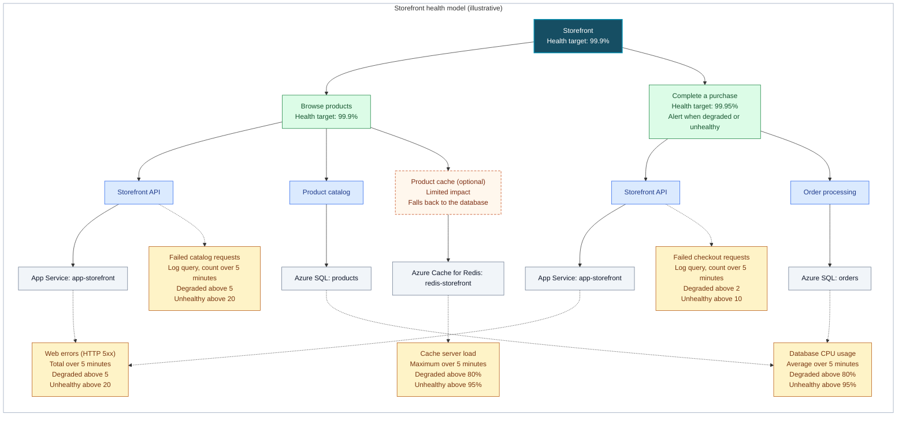

# Health Model for <workload or project name>

<!-- Write for someone who doesn't know health models or Azure, in about two screens; the tables and the diagram carry most of it.
Say what things mean instead of naming them, for example:
- telemetry → the data the app reports
- exceptions → errors
- throttling, HTTP 429 → the service turns requests away because it's overloaded
- latency, p95 → how long it takes for most users
- synthetic check, fixture question → a test question the system asks itself every few minutes
- action group → who gets notified
- worst-of rollup → takes the worst health of what it depends on
- subscription, resource group, environment name → which Azure environment
Keep product feature names only if the app's users know them; otherwise describe the feature ("recommendations based on what others bought").
Technical names belong only in the Azure resource boxes. Caveats, disclaimers, evidence limits and gap details belong in the modelspec. -->

## What does health mean for my workload?
<!-- Ask the user or come up with a simple sentence on what health means. Instead of longer sentences, is also fine to use bullet points. 
E.g. for a global AI chat application it could be
- The service is responsive and available to users worldwide.
- User messages are processed correctly and in a timely manner.
- System dependencies, such as databases and APIs, are functioning as expected.
-->

## User flows
<!-- - every user flow the model covers, so the user can check nothing is missing
- each flow lists the system components it depends on and the signals that cover them; a flow without signals underneath would show Unknown
- describe signals in plain words, e.g. "failed checkout requests", "database too busy", "search turns requests away"
- mark values that are assumptions (defaults you chose) with "(assumed)"; numbers the user gave are not assumptions
- list optional features that are off in this deployment under "Not modelled", so the user can ask to add them -->

| User flow | What users do | Depends on | Signals | Health target | Alert |
|-----------|---------------|------------|---------|---------------|-------|
| Browse products | Find and view products | Storefront API, Product catalog, optional Product cache | Failed catalog requests, web errors, database CPU, cache server load | 99.9% (assumed) | None |
| Complete a purchase | Pay and get an order confirmation | Storefront API, Order processing | Failed checkout requests, web errors, database CPU | 99.95% | When degraded or unhealthy |

**Not modelled:** product reviews (turned off in this deployment).

## Diagram

<!-- Show a conceptionally complete diagram with easy to read and understand entities
- write for someone who doesn't know health models: plain names in the labels, no IDs (they stay in the modelspec), no jargon
- a tree in three layers: user flows on top, the system components each flow needs below it, Azure resources with their platform signals at the bottom; every entity has one parent, so a component used by two flows appears under each; component names describe function, the concrete Azure resource sits directly under its component, and no virtual entity has a single virtual child
- use colors if possible
- use swimlanes if available
- add important concepts like limited impact or custom rollup types

You can provide multiple diagrams showcasing how the model will be helpful to the user
 -->

**Colors:** green = user flows; blue = system components; orange with a dashed border = optional component; gray = Azure resources; amber = health signals.

Read top to bottom: what users do, the parts of the system that make it work, then the Azure resources behind them. Each flow has its own copy of the parts it uses, so a problem only checkout sees doesn't turn browsing red. Solid arrows mean **depends on**; dotted arrows connect to **health signals**, and one signal can be reused by several entities. Each part takes the worst health of what it depends on. The optional product cache has **limited impact**: when it fails, browsing is at most degraded, never unhealthy. Targets and thresholds are illustrative.

## What happens when something breaks
<!-- 2-4 realistic failure scenarios for this workload, so the user sees what the model will show and who gets alerted. Use only names shown in the diagram above, and list every entity whose state changes, including other flows sharing the failed dependency and the root. -->

| If this happens | The model shows | Alert |
|-----------------|-----------------|-------|
| The database is overloaded (CPU above 95%) | Azure SQL: products, Azure SQL: orders, Product catalog, Order processing, Browse products, Complete a purchase and Storefront turn **Unhealthy** | Purchase alert fires |
| The cache is overloaded (server load above 95%) | Azure Cache for Redis: redis-storefront and Product cache turn **Unhealthy**; Browse products and Storefront only **Degraded** (limited impact) | None |
| More than 2 checkout requests fail in 5 minutes | Storefront API under checkout, Complete a purchase and Storefront turn **Degraded**; Browse products stays **Healthy** | Purchase alert fires |

## Assumptions
<!-- defaults you chose where no source said anything, one short line each, so the user can correct them quickly -->

- Browsing has the same 99.9% health target as the whole storefront.
- Thresholds for failed requests, web errors and database CPU are common starting values, to tune after a week of real data.

## What to do next?
<!-- - this is content for the user
- you can tell him to call e.g. the build skill after reviewing the plan
- if there's a lot of gaps in the modelspec, you can tell him what is missing 
- use simple language and bullet points
- at most three asks for the user, one sentence each, in their words (e.g. "Which Azure environment runs the app?", "Who should be notified?") -->