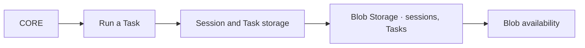

## Which part of CORE runs a Task?

- In **Health model**, search for `rg-anboahmdemo`. Choose `hm-anboahmdemo`.
- Start with **Cause path**. Read the status above the graph. Open a folded chip to see the entities behind its count.

{{excerpt:cause}}

**How to read this** explains the state glyphs and impact rules beside the model.

- Follow the arrows to find dependencies. Read back toward CORE to trace the impact of a state change.

### Six ways to read the same model

| Which question are you asking? | In the workspace |
| --- | --- |
| **Swimlanes** · Which flows, systems and resources share a layer? Use **Fit** to see the lanes together. |  |
| **Tidy arrange** · Which parts sit below each parent? Follow the branches from top to bottom. |  |
| **Semantic zoom** · Where is my resource in the whole model? Zoom in for cards and signals, or out for names and dots. |  |
| **Outline** · Which entities deserve a closer look? Expand a row with **→**, collapse it with **←**, or jump down the list using the marks at the right. |  |
| **Coverage** · Which branch contains the most leaf entities? Compare band widths, then zoom into one branch. |  |

Watch the CORE graph change views (GIF)

### Follow the Task branch

- In **Coverage**, double-click **Run a Task**, or focus it and press **Shift+Enter**. Find **Session and Task storage** in the band below it. **Whole model** returns to the overview.

- In **Tidy arrange**, drag a card beside a sibling. With the keyboard, press **M**, an arrow key, then **Enter**. **Order** changes to **Custom**. **Reset custom order** restores the view’s ordering.

- In **Semantic zoom**, the **Layout** chooser offers four hierarchy directions, ELK layered or radial, and static or live force-directed layouts. **Edge style** and **Connection points** control how the lines run.

| Hierarchy from left to right | ELK radial |
| --- | --- |
|  |  |

Watch the card layout and edge routing change (GIF)

- Use **Signals** to add readings and six-hour sparklines to the cards. In **Filter by state**, choose which states to inspect. **Gray dot** keeps excluded entities on the map.

- On a phone, the **View** dropdown replaces the desktop tabs. **Outline** keeps the entity names in a vertical list. The theme button switches between light and dark.

### Find the storage account behind the Task

- Open graph **Search…** with the button or **Ctrl/Cmd+K**. Search for `session-storage` and select the entity under **Entities**. The other groups let you jump to a relationship or signal.

- The graph focuses the match. The timeline opens to that entity’s row, ready to inspect its readings.

Watch search find the storage dependency (animated PNG)

